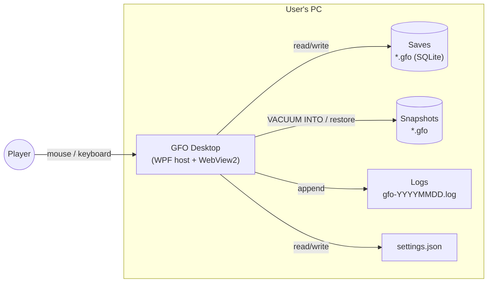
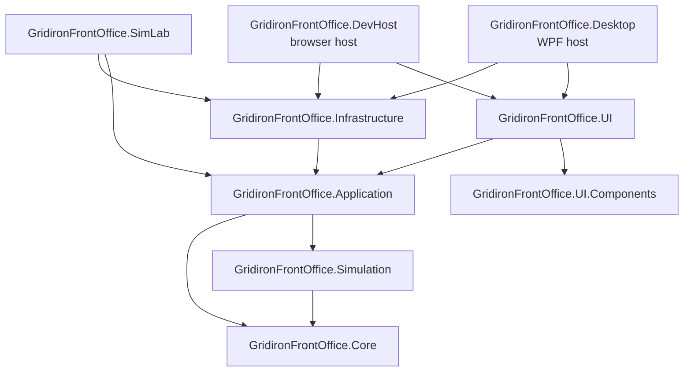
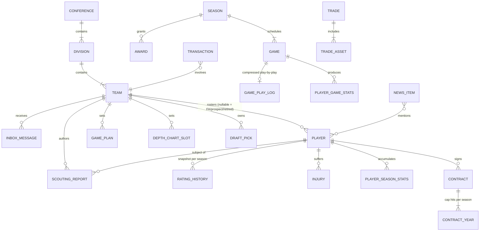
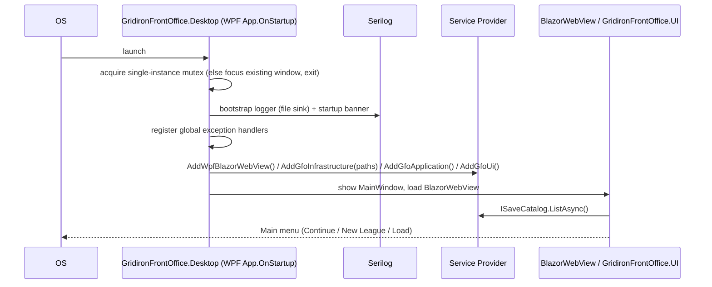

# Technical Architecture

> **Status:** Proposed · 2026-10-13 · Decisions referenced as `D-xxx` live in [DECISIONS.md](DECISIONS.md)
>
> This is the overview. Deep dives are in [architecture/](architecture/).

---

## 1. Architectural goals

Listed in priority order. When goals conflict, the higher one wins.

| # | Goal | What it means in practice |
|---|---|---|
| 1 | **Save integrity** | A crash, a power loss or a bug must never corrupt a league someone has played for 20 seasons. A single transaction owner (`SaveWriter`), WAL journaling, snapshots before risky operations, integrity checks on open, and **transaction torture tests from M0**. Because transactions have been a past pain point, exactly how to read and write data is spelled out in **[DATA_ACCESS_GUIDE.md](architecture/DATA_ACCESS_GUIDE.md)**. |
| 2 | **Deterministic, testable simulation** | Same inputs + same seed = same result. Bugs can be reproduced, and calibration can be automated. |
| 3 | **Responsiveness** | UI interactions under 100 ms. The UI thread is never blocked. Long operations report progress. |
| 4 | **A thin, replaceable host** | Nothing depends on the host framework except the window. Swapping hosts (WPF ↔ MAUI ↔ Photino, or a browser dev host) should take about a day, not a rewrite. |
| 5 | **Solo-developer maintainability** | Few projects, few dependencies, boring technology, strong conventions, fast tests. |
| 6 | **Steam-ready** | Clean licensing, an installer and updater, versioned save migrations. None of the Steam integration cost is paid now. |

---

## 2. Technology stack

| Concern | Choice | Why | Decision |
|---|---|---|---|
| Runtime | **.NET 10 (LTS)**, C# 14 | LTS support until Nov 2028. Do not adopt .NET 11 (STS) mid-project. | [D-002](DECISIONS.md#d-002-platform-net-10-lts--blazor-hybrid-windows-first) |
| Desktop host | **WPF + `BlazorWebView`** (`Microsoft.AspNetCore.Components.WebView.Wpf`), TFM `net10.0-windows10.0.19041.0` | The same Razor/HTML/CSS UI as MAUI Blazor Hybrid, without the MAUI workload. Measured 2.3–4.7× faster builds ([HOST_BENCHMARK.md](architecture/HOST_BENCHMARK.md)). | [D-021](DECISIONS.md#d-021-host-wpf--blazorwebview-maui-removed) |
| UI framework | **Blazor (Razor components)** in Razor Class Libraries | All UI is portable across hosts and testable with bUnit. | [D-003](DECISIONS.md#d-003-ui-lives-in-razor-class-libraries-the-host-stays-thin) |
| Rendering engine | **WebView2 (evergreen Chromium)** | Modern CSS is available: nesting, container queries, `:has()`, the Popover API, anchor positioning. | — |
| Persistence | **SQLite**, one file per save (`.gfo`), via **Microsoft.Data.Sqlite** | A self-contained, portable, transactional save file. | [D-004](DECISIONS.md#d-004-save-model-autosave--snapshots) |
| Data access (ORM) | **EF Core 10** + the GFO unit of work (`SaveWriter` is the only transaction owner). Raw ADO via the unit of work for bulk inserts. | Migrations, LINQ, productivity. The rules make transactions boring. | [D-024](DECISIONS.md#d-024-data-access-ef-core-with-the-gfo-unit-of-work), [DATA_ACCESS_GUIDE.md](architecture/DATA_ACCESS_GUIDE.md) |
| Logging | **Serilog** behind `Microsoft.Extensions.Logging`, writing to a rolling `.log` file | The standard choice, with structured events and async file writes. | [D-007](DECISIONS.md#d-007-logging-serilog-to-rolling-log-files) |
| UI components | **Fluent UI Blazor v5** (Microsoft, MIT), plus GFO wrappers (`DataGrid<T>`, theme, dialogs, toasts, icons) and football composites | The owner's preference. Modern Fluent 2 look, runtime brand theming (team colors), accessible components. | [D-025](DECISIONS.md#d-025-ui-component-library-fluent-ui-blazor-v5), [UI_DESIGN_SYSTEM.md](architecture/UI_DESIGN_SYSTEM.md) |
| Visual design | **Stadium** direction: Dark default + Light + Match Windows, Archivo (UI + condensed display), JetBrains Mono (debug), Fluent System Icons (proposed) | Rounded, athletic, team-color hero bands. All fonts SIL OFL and bundled locally. | [D-031](DECISIONS.md#d-031-visual-direction-stadium-light--dark-dark-by-default), [VISUAL_DESIGN.md](VISUAL_DESIGN.md) |
| Charts | **In-house SVG components**, themed with Fluent tokens | Fluent UI Blazor isn't a charting library. GFO's charts are small and specific (sparkline, WP chart, drive chart). | [D-008](DECISIONS.md#d-008-ui-components-and-assets-permissive-licenses-only) |
| DI / config | `Microsoft.Extensions.DependencyInjection`, `Options` | Built in. | — |
| Time | `System.TimeProvider` (built-in abstraction) | Makes the real-time draft testable with `FakeTimeProvider`. | — |
| Randomness | **Custom PRNG** (xoshiro256** or PCG32) in `GridironFrontOffice.Simulation` | Determinism that won't change across .NET versions. | [D-012](DECISIONS.md#d-012-deterministic-simulation-with-an-in-house-prng) |
| Tests | **xUnit v3**, **bUnit**, **Shouldly**, **Verify**, `Microsoft.Extensions.TimeProvider.Testing`, NetArchTest | Permissive licenses (see the note below). | [D-018](DECISIONS.md#d-018-testing-stack) |
| Benchmarks | BenchmarkDotNet | For engine performance budgets. | — |
| Packaging | **Self-contained, unpackaged** WPF app (no MSIX), **Velopack** installer and updater | A simple installer and delta updates. Steam replaces Velopack later. | [D-019](DECISIONS.md#d-019-distribution-unpackaged--velopack-steam-later) |
| Build & CI | Local `build.ps1` now. GitHub Actions later (**F-30**). | One script runs the same gates locally and later in CI. No workloads needed. | [D-030](DECISIONS.md#d-030-source-hosting-and-ci-deferred-to-f-30) |

> **Licensing hygiene (Steam-ready).** Several popular .NET libraries moved to commercial licensing in 2025: **MediatR, AutoMapper, FluentAssertions (v8+), MassTransit (v9+)**. Some have free tiers, but GFO avoids them entirely. Use plain services, hand-written mapping, Shouldly (or the AwesomeAssertions fork), and in-process events. Every new dependency gets a license check before it's added. See [D-011](DECISIONS.md#d-011-release-posture-personal-first-steam-ready).

---

## 3. System context

GFO is a single-process desktop app. It never talks to a network.



---

## 4. Solution structure

```
GridironFrontOffice/
├─ GridironFrontOffice.slnx      # XML solution format (.NET 9 SDK+ / VS 17.13+)
├─ CLAUDE.md                     # Conventions for AI assistants (points into docs/)
├─ Directory.Build.props         # Nullable, LangVersion, TreatWarningsAsErrors, analyzers
├─ Directory.Packages.props      # Central Package Management (all versions in one place)
├─ global.json                   # Pin the .NET 10 SDK band
├─ .editorconfig
├─ docs/                         # ← you are here
├─ src/                          # Each folder holds GridironFrontOffice.<Folder>.csproj
│  ├─ Core/                      # Domain model + pure rules. No dependencies.
│  ├─ Simulation/                # Game engine. Pure, deterministic. Depends on Core (enums/value types only).
│  ├─ Application/               # Use cases, phase machine, AI GMs, live events, valuation. Defines ports.
│  ├─ Infrastructure/            # EF Core + SQLite (LeagueDbContext, SaveWriter/Reader, migrations), saves, snapshots, logging setup.
│  ├─ UI.Components/             # GFO layer over Fluent UI Blazor v5: theme, wrappers, gap components, charts.
│  ├─ UI/                        # Football screens + composites RCL (pages, Draft Room, Game Center…).
│  ├─ Desktop/                   # WPF + BlazorWebView host = composition root. Thin.
│  └─ DevHost/                   # Blazor Web App host for browser dev, hot reload, component gallery, Playwright.
├─ tools/
│  └─ SimLab/                    # Console: calibration runs, league autoplay, EP/WP table generation.
├─ tests/                        # Each folder holds GridironFrontOffice.<Folder>.csproj
│  ├─ Core.Tests/
│  ├─ Simulation.Tests/
│  ├─ Application.Tests/
│  ├─ Infrastructure.Tests/
│  ├─ UI.Components.Tests/       # bUnit
│  ├─ UI.Tests/                  # bUnit
│  └─ Architecture.Tests/        # Dependency rules enforced as tests
└─ data/                         # Source seed data (names, colleges, cities, team identities) → embedded resources
```

> **Naming ([D-028](DECISIONS.md#d-028-project-naming-gridironfrontoffice)):** projects, assemblies and root namespaces use the full `GridironFrontOffice.<Name>` (e.g., `src/Core/GridironFrontOffice.Core.csproj`, namespace `GridironFrontOffice.Core`). **Folders use the short name** to keep paths readable and well under Windows' 260-character limit. Short *type* prefixes stay as they are (`GfoThemeService`, `AddGfoInfrastructure()`), as do the CSS prefix `gfo-` and the save extension `.gfo`.

### 4.1 Dependency rules



| Rule | Enforced by |
|---|---|
| `GridironFrontOffice.Core` references **nothing** (BCL only). No EF, no logging, no UI. | Architecture tests |
| `GridironFrontOffice.Simulation` references only `GridironFrontOffice.Core`. No DB, no logging framework beyond `ILogger` abstractions, no `DateTime.Now`, no `System.Random`. | Architecture tests + analyzer bans |
| `GridironFrontOffice.Application` never references Infrastructure or any UI project. It defines **ports** (interfaces) that Infrastructure implements. Its one data dependency is the **`Microsoft.EntityFrameworkCore` core package** (no provider), for `DbSet`/LINQ through `ILeagueDb` ([D-024](DECISIONS.md#d-024-data-access-ef-core-with-the-gfo-unit-of-work)). | Architecture tests |
| `GridironFrontOffice.UI.Components` references **no other** `GridironFrontOffice.*` project (only Fluent UI). It's app-only ([D-027](DECISIONS.md#d-027-ui-components-are-for-this-app-only)), but kept football-agnostic so generic UI never couples to game services. | Architecture tests |
| `GridironFrontOffice.UI` never references Infrastructure or the host framework (WPF). Platform features go through interfaces (`IPlatformServices`). | Architecture tests |
| Only hosts (`Desktop`, `DevHost`, `SimLab`) compose everything. | Convention |
| **Persistence entities never reach the UI.** Screens consume read-model DTOs from Application queries. | Code review + architecture tests (UI has no data-access reference) |
| **Only `SaveWriter` begins, commits or rolls back transactions.** No `AddDbContext` in DI. | Banned-API analyzer + architecture tests ([DATA_ACCESS_GUIDE.md §8](architecture/DATA_ACCESS_GUIDE.md#8-how-the-rules-are-enforced-so-you-cant-do-it-wrong-by-accident)) |

### 4.2 Project responsibilities

#### `GridironFrontOffice.Core` (domain)
- Entities and value objects: `Team`, `Player`, `Contract`, `ContractYear`, `DraftPick`, `Game`, `Injury`, `Transaction`, …
- **Strongly typed IDs** (`readonly record struct PlayerId(int Value)`), mapped to `INTEGER` keys ([D-015](DECISIONS.md#d-015-integer-keys-with-strongly-typed-ids)).
- **Pure rules** that are unit-testable without a database: cap hit and dead money math, contract proration, position overall formulas, tiebreakers, roster limit validation, draft order.
- `Money` is a `long` number of whole dollars. **No `decimal` and no floating point for money** (SQLite stores `decimal` as TEXT, which breaks ordering and aggregation).
- In-game dates use `DateOnly`, stored as ISO text so they sort correctly.

#### `GridironFrontOffice.Simulation` (engine)
- Input: `SimGameInput` (immutable snapshots of both teams' active players, depth chart slots, game plans, coaching tendencies, and the seed).
- Output: `SimGameResult` (play event log, score, injuries, per-play deciding matchups). Box scores are *derived* from the event log.
- Contains the PRNG, the situational play-calling AI, play resolvers and tuning configuration.
- Details: [architecture/SIMULATION_ENGINE.md](architecture/SIMULATION_ENGINE.md).

#### `GridironFrontOffice.Application` (use cases)
- Feature folders (vertical slices), not technical layers:
  `Leagues/`, `Rosters/`, `DepthCharts/`, `GamePlans/`, `Season/`, `Calendar/`, `Contracts/`, `FreeAgency/`, `Scouting/`, `Draft/`, `Trades/`, `Development/`, `Ai/`, `Valuation/`, `LiveEvents/`, `News/`, `Inbox/`.
- Each feature exposes **command services** (mutations) and **query services** (read models).
- **Ports** for Infrastructure: `ISaveWriter`, `ISaveReader`, `ISnapshotService`, `ISaveCatalog`, `IAppPaths`, `IPlatformServices`, `ISeedData`.
- The **phase machine** (calendar), **AI GM** decision logic (pure: snapshot in, intents out), the **valuation model** and the **live event runner**.
- Converts domain state into `SimGameInput` and writes `SimGameResult` back out.

#### `GridironFrontOffice.Infrastructure`
- EF Core: `LeagueDbContext` (implements `ILeagueDb`/`ILeagueReadDb`), Fluent API configurations (so Core stays EF-free), migrations, the SQLite pragma interceptor.
- `SaveWriter`/`SaveReader` (the single-writer queue, **the only transaction owner**, unit of work, post-commit event publishing). See [DATA_ACCESS_GUIDE.md §3](architecture/DATA_ACCESS_GUIDE.md#3-the-building-blocks-the-code-youll-write-once-in-m0).
- `SaveManager` (create, open, close, export, import, delete-to-Recycle-Bin), `SnapshotService` (`VACUUM INTO`), integrity checks.
- High-volume writers (raw ADO.NET prepared statements) for stats and play logs.
- Logging bootstrap (Serilog configuration), `AppPaths`, `SettingsStore` (`settings.json`).
- Embedded seed data loader.

#### `GridironFrontOffice.UI.Components` (design system)
- Tokens (CSS custom properties), themes, layout primitives, inputs, the DataGrid, overlays, charts. Fonts, icons and theme values come from [VISUAL_DESIGN.md](VISUAL_DESIGN.md) (Stadium, [D-031](DECISIONS.md#d-031-visual-direction-stadium-light--dark-dark-by-default)).
- Built on **Fluent UI Blazor v5** ([D-025](DECISIONS.md#d-025-ui-component-library-fluent-ui-blazor-v5)). Screens use Fluent primitives directly. GFO wraps only the DataGrid, theme, dialogs, toasts and icons, and adds gap components (command palette, charts, KPI tiles).
- **For this app only** ([D-027](DECISIONS.md#d-027-ui-components-are-for-this-app-only)). It's kept free of game knowledge for dependency hygiene, not for reuse, so it carries no packaging, versioning or public-API burden.
- Details: [architecture/UI_DESIGN_SYSTEM.md](architecture/UI_DESIGN_SYSTEM.md).

#### `GridironFrontOffice.UI` (game UI)
- Routes and pages, app shell, navigation, command palette registry, football composites (`PlayerCard`, `DepthChartBoard`, `DraftRoom`, `CapSheet`, `TradeBuilder`, `GameCenter`, `Scorebug`, `DriveChart`).
- A screen-level state container (`GameStateStore`) for "where am I in the league": current date and phase, user team, record, cap summary, live event status.

#### `GridironFrontOffice.Desktop` (WPF host)
- A WPF app (**`net10.0-windows10.0.19041.0`**, `<UseWPF>true</UseWPF>`, Razor SDK) with one `MainWindow` containing a `BlazorWebView`. The Windows SDK TFM is required: the .NET 10 WPF `BlazorWebView` uses WebView2's composition control and crashes at startup on plain `net10.0-windows` ([HOST_BENCHMARK.md](architecture/HOST_BENCHMARK.md#gotchas-found-while-measuring-worth-knowing-for-m0)).
- `App.OnStartup`: bootstrap logging → build the `ServiceCollection` (`AddWpfBlazorWebView()` + GFO services) → configure the window (minimum size, restore size and position, title bar) → show it.
- **Title bar options** (to validate in M0): (a) `WindowChrome` with a slim native WPF caption strip styled to match, the simplest and keeps native Snap Layouts; (b) a borderless window with the title bar drawn in HTML using WebView2 non-client region support (`IsNonClientRegionSupportEnabled` + CSS `app-region: drag`). Option (b) looks more seamless, but WebView2 docs note it doesn't give native caption-button behavior such as Snap Layouts.
- Platform services: open a folder in Explorer, file pickers for import/export, single-instance mutex, window title.
- Global exception hooks (see [LOGGING.md](architecture/LOGGING.md)).

#### `GridironFrontOffice.DevHost` (browser dev host)
- A Blazor Web App (Interactive Server) hosting `GridironFrontOffice.UI` against a dev save folder.
- **Why:** browser hot reload and DevTools are faster and more reliable than Hybrid hot reload. It also hosts the **component gallery** (`/_gallery`) and enables Playwright end-to-end tests.
- Not shipped. A dev tool only.

#### `GridironFrontOffice.SimLab` (console tool)
- `simlab calibrate --seasons 200 --seed 42` → a calibration report compared against the target bands.
- `simlab autoplay --seasons 30 --seed 42` → full-league autoplay with AI running every team → league-health report.
- `simlab tables` → generates the Expected Points and Win Probability lookup tables from the sim itself (see [STANDOUT_FEATURES.md §C](STANDOUT_FEATURES.md#c-film-room-explainable-results)).
- `simlab bench` → engine microbenchmarks.

---

## 5. Domain model overview

There is one league per save file. League-level data (settings, metadata) is a singleton row.



**Key modeling choices**
- **Player lifecycle in one table.** `Players.Status` ∈ {Prospect, Active, PracticeSquad, InjuredReserve, FreeAgent, Retired}. Prospects are players with a draft class and no team.
- **Ratings.** Current true ratings live on the player (hidden in the UI). `RatingHistory` keeps one snapshot per season for history and development charts. Perceived ratings live in `ScoutingReport`.
- **Contracts.** A contract header plus one `ContractYear` row per season (base salary, prorated bonus, guarantees, cap hit). Cap math is pure functions in Core.
- **Draft picks** are first-class assets (`Season`, `Round`, `OriginalTeamId`, `OwnerTeamId`, `OverallPick` once known). Picks can be traded for the upcoming draft and the next two (the NFL's horizon, confirmed in the F-19 spec).
- **The transaction log** is append-only: every signing, release, trade, claim and pick. It's the source for history and the news engine.

Schema details: [architecture/PERSISTENCE.md](architecture/PERSISTENCE.md).

---

## 6. Runtime model

### 6.1 Startup sequence



### 6.2 League session lifecycle

Opening a save creates a **league session**, the scope for everything tied to that save file.

1. `SaveManager.OpenAsync(path)`:
   1. Validate: `PRAGMA quick_check`, then read `SaveInfo` (schema version, app version).
   2. If the schema is older: take a **pre-upgrade snapshot**, then run migrations.
   3. If the schema is newer than the app: refuse to open, with a clear message.
   4. Create the `LeagueSession` (save path, `SaveInfo`, connection factory) and publish `LeagueOpened`.
2. Scoped services resolve the current session through `ILeagueSessionAccessor`.
3. Close: finish any queued writes → `PRAGMA wal_checkpoint(TRUNCATE)` → dispose → `SqliteConnection.ClearPool(...)` (Microsoft.Data.Sqlite pools connections, and the file stays locked until the pool is cleared) → publish `LeagueClosed`.

> **Blazor Hybrid DI note.** In Hybrid (WPF or MAUI), "scoped" means per-`BlazorWebView`, which in practice means app lifetime. Don't rely on scopes for per-league isolation. Use the explicit `LeagueSession` object. **Never inject a database context or connection into components.** A long-lived shared context is a classic cause of SQLite transaction failures.

### 6.3 Reads and writes: the single-writer rule

**All mutations to a save go through one serialized queue** ([D-016](DECISIONS.md#d-016-single-writer-command-queue)).

```csharp
// Application port (simplified)
public interface ISaveWriter
{
    Task<T> ExecuteAsync<T>(string operation,
        Func<IUnitOfWork, CancellationToken, Task<T>> work,
        CancellationToken ct = default);
}
```

- `ExecuteAsync` acquires a `SemaphoreSlim(1)`, opens one connection, begins one **IMMEDIATE** transaction, hands feature code an `IUnitOfWork` bound to that connection and transaction, commits, then **publishes domain events after commit**. Any exception rolls back everything. It also logs the operation name and elapsed time.
- `SaveWriter` is the **only** code allowed to begin, commit or roll back a transaction. **How to use it** (patterns, anti-patterns, troubleshooting, torture tests) is in [DATA_ACCESS_GUIDE.md](architecture/DATA_ACCESS_GUIDE.md).
- **Reads** (`ISaveReader`) don't take the lock. SQLite WAL mode allows concurrent readers alongside one writer. Reads are untracked and project straight to DTOs.
- **Why it matters:** the real-time draft can fire an auto-pick at 0:00.00 while the user clicks "Send it in" at 0:00.05. Both are commands. Whichever commits first wins, and the second is rejected by a version check (see [LIVE_EVENTS.md](architecture/LIVE_EVENTS.md)). There's no data race and no double pick.

### 6.4 Threading

| Work | Where it runs | How results reach the UI |
|---|---|---|
| UI events and rendering | Blazor dispatcher (the WPF UI thread in Hybrid) | — |
| Week sim / phase advance | `Task.Run`. Games within a week are simulated **in parallel** (each game is independent and pure), then persisted in one transaction. | `IProgress<AdvanceProgress>` → `InvokeAsync(StateHasChanged)` |
| Live event loop (draft clock) | A background `PeriodicTimer` on `TimeProvider` | Event channel → UI store |
| AI decisions | Background tasks during phase advance or live events | Commands through `ISaveWriter` |

Rules: never share a unit of work, connection or ORM context across threads. Never call `.Result` or `.Wait()`. Every long operation accepts a `CancellationToken`.

### 6.5 Domain events and UI refresh

- Commands raise domain events (`PlayerSigned`, `PickMade`, `GameCompleted`, `PhaseAdvanced`, …) into an `IDomainEventSink`.
- **After commit**, the events are dispatched in-process to:
  - **Projectors** (news generator, inbox, season stat aggregates, records). These run as follow-up commands.
  - **UI stores** (`GameStateStore`, screen stores), which mark themselves stale and re-query.
- Events are never published for rolled-back transactions.

### 6.6 Two clocks

| Clock | Type | Advances when | Used by |
|---|---|---|---|
| **League calendar** | `DateOnly` + `Phase`, persisted in `SaveInfo` | **Only** when the user presses Advance (or AI autoplay does) | Everything seasonal |
| **Wall clock** | `TimeProvider` (monotonic timestamps) | Always | Live events only (the draft, FA Frenzy, Deadline Day) |

Details: [CALENDAR_AND_PHASES.md](architecture/CALENDAR_AND_PHASES.md), [LIVE_EVENTS.md](architecture/LIVE_EVENTS.md).

---

## 7. Cross-cutting concerns

### 7.1 Error handling
- **Commands** validate first and return typed results (`Result<T>` with domain error codes such as `OverCap` or `RosterFull`). Exceptions are for bugs and I/O, not business rules.
- **UI**: an `ErrorBoundary` on each routed page shows a friendly error panel with "Copy diagnostics" and "Return to dashboard". The app shell keeps working.
- **Unhandled exceptions**: logged as Fatal and shown in a crash dialog with the log path. The save is safe because every command is a transaction.
- **On open**: integrity check failure → offer to restore the most recent snapshot.

### 7.2 Logging
Serilog writes to `%LOCALAPPDATA%\GridironFrontOffice\logs\gfo-YYYYMMDD.log`. Rolling files, async writes, a startup banner, crash capture (including JavaScript errors from the WebView), and an optional sim-trace log. Details: [architecture/LOGGING.md](architecture/LOGGING.md).

### 7.3 File locations ([D-005](DECISIONS.md#d-005-saves-live-in-localappdata-not-documents))

| What | Path |
|---|---|
| Saves | `%LOCALAPPDATA%\GridironFrontOffice\Saves\*.gfo` |
| Snapshots | `%LOCALAPPDATA%\GridironFrontOffice\Snapshots\<SaveId>\*.gfo` |
| Logs | `%LOCALAPPDATA%\GridironFrontOffice\logs\` |
| Settings | `%LOCALAPPDATA%\GridironFrontOffice\settings.json` |
| Crash dumps / diagnostics zips | `%LOCALAPPDATA%\GridironFrontOffice\diagnostics\` |

> **Challenge: why not `Documents\My Games`?** OneDrive's Known Folder Move silently redirects `Documents` into a synced folder on many Windows machines. A **live** SQLite database with `-wal`/`-shm` side files inside a sync folder risks locking conflicts and partially synced (corrupt) copies. Saves therefore live in non-synced `LocalAppData`. For sharing and backups there's an explicit **Export** (a consistent single-file copy via `VACUUM INTO`) and an **Open saves folder** button.

All paths go through `IAppPaths`, so DevHost, tests and SimLab can redirect them.

### 7.4 Settings
- **App settings** (theme, density, sound, snapshot budget, window position, developer flags) are stored in `settings.json`, loaded with `IOptionsMonitor`, and written atomically (write to temp, then replace).
- **League settings** (clock mode, clock preset, Ironman, Live Event toggles, injury frequency, rules; [D-036](DECISIONS.md#d-036-league-settings-at-creation-are-gameplay-only-one-user-team)) live **inside the save**. A save file is self-contained.
- **League data files** (the default team set and the fictional college list) are versioned JSON files with a published schema, shipped with the app. The generators read them and never hard-code lists. A user-supplied set can be imported at league creation from M11 ([D-035](DECISIONS.md#d-035-fictional-colleges-teams-and-colleges-as-data-files-user-import-in-m11)).

### 7.5 Randomness and determinism
- One PRNG implementation, in `GridironFrontOffice.Simulation.Random`. `System.Random` is **banned** in Core, Simulation and Application (with a banned-API analyzer).
- Seeds are **derived, not chained**: `seed(game) = Hash(leagueSeed, "game", gameId)`, `seed(progression) = Hash(leagueSeed, "prog", season, playerId)`. A change in one system doesn't shift the random sequence of another, so golden tests stay stable.
- Live events involve human timing and are **not** reproducible. Their decisions are logged with inputs at Information level instead.

### 7.6 Localization
English only for 1.0. Store data culture-invariant. Format numbers and money for display with an explicit culture (en-US). UI strings live in components. Full i18n is deferred.

### 7.7 Privacy and security
Fully offline. No telemetry. No network calls. Crash reports, if ever added, are opt-in and show you exactly what would be sent. Imported `.gfo` files are treated as untrusted: they're validated (integrity check, schema version, required tables) before opening, and their text is never rendered as raw HTML.

---

## 8. Seed and reference data

- Name lists (first/last with frequency weights), colleges, hometowns, team identities (city, nickname, colors, mark style), stadiums and personality text templates live in `data/` as JSON and are compiled as **embedded resources**.
- **A save is self-contained.** At league creation, any reference data the league needs (team identities, the college list in use) is copied into the save. App updates to name lists never change existing leagues.
- **Steam-ready:** all names are fictional. Generated full names are checked against a blocklist of famous real people. Teams use real cities with original nicknames ([D-033](DECISIONS.md#d-033-default-teams-32-curated-franchises-real-cities-original-nicknames)), and colleges are fictional ([D-035](DECISIONS.md#d-035-fictional-colleges-teams-and-colleges-as-data-files-user-import-in-m11)).

---

## 9. Performance budgets

Measured on the reference machine: a 6-core CPU from around 2020, 16 GB of RAM, an SSD, release build.

| Operation | Budget | Notes |
|---|---|---|
| Cold start to main menu | < 3 s | WebView2 warm-up dominates |
| Generate a new league | < 5 s (M1); < 15 s with the simulated prior season (M5) | With progress ([D-049](DECISIONS.md#d-049-a-new-league-starts-at-the-offseason-the-previous-gm-was-fired)) |
| Open a save (10 seasons in) | < 1.5 s | Includes `quick_check` |
| Navigate between screens | < 150 ms | Read-model queries < 50 ms |
| Sort or filter a 2,000-row grid | < 100 ms | Virtualized rendering |
| Simulate one game (headless) | < 50 ms (target 10 ms) | No allocations in the hot loop |
| Simulate a full week, including persistence | < 3 s | Parallel games, bulk inserts |
| Advance an offseason phase (AI processing) | < 5 s | With a progress UI |
| AI draft pick decision | < 200 ms | The "deliberation" delay is cosmetic |
| Snapshot (`VACUUM INTO`) at 100 MB | < 2 s | Off the UI thread |
| Save size after 10 seasons | < 150 MB | Measured in M5; play-by-play fallback pruning if logs exceed 25% ([D-039](DECISIONS.md#d-039-play-by-play-is-kept-measure-before-pruning)) |
| Memory (steady state) | < 600 MB | WebView2 accounts for ~150–300 MB |

Budgets are checked with BenchmarkDotNet (engine) and timed log entries (everything else). A regression of more than 20% fails the slow gate (`build.ps1 -Full`, and nightly CI once F-30 lands).

---

## 10. Build, packaging and distribution

- **Build hygiene:** `Directory.Build.props` sets `<Nullable>enable</Nullable>`, `<TreatWarningsAsErrors>true</TreatWarningsAsErrors>`, `<AnalysisLevel>latest-recommended</AnalysisLevel>` and `<ImplicitUsings>enable</ImplicitUsings>`. Package versions are managed centrally in `Directory.Packages.props`.
- **Versioning:** SemVer. The app version is stamped into every save (`AppVersionCreated`, `AppVersionLastOpened`) and into the log banner.
- **Windows packaging:** a self-contained WPF publish (`dotnet publish -r win-x64 --self-contained -p:PublishReadyToRun=true`). ReadyToRun trims startup JIT time (measured −70 ms) for about 30 MB more on disk. No MSIX and no Windows App SDK. MSIX is avoided because of its sandboxed file-system quirks and sideloading friction.
- **Installer and updates:** **Velopack** (MIT) for direct distribution, with delta updates and prerequisite bootstrapping (WebView2). The WebView2 Evergreen runtime ships with Windows 11 and is present on most Windows 10 machines. The installer still checks for it.
- **Steam (later):** Steam handles installs and updates, so Velopack is disabled in Steam builds (via a build flag). Steamworks.NET (MIT) for achievements and cloud. See F-29.
- **Build script now, CI later:** `./build.ps1` builds everything (warnings are errors) and runs the fast tests. `./build.ps1 -Full` adds SimLab calibration, the 30-season autoplay and benchmarks. GitHub Actions will call the same script when F-30 is done ([TESTING_AND_QUALITY.md §7](architecture/TESTING_AND_QUALITY.md#7-build-script-now-ci-later)).

---

## 11. Alternatives considered (host framework)

> **The key insight.** The modern HTML/CSS UI you want comes from **Blazor + `BlazorWebView`**, not from MAUI. Microsoft ships the same `BlazorWebView` for WPF and WinForms, and it renders the same Razor components in the same WebView2 engine. For a Windows-first game, MAUI mostly adds a large workload, Windows App SDK packaging, slower builds and churn, and in return offers a macOS path. So the host is **WPF** ([D-021](DECISIONS.md#d-021-host-wpf--blazorwebview-maui-removed), accepted). The host stays thin, so adding MAUI or Photino later for macOS is a small project.
>
> **Measured** ([HOST_BENCHMARK.md](architecture/HOST_BENCHMARK.md)): clean build 10.4 s → 2.2 s, edit-and-build 2.4 s → 1.1 s, publish 37 s → 18 s, install 233 MB → 200 MB. Runtime is a wash: MAUI's warm first render is ~0.2 s faster, and memory is about equal.

| Option | Pros | Cons | Verdict |
|---|---|---|---|
| **WPF + `BlazorWebView`** | Same Razor/HTML/CSS UI. Light, mature, fast builds, simple self-contained publish. | Windows only. Custom title bar needs some WPF work. ~0.2 s slower warm first render than MAUI. | **Chosen** |
| MAUI Blazor Hybrid | Your past experience. A macOS path. | Heavy workload, Windows App SDK packaging, slower builds, churn | Add as a second host **only if** macOS becomes a goal |
| Photino.Blazor | Tiny and cross-platform (Windows, macOS, Linux) | Smaller ecosystem. Fewer native features. Linux/macOS WebViews differ from Chromium. | Option for macOS/Linux later |
| WinForms + `BlazorWebView` | Same as WPF | Less control over window chrome | Not needed |
| Avalonia / WinUI native | True native UI | Loses HTML/CSS styling and your Blazor skills (XAML) | Rejected |
| Electron + a JS front end | The best web tooling | Leaves .NET for the UI. Large bundle. | Rejected |
| Unity / Godot | Engine features | The wrong tool for data-dense UI | Rejected |

---

## 12. Technical risks

| Risk | Likelihood | Impact | Mitigation |
|---|---|---|---|
| Blazor render performance on big tables | Medium | High | `Virtualize`, `@key`, `ShouldRender`, read-model DTOs, profiling in DevHost |
| **SQLite transaction misuse** (a past pain point) | Medium | **High** | One transaction owner, banned APIs, WAL, torture tests on every build from M0 ([DATA_ACCESS_GUIDE.md](architecture/DATA_ACCESS_GUIDE.md)) |
| Fluent UI Blazor v5 is a brand-new major version | Medium | Medium | Pin the version, read release notes before upgrading, Spike S0b validates the DataGrid, `DataGrid<T>` wrapper allows a grid swap |
| ORM too slow for bulk stat writes | Medium | Medium | Raw prepared statements (or linq2db `BulkCopy`) for hot paths. Measured in Spike S0a. |
| Save schema churn breaks old saves | High | High | Migrations on open, a pre-upgrade snapshot, fixture saves for every released schema in tests |
| Sim calibration takes much longer than expected | High | High | Headless engine first (M2), tuning in a data file, SimLab automation |
| WebView2 regressions | Low | Medium | Pin the SDK with `global.json`, keep the host thin, test against the Evergreen runtime |
| Live event race conditions | Medium | High | Single-writer queue, version tokens, `FakeTimeProvider` scenario tests |
| Talent inflation or deflation across decades | High | High | Equilibrium tests in the nightly autoplay (from M5) |
