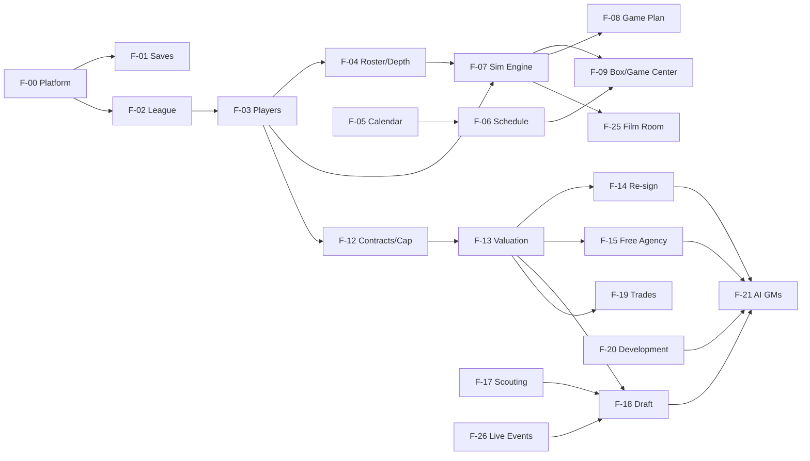

# Feature Catalog

> **Status:** Draft v1 · 2026-10-13
>
> A high-level breakdown of every feature (F-00 … F-30). Each entry covers the player value, MVP vs. later scope, dependencies and the AI counterpart. Detailed specs are written later in `docs/features/` using [the template](features/_TEMPLATE.md), right before each feature is built.
>
> **Tiers:** 🟥 **Core** (required for the MLP at M6) · 🟧 **Differentiator** · 🟨 **Depth** (post-MLP, pre-1.0) · ⬜ **Future** (post-1.0) · ⚙️ **Engineering** (no player-facing change)

---

## Feature map

| ID | Feature | Tier | First milestone | Deepened in |
|---|---|---|---|---|
| F-00 | Platform foundation | 🟥 | M0 | — |
| F-01 | League creation & save management | 🟥 | M0 | M1, M11 |
| F-02 | League structure & team identity | 🟥 | M1 | — |
| F-03 | Players: model & generation | 🟥 | M1 | M6 |
| F-04 | Roster & depth chart | 🟥 | M1 | M3 |
| F-05 | Calendar & season flow | 🟥 | M3 | M5 |
| F-06 | Schedule, standings & playoffs | 🟥 | M3 | — |
| F-07 | Game simulation engine | 🟥 | M2 | M3, M8 |
| F-08 | Game plan | 🟥 | M3 | M8 |
| F-09 | Box scores & Game Center | 🟥 / 🟧 | M3 | M8 |
| F-10 | Stats, records, awards & history | 🟥 | M3 | M5, M10 |
| F-11 | Injuries & health | 🟥 | M3 | M10 |
| F-12 | Contracts & salary cap | 🟥 | M4 | M9 |
| F-13 | Player valuation model | 🟥 | M4 | M7 |
| F-14 | Re-signing & negotiation | 🟥 | M5 | M9 |
| F-15 | Free agency | 🟥 | M5 | M9 |
| F-16 | Waivers, cuts & practice squad | 🟥 | M5 | — |
| F-17 | Scouting (fog of war) | 🟧 | M6 | — |
| F-18 | The draft (real-time) | 🟧 | M5 (headless) | M6 (live) |
| F-19 | Trades | 🟨 | M7 | — |
| F-20 | Player development, aging & retirement | 🟥 | M5 | M10 |
| F-21 | AI general managers | 🟥 | M5 | M7, ongoing |
| F-22 | Coaching staff & schemes | 🟨 | M10 | — |
| F-23 | Owner, budget & job security | 🟧 | M10 | — |
| F-24 | Inbox, news & narrative | 🟥 / 🟨 | M3 | M10 |
| F-25 | Film Room (analytics) | 🟧 | M8 | — |
| F-26 | Live Events framework | 🟧 | M6 | M9 |
| F-27 | Settings, help & accessibility | 🟥 | M0 | M11 |
| F-28 | Commissioner mode, editing & modding | ⬜ | Post-1.0 | — |
| F-29 | Steam integration | ⬜ | Post-M11 gate | — |
| F-30 | Source hosting & CI | ⚙️ Engineering | Later: recommended before M5, required before M11 | — |

### Dependency graph (simplified)

---

## 🟥 F-00: Platform foundation
**What:** the solution skeleton and cross-cutting infrastructure everything else stands on.
- **MVP (M0):** solution and projects with dependency rules, the WPF + BlazorWebView host with a custom title bar, the DevHost, Serilog file logging with crash capture, SQLite save create/open/close with a single transaction owner and torture tests, migrations on open, snapshots, the app shell, design tokens and the first components, a settings store, a local `build.ps1` (CI comes later in F-30). Stack: EF Core with the GFO unit of work (D-024) and Fluent UI Blazor v5 (D-025), each validated by an M0 spike.
- **See:** [ARCHITECTURE.md](ARCHITECTURE.md) and every doc in [architecture/](architecture/).
- **Non-goals:** a `.gfo` file association (double-clicking a save does nothing; Import handles it), any network access.

## 🟥 F-01: League creation & save management
**Player value:** start a dynasty quickly, and trust that it's safe.
- **New League wizard.** The league is **generated before you pick a team**, because team selection shows each team's situation:
  1. League name + seed (random or manual) → **generate** (with progress; changing the seed regenerates).
  2. **Pick a team:** all 32 with roster strength, cap space and needs. From M5 this also shows the **inherited situation** (last season's record, expiring contracts), because you take over a team whose previous GM was fired ([D-049](DECISIONS.md#d-049-a-new-league-starts-at-the-offseason-the-previous-gm-was-fired)). **Team choice is the difficulty dial** (no difficulty presets, [D-042](DECISIONS.md#d-042-no-difficulty-presets-in-10)).
  3. **Rules** (the full list is in [D-036](DECISIONS.md#d-036-league-settings-at-creation-are-gameplay-only-one-user-team)), each step arriving with the milestone that gives it meaning: injury frequency (M3), Ironman (M5, requires Live), clock mode and draft clock preset (M6), live event toggles (M9), "career can end" (M10, [D-063](DECISIONS.md#d-063-career-can-end-is-a-creation-setting-off-by-default)).
  4. **League data (M11):** optionally import a custom team set and/or college list (JSON, with validation errors, [D-035](DECISIONS.md#d-035-fictional-colleges-teams-and-colleges-as-data-files-user-import-in-m11)).
  5. Confirm.
- **Start point:** M1–M4 development builds start at Training Camp. **From M5, a new league starts at the Re-sign & Tag Window** after a simulated prior season, with your team's in-season prospect scouting inherited from the previous regime ([D-049](DECISIONS.md#d-049-a-new-league-starts-at-the-offseason-the-previous-gm-was-fired)).
- **Budgets:** generating a league < 5 s (M1). With the simulated prior season < 15 s (M5). Both with progress.
- **Save management, by milestone:**
  - **M0:** create, open, close, the load screen (save cards: crest, season and phase, record, last played, version warning; Ironman and LIVE badges once those exist), **Continue** (most recent save), delete (to the Recycle Bin).
  - **M3:** the **Time Machine** (snapshot list and restore), **export, import and duplicate**.
  - **M5:** Ironman guards: no chosen restore or duplicate, automatic corruption-only recovery ([D-026](DECISIONS.md#d-026-ironman-mode-requires-live-clock-mode)). Restore, duplicate and export are disabled during live events (M6).
- **Later:** league templates, multiple user teams (F-28, [D-036](DECISIONS.md#d-036-league-settings-at-creation-are-gameplay-only-one-user-team)). A "start at Training Camp" option is parked ([IDEAS.md](IDEAS.md)).
- **Depends on:** F-00, F-02, F-03. The offseason start depends on F-05 (offseason phases), F-07 (to simulate the prior season) and F-17 (inherited scouting, M6).
- **Spec notes:** [PERSISTENCE.md](architecture/PERSISTENCE.md). The spec confirms the D-049 defaults (simulated prior season, inherited scouting).

## 🟥 F-02: League structure & team identity
**Player value:** a league that feels like a real league, with its own identity.
- **MVP:** 32 fictional franchises, 2 conferences × 4 divisions × 4 teams. City, nickname, abbreviation, primary/secondary/accent colors, a **generated SVG crest** (a small parametric set: shape + monogram + stripe pattern, chosen per team in the data file), and a stadium (name, capacity, roof, surface, climate zone).
- **Default team set** ([D-033](DECISIONS.md#d-033-default-teams-32-curated-franchises-real-cities-original-nicknames), amended): 32 hand-written franchises in metros that **mirror the NFL's footprint** (two teams each in the New York and Los Angeles areas), with **original nicknames** and original conference and division names. Divisions are aligned by geography, with each two-team metro split across conferences. Drafted in the F-02 spec for owner review.
- **Guardrails (tests):** nicknames checked against a blocklist of real pro football team names, past and present. **No team uses the colors of the real team in its metro.** No crest resembles a real logo. Abbreviations are unique. Colors are distinguishable within a division. Text on every team color meets contrast.
- **Honest flavor:** stadium roof, surface and climate have no game effect until weather arrives (post-1.0). "Division rivalries" means the schedule only, until storylines (M10).
- **Data-driven:** the team set is a versioned JSON data file with a published schema from M1. User import of a custom set ships in M11 ([D-035](DECISIONS.md#d-035-fictional-colleges-teams-and-colleges-as-data-files-user-import-in-m11)). Imported SVG logos are rendered as `` (or sanitized), never inlined.
- **Later:** a team editor (F-28), relocation and expansion (far future). "Randomize identities" is parked ([IDEAS.md](IDEAS.md)).
- **Depends on:** F-00.

## 🟥 F-03: Players: model & generation
**Player value:** believable, distinct players whose careers you remember.

**Positions:** QB, RB, FB, WR, TE, OT, OG, C, EDGE, DT, LB, CB, S, K, P, LS. Scheme-specific roles (3-4 OLB, nickel CB, FS/SS) are depth chart *slots*, not separate positions.

**Attributes** (internal 0–100). **Every attribute must be read by at least one play resolver** ([D-050](DECISIONS.md#d-050-every-player-attribute-must-be-read-by-the-sim)). The list below is the *starting* list. The F-03 spec reconciles it with [SIMULATION_ENGINE.md §4](architecture/SIMULATION_ENGINE.md#4-play-resolution) through an attribute → resolver matrix. Agility, Jumping, Strength and Play Recognition currently have no consumer, and the run pipeline's "strip skill" has no attribute.

| Group | Attributes |
|---|---|
| Physical | Speed, Acceleration, Agility, Strength, Jumping, Stamina, Toughness |
| Mental | Awareness (football IQ), Discipline, Play Recognition |
| Passing | Arm Strength, Short / Medium / Deep Accuracy, Throw on the Run, Pocket Presence, Decision Making |
| Ball carrying | Ball Security, Vision, Elusiveness, Break Tackle |
| Receiving | Hands, Route Running, Release, Contested Catch |
| Blocking | Pass Block, Run Block, Lead Block |
| Defense | Pass Rush (Power), Pass Rush (Finesse), Block Shedding, Tackling, Pursuit, Hit Power, Man Coverage, Zone Coverage, Press, Ball Skills |
| Special teams | Kick Power, Kick Accuracy, Punt Power, Punt Accuracy, Return, Snap Accuracy |
| **Hidden ratings** | Potential (ceiling), Development curve (early, normal or late bloomer; bust risk), Peak age offset, Injury proneness |
| **Personality** ([D-043](DECISIONS.md#d-043-limited-personality-model-only-traits-with-a-consumer)) | Work ethic, Coachability (development) · Greed, Loyalty (negotiation) · Competitiveness (FA contender priority, retirement) · Ego (role demands). Only traits that some system reads. Defined in data, so more can be added later with a deterministic backfill. |

- **Overall (OVR):** a position-specific weighted formula (weights in data). Archetypes (e.g., Pocket Passer vs. Scrambler) give a secondary label. Under fog of war, a perceived OVR is the same formula over perceived attributes, and its range comes from the attributes' uncertainties (the spec defines the propagation).
- **Potential:** a hidden **peak-OVR target**, shown only as a letter grade through bands defined in the spec ([D-034](DECISIONS.md#d-034-ratings-display-099-with-ranges-letter-grades-for-potential)).
- **Measurables:** height, weight, 40-yard dash (+10-yard split), bench reps, vertical, broad jump, 3-cone, shuttle, arm length, hand size. **Generated first.** Physical ratings are derived from them plus a small hidden noise term, so the combine making physical ratings near-exact falls out naturally.
- **Bio:** fictional name (frequency-weighted lists, checked against a blocklist of famous real people), age and birthdate, college (fictional, from the colleges data file, each with a region and tier; [D-035](DECISIONS.md#d-035-fictional-colleges-teams-and-colleges-as-data-files-user-import-in-m11)), hometown, experience, jersey number, draft info.
- **Generation targets:** rating distributions per position and depth tier (starter, backup, fringe), plus age distribution. These must hold in balance with F-20 over decades.
- **Display** ([D-034](DECISIONS.md#d-034-ratings-display-099-with-ranges-letter-grades-for-potential)): 0–99 with color bands. `RatingChip` shows an estimate and a range when uncertain and a plain value when exact. Potential is a **letter grade** ("Ceiling: B+"), never a number.
- **Visibility** ([D-032](DECISIONS.md#d-032-fog-of-war-your-roster-exact-other-pros-slightly-fuzzy-prospects-scouted)): your roster's current ratings are exact. Other teams' players are slightly fuzzy and never sharpen. Prospects are very fuzzy until scouted. Potential is fuzzy for everyone.
- **MVP (M1):** everything above except fog-of-war *data* (M6). Before M6 every rating is shown exactly (σ = 0), but the UI already renders ranges, so M6 changes data, not screens.
- **Yearly draft class generation** (about 300 prospects with college production) is part of this feature but first needed in M5 (headless draft).
- **Spec scope also includes:** the source and curation of the "famous real people" name blocklist (real effort), jersey number rules by position, and the roster sizes generated per start point (Training Camp vs. the offseason, [D-049](DECISIONS.md#d-049-a-new-league-starts-at-the-offseason-the-previous-gm-was-fired)).
- **Depends on:** F-02.

## 🟥 F-04: Roster & depth chart
**Player value:** shape the team, and see the consequences on Sunday.
- **MVP**
  - **Roster:** 53 active, practice squad of 16, IR. A roster grid with saved views. Player peek sheets everywhere. (No non-football injury list: nothing generates non-football injuries.)
  - **Limits:** 53/16 enforced at the right phases (90 in the offseason, 53 after final cuts).
  - **Depth chart by position** ([D-052](DECISIONS.md#d-052-depth-chart-position-depth-drives-every-package-with-optional-overrides)): you order players per position (QB1, QB2, RB1…, WR1–WR5, CB1–CB4, …) and set K, P, LS, KR and PR. **Every package is derived automatically** (offense 11/12/21/22/10/goal line, defense base/nickel/dime/goal line, special teams coverage units). **Optional per-package overrides** for power users. Drag-and-drop **and** keyboard reordering. Locks. **Auto depth chart** (best available, aware of injuries and fatigue).
  - **Gameday inactives** (auto by default, with an override).
- **Later:** practice squad elevations, position changes (e.g., CB → S with a learning curve), jersey number management.
- **AI counterpart:** the AI sets position depth (and any overrides) and inactives every week, through the same model.
- **Depends on:** F-03.

## 🟥 F-05: Calendar & season flow
**Player value:** a clear "what's next" at every moment, with no busywork.
- **MVP:** the phase machine, stops, a context-aware **Advance** button, "sim to…" options, blocking issues with auto-fix, resumable advances, AI processing in the same pipeline.
- **M3:** season phases only (Camp → Regular Season → Playoffs → Wrap). **M5:** the full offseason, and new leagues start there ([D-049](DECISIONS.md#d-049-a-new-league-starts-at-the-offseason-the-previous-gm-was-fired)).
- **Firing happens only at the owner review in Season Wrap** (M10), never mid-season. A fired GM interviews in the same offseason, so there's no "between jobs" autoplay state.
- **See:** [CALENDAR_AND_PHASES.md](architecture/CALENDAR_AND_PHASES.md).

## 🟥 F-06: Schedule, standings & playoffs
**Player value:** a real season structure, with real stakes in the standings.
- **Schedule generation:** a pro-style rotation formula. 6 division games, 4 against a rotating same-conference division, 4 against a rotating other-conference division, 2 against same-place finishers in the remaining same-conference divisions, and 1 against a same-place finisher from the other conference (17 total). Then **week assignment** with byes in Weeks 5–14, home/away balance and no back-to-back repeat opponents. (A constraint problem: randomized greedy + backtracking, seeded.)
- **Standings:** W-L-T, win %, division and conference records, PF/PA, net points, streak, last 5. Clinch and elimination indicators (later).
- **Tiebreakers (v1):** an ordered, data-driven list. Head-to-head → division record → common games (min 4) → conference record → strength of victory → strength of schedule → coin flip (seeded). **Heavily unit-tested.** The spec defines the **division** and **wild-card** procedures separately: for wild cards, only the highest-ranked team from each division stays in, and multi-team ties restart from step 1 after each elimination.
- **Playoffs:** 7 seeds per conference, #1 seed bye, reseeding each round, a neutral-site championship.
- **The first schedule** has no prior standings for its same-place-finisher games (and the D-049 simulated prior season needs a schedule too). It uses a seeded order based on team strength.
- **Depends on:** F-02, F-05.

## 🟥 F-07: Game simulation engine
**Player value:** results that feel earned and believable.
- **MVP (M2):** a headless statistical play-by-play engine, deterministic, calibrated with SimLab. **M3:** depth packages, basic game plan, OT, playoffs. **M8:** EP/WP models, player grades, Film Room data.
- **Bootstrapping EP/WP:** the tables are generated *from* the engine, so until M8 the coaching AI uses a **heuristic 4th-down and 2-point chart**, and each play's win probability fields stay empty. In M8: generate the tables, switch decisions to them, regenerate once so the tables reflect the new decisions, then recalibrate.
- **Every attribute has a consumer** ([D-050](DECISIONS.md#d-050-every-player-attribute-must-be-read-by-the-sim)). A test checks it from M2.
- **Player grades** (M8) feed the Film Room, awards and contract talks. They don't sharpen perception: other teams' players never sharpen ([D-032](DECISIONS.md#d-032-fog-of-war-your-roster-exact-other-pros-slightly-fuzzy-prospects-scouted)).
- **See:** [SIMULATION_ENGINE.md](architecture/SIMULATION_ENGINE.md).

## 🟥 F-08: Game plan
**Player value:** your weekly strategic lever on game day ([D-009](DECISIONS.md#d-009-game-day-role-gm--game-plan)).
- **MVP (M3):** 3 settings: run/pass balance, aggression, blitz frequency. A "Coach's plan" default.
- **M8 (full):** all settings in [SIMULATION_ENGINE.md §5](architecture/SIMULATION_ENGINE.md#5-the-game-plan-the-users-lever-on-game-day), an opponent scouting report (their tendencies from real play logs), saved plan presets, and a post-game "did the plan work?" review.
- **Guardrail:** an optimal plan is worth about +2–5% win probability against an equal opponent.
- **AI counterpart:** AI coaches set plans from tendencies plus an opponent heuristic.

## 🟥 / 🟧 F-09: Box scores & Game Center
**Player value:** the weekly payoff. Watch your team, feel the result.
- **MVP (M3):** box scores (team and player stats), scoring summary, drive summary, a full play-by-play list, the week's scoreboard, and a **minimal text replay** of your game: scorebug + play-by-play feed at 1× / 2× / 4× / instant, with other scores ticking in ([D-053](DECISIONS.md#d-053-m3-game-day-a-minimal-text-replay)).
- **M8 (Game Center):** the full replay adds an SVG **drive chart**, a **win probability chart**, the polished other-games ticker and a "Game final" moment.
- **Later:** a "RedZone" multi-game view, halftime adjustments ([D-048](DECISIONS.md#d-048-halftime-adjustments-post-10-engine-split-kept-possible)).
- **Depends on:** F-07, F-06.

## 🟥 F-10: Stats, records, awards & history
**Player value:** "Your league, your story". Memory and legacy.
- **MVP (M3):** player and team stats per game and season, league leaders, sortable stat grids.
- **M5:** career stats, season awards (MVP, Offensive and Defensive Player of the Year, Offensive and Defensive Rookie of the Year, Comeback, All-League 1st and 2nd team, an all-star roster equivalent), a champions list, franchise history pages, the transaction log, draft history.
- **M10:** a records book (game, season, career; player, team and league), the **Hall of Fame** (a voting algorithm with a waiting period), milestone tracking ("needs 112 yards for 10,000"), a GM legacy page.
- **AI counterpart:** awards voting (stats + team success, with noise). Player grades join the formula when they arrive in M8.
- **History starts before you arrive:** from M5, the D-049 simulated prior season is the league's first season of stats, awards and a champion.

## 🟥 F-11: Injuries & health
**Player value:** realistic adversity, and a reason to value depth.
- **MVP (M3):** injuries come out of the sim (exposure-based). Types and body parts with severity distributions, expected return in weeks, and IR (minimum games). Status is **Available or Out** ([D-054](DECISIONS.md#d-054-injury-status-is-available--out-until-playing-hurt-m10)). Auto depth chart substitution.
- **M10:** **Questionable / Doubtful** together with playing through injury (a performance penalty), re-injury risk, reduced performance after returning, an injury-prone trait shown via the injury report. There's no medical staff ([D-062](DECISIONS.md#d-062-coaching-staff-is-head-coach--two-coordinators-only)). Recovery speed doesn't depend on staff.
- **Setting:** injury frequency Low / Realistic / High, chosen at creation and locked ([D-037](DECISIONS.md#d-037-injury-frequency-setting-locked-at-creation)).

## 🟥 F-12: Contracts & salary cap
**Player value:** the GM's core puzzle: talent vs. money across years.
- **MVP (M4)**
  - Contract = years (1–7) × (base salary, prorated signing bonus, guaranteed amount) → **cap hit per year** (pure functions in Core).
  - **Signing bonus proration** over at most 5 years.
  - **Release → dead money**, with remaining proration accelerated.
  - **The salary cap** per league year, with growth plus variance. **Cap rollover** of unused space.
  - **A minimum salary** by experience, and the **rookie wage scale** by pick slot (4 years; 5th-year option later).
  - **The franchise tag** (1 per team per year, priced by the top salaries at the position).
  - **Extensions.**
  - **The offseason "Top 51" rule:** from the new league year until the regular season, only the 51 highest cap hits count, plus dead money ([D-056](DECISIONS.md#d-056-the-offseason-top-51-cap-rule-is-in-amends-d-040)).
  - **Cap sheet UI:** a multi-year table, cap space, dead money, top cap hits, projections, and a "what if I cut him?" preview.
  - Validation: no signing that puts the team over the cap.
  - **Spec must cover:** guaranteed salary becoming dead money on release (not only bonus proration), the tag price formula (e.g., the average of the top 5 cap hits at the position, or 120% of the prior salary if higher), the definition of an accrued season, and the Top 51 fine print, all checked against a real reference.
- **v2 (M9):** the 5th-year option, restructures (base → bonus), June 1 designations ([D-040](DECISIONS.md#d-040-salary-cap-realism-tiers)).
- **Not in 1.0:** RFA tenders, the transition tag, void years, incentives, offsets, compensatory picks ([IDEAS.md](IDEAS.md)). Expiring players with fewer than 4 accrued seasons are **exclusive-rights** free agents instead (D-040).
- **Depends on:** F-03.

## 🟥 F-13: Player valuation model (internal system)
**Why it's its own feature:** contracts, free agency, trades, the draft, AI rosters and media rankings all ask "what is this player worth?". **If they answer differently, the game can be exploited.** One model, used everywhere.
- **Inputs:** **perceived** ratings (the evaluating team's view, consistent with fog of war; uncertain estimates are discounted so the AI doesn't fall for the winner's curse in free agency, [D-032](DECISIONS.md#d-032-fog-of-war-your-roster-exact-other-pros-slightly-fuzzy-prospects-scouted)), age and the projected aging curve, positional value (QB ≫ RB), contract (surplus value = production value − cost), team context (need, scheme fit later), injury history.
- **Outputs:** market value (average per year and term), trade value (points), draft value (pick-equivalent), the "tier" label shown in the UI.
- **Calibration:** the market average-per-year distribution per position matches target bands (e.g., top QB ≈ 15–20% of the cap). The **no-arbitrage** tests: no cheap loop like "sign FA → trade for a 1st".
- **Aging curves live here:** contract surplus value needs a projection of future performance in M4, before F-20 exists. The **expected aging curve by position** is F-13 data from M4, and F-20 (M5) reuses it for actual progression.
- **The difficulty hook** ([D-042](DECISIONS.md#d-042-no-difficulty-presets-in-10)): `UserDealMargin` is applied here, neutral by default and not exposed.
- **MVP (M4):** contracts and free agency. **M7:** trades, a star premium (superlinear, so two quarters are worth less than a dollar), GM personality modifiers.

## 🟥 F-14: Re-signing & negotiation
**Player value:** keeping your core together is a skill, not a click.
- **MVP (M5):** the player sets an **ask** (average per year, years, guarantees) from valuation + personality (Greed and Loyalty, [D-043](DECISIONS.md#d-043-limited-personality-model-only-traits-with-a-consumer)). You offer. Response: accept / counter / reject, with an **interest meter** and a limited number of rounds. Lowballing drains the interest meter for *this* negotiation (and, from M9, the agent remembers). It isn't a morale system. Extensions in the final contract year.
- **M9 (full):** **agents as characters** (each represents many players, has a personality, and **remembers how you treat their clients**), player **priorities** (money, contender, role, location and climate, loyalty), **holdouts**, hometown discounts, deadline pressure inside FA Frenzy.
- **AI counterpart:** AI teams re-sign through the **same ask → offer → counter loop** with the same asks, deciding by value vs. ask vs. cap health.

## 🟥 F-15: Free agency
**Player value:** the market. Compete with 31 front offices for talent.
- **MVP (M5):** UFA eligibility (4+ accrued seasons; fewer = exclusive rights, retained with a one-year qualifying offer, [D-040](DECISIONS.md#d-040-salary-cap-realism-tiers)), the market opens at the new league year, **turn-based day by day** for about 14 days and then weekly. AI teams bid (valuation × need × cap). Players choose by offer score (money-weighted, with priorities in M9). **Blind bids with signals** ([D-057](DECISIONS.md#d-057-free-agency-blind-bids-with-signals)): you see the number of serious suitors and the player's current leaning, never competing amounts, and AI teams see the same about your offers. A signing news feed.
- **M9:** the **FA Frenzy** live event (F-26, committed by [D-046](DECISIONS.md#d-046-live-events-fa-frenzy-committed-deadline-day-conditional)). No RFA tenders or compensatory picks in 1.0.
- **Depends on:** F-12, F-13.

## 🟥 F-16: Waivers, cuts & practice squad
- **MVP (M5):** waiver claims by priority (reverse standings; in the offseason, the draft order), cut-down day to 53, practice squad signing and poaching (no protections), veterans with 4+ accrued seasons bypassing waivers (simplified rule).
- **AI counterpart:** claims, cuts, practice squad decisions.

## 🟧 F-17: Scouting (fog of war)
**Player value:** information is an asset. Your scouts' judgment *is* your edge.
- **The model** ([D-032](DECISIONS.md#d-032-fog-of-war-your-roster-exact-other-pros-slightly-fuzzy-prospects-scouted)): **your roster is exact** (current ratings), **other teams' players and free agents are slightly fuzzy by a fixed amount and never sharpen** (game film is public), and **prospects are very fuzzy and sharpen only through scouting**. Potential is a letter grade that stays fuzzy for everyone (on your roster it narrows as the player develops). Each team's error is deterministic and redrawn once per league year.
- **MVP (M6):** the perception model above for every team, AI included. A scouting department (director plus area scouts with visible **accuracy** and **position expertise**), the same capacity for every team (the owner-funded budget arrives in M10, [D-041](DECISIONS.md#d-041-finances-owner-funded-staff-budget-in-m10-only)), the combine (exact measurables), pro days, **limited interviews** (personality reveal), media consensus boards and mock drafts, and **your Big Board** (tiers, notes, drag and drop).
- **Assignments** ([D-058](DECISIONS.md#d-058-scouting-department-standing--special-assignments-no-biases-in-10)): **standing assignments** (each scout covers a region or a position group until you change it) sharpen every covered prospect automatically, **down to a floor**. **Special assignments** to a specific prospect sharpen past that floor, at the cost of the scout's standing coverage while he's on it. No required weekly input. AI teams use the same model, and their default assignments are the baseline a new league's team inherits ([D-049](DECISIONS.md#d-049-a-new-league-starts-at-the-offseason-the-previous-gm-was-fired)).
- **Spec notes:** the floor, rates and number of special assignments per scout. Scouting narrows a prospect's *potential* range only partly ("potential is always the most uncertain thing").
- **Not in 1.0:** pro scouting assignments, snap-based sharpening of pro perception, **scout biases** ([IDEAS.md](IDEAS.md)).
- **Later:** scout hiring and firing, scout reputation, scout-specific reports ("Our West scout loves him") together with biases.
- **See:** [STANDOUT_FEATURES.md §A](STANDOUT_FEATURES.md#a-scouting-fog-of-war).
- **Depends on:** F-03, F-13.

## 🟧 F-18: The draft (real-time)
**Player value:** the hallmark moment of the year.
- **M5 (headless):** draft order (from standings, including the D-049 simulated prior season), 7 rounds, tradable future picks (the upcoming draft and the next two), AI picks, rookie contracts, and the **UDFA window: one turn-based round of blind offers** after the last pick, resolved all at once ([D-059](DECISIONS.md#d-059-the-udfa-window-is-one-turn-based-round-of-blind-offers)). Needed to close the annual loop.
- **M6 (live):** the **Draft Room** with the real-time clock, AI pick timing and acceleration, the ticker, the trade phone (pick-for-pick), the pick queue, auto-pick, resume after a crash, "the pick is in" moments, instant media grades, and the **draft class retrospective** (re-graded after 3 and 5 years; until player grades exist in M8 it's measured by seasons as a starter, OVR reached and awards).
- **M7:** player-for-pick trades in the Draft Room (with F-19).
- **Later:** a "war room" staff voice (assistants arguing for players). Compensatory picks are not in 1.0 ([IDEAS.md](IDEAS.md)).
- **See:** [STANDOUT_FEATURES.md §1](STANDOUT_FEATURES.md#1-the-real-time-draft-the-clock-never-stops), [LIVE_EVENTS.md](architecture/LIVE_EVENTS.md).

## 🟨 F-19: Trades
**Player value:** bold, creative roster building, and the AI must not be a pushover.
- **MVP (M7):** a trade builder (players plus picks for the upcoming draft and the next two, the NFL's horizon, confirmed in the spec), cap and roster legality for both sides (the sending team keeps the dead money from remaining bonus proration), AI evaluation through F-13 (perceived values, need, GM personality), a **qualitative reaction scale** (Not interested → Deal) with **no value numbers**, plus **"what would it take?"** feedback where the AI names what it wants ([D-061](DECISIONS.md#d-061-trade-feedback-is-qualitative-plus-what-would-it-take)), a **trade block** (shop players and receive offers), **AI-initiated offers** in the inbox (with expiry), AI↔AI trades (frequency tuned), and the trade deadline.
- **Anti-exploit rules:** the AI values on its *own* perception, star consolidation is superlinear, there's a "fleece memory" (Rival GMs), and the same player can't be traded back for 1 year.
- **M9 (conditional):** **Trade Deadline Day** live event, built only if FA Frenzy proves the pattern ([D-046](DECISIONS.md#d-046-live-events-fa-frenzy-committed-deadline-day-conditional)).
- **Depends on:** F-12, F-13, F-21.

## 🟥 F-20: Player development, aging & retirement
**Player value:** watching a rookie become a star (or bust) is the long-term hook.
- **MVP (M5)**
  - **Annual progression** at training camp: f(age curve by position, potential gap, work ethic, coaching (M10), playing time last season, random variance including **breakouts and busts**).
  - **Small in-season progression** for young players getting snaps.
  - **Decline** after a position-specific peak (e.g., RBs decline early, QBs late).
  - **Development focus:** the user picks a few players for extra development each camp (user agency). **AI teams pick theirs too**, by the same rule. Otherwise AI teams develop systematically worse, a hidden user advantage.
  - **Retirement:** f(age, decline, injuries, contract status, titles, personality). Some players announce in advance.
- **Potential narrows on your roster** ([D-032](DECISIONS.md#d-032-fog-of-war-your-roster-exact-other-pros-slightly-fuzzy-prospects-scouted)): the confidence band on your own players' potential grade tightens with each season you observe their development. The mechanism is shared with F-17.
- **Aging curves:** the expected curves by position come from F-13 (defined in M4). F-20 adds the variance (breakouts, busts, early or late bloomers).
- **Balance requirement:** generation (F-03) and progression together keep the league's talent distribution **stable over decades** (the autoplay gate).
- **Depends on:** F-03, F-13 (aging curves).

## 🟥 F-21: AI general managers
**Player value:** 31 believable rivals. The game is only as good as its AI.
- **Principles:** the AI uses **the same commands and validation as the user**, **doesn't cheat** (it knows its own roster exactly and sees everyone else through its own perception, [D-032](DECISIONS.md#d-032-fog-of-war-your-roster-exact-other-pros-slightly-fuzzy-prospects-scouted)), **judges your offers exactly as it judges another AI team's** (no difficulty fudging, [D-042](DECISIONS.md#d-042-no-difficulty-presets-in-10)), and is **pure**: a state snapshot goes in, intents come out, and Application executes them.
- **GM personalities:** Analytics, Old School, Win-Now, Patient Builder, Gambler. Each weights needs vs. best available, youth vs. veterans, and cap risk tolerance differently.
- **Phase behaviors:** depth charts and game plans (via the head coach), development focus, re-sign/tag/cut, FA bidding, the draft board and trades, waivers, practice squad, extensions, trade deadline buying and selling.
- **League health** is monitored by the 30-season autoplay (see [TESTING_AND_QUALITY.md §5](architecture/TESTING_AND_QUALITY.md#5-league-health-metrics-from-m5)).
- **MVP (M5):** competent, cap-healthy, rule-abiding. **M7:** personalities, trades, rival memory. **Ongoing:** tuning.

## 🟨 F-22: Coaching staff & schemes
- **M10** ([D-062](DECISIONS.md#d-062-coaching-staff-is-head-coach--two-coordinators-only)): **head coach** (game management, development, special teams), **offensive coordinator** and **defensive coordinator** (scheme, play-calling). Nothing else: no special teams coordinator, position, strength or medical staff. Every coach attribute must have a consumer in the sim or in development (the D-050 rule applied to coaches). **Schemes** (offense: West Coast, Air Raid, Power Run, Spread, Pro Style; defense: 4-3, 3-4, Multiple/Nickel) affect play-calling tendencies and **scheme fit** (value and performance modifiers). Coaching carousel, coach contracts (paid from the owner's staff budget, not the cap).
- **Before M10:** each team has an implicit default coach with tendencies.
- **AI counterpart:** AI GMs hire and fire coaches through the same carousel.

## 🟧 F-23: Owner, budget & job security
- **M10:** owner personality and goals, a job security meter, the end-of-season review (**the only firing point**), a staff budget (scouting and coaching, [D-041](DECISIONS.md#d-041-finances-owner-funded-staff-budget-in-m10-only)), **getting fired → interviewing → a new team** in the same offseason, GM reputation and legacy, and **choosing to retire** (ends the save with a legacy screen).
- **"Career can end"** ([D-063](DECISIONS.md#d-063-career-can-end-is-a-creation-setting-off-by-default)): a locked creation setting, **off by default** (you always get at least one offer). When on, a bad enough reputation means no offers and the career ends.
- **AI counterpart:** owners review **AI GMs with the same logic**. Fired AI GMs are replaced by new ones (with new personalities). That's where the openings you interview for come from, and it keeps the league from going stale.
- **Guardrail:** the owner never vetoes moves. No business sim ([D-041](DECISIONS.md#d-041-finances-owner-funded-staff-budget-in-m10-only)).
- **See:** [STANDOUT_FEATURES.md §D](STANDOUT_FEATURES.md#d-the-owners-box-job-security-and-the-gm-career).

## 🟥 / 🟨 F-24: Inbox, news & narrative
- **MVP (M3)** ([D-055](DECISIONS.md#d-055-m3-messaging-briefing--news-feed-the-inbox-arrives-in-m7)): the **Front Office Briefing** weekly digest (results, injuries, the upcoming opponent, a "needs your attention" section that mirrors the Advance flow's warnings) and a **news feed** of league events built from domain events via templates.
- **M7:** the **inbox** arrives with the first items that expire (trade offers). **M7–M9:** contract demands with expiry, owner messages, scout reports.
- **M10:** **storylines** (multi-event narratives: QB controversy, holdout saga, rookie breakout, revenge game, coach on the hot seat), headline importance scoring, wording variation.

## 🟧 F-25: Film Room (analytics & explainability)
- **M8:** a post-game report (WP chart with swing plays, key matchups, unit and player grades, "why we won/lost", game plan review) and season analytics (EPA-style efficiency, success rate, explosive rate, pressure rate) at the team, player and league level.
- **See:** [STANDOUT_FEATURES.md §C](STANDOUT_FEATURES.md#c-film-room-explainable-results).

## 🟧 F-26: Live Events framework
- **M6:** the runner, clock, offers, ticker, persistence and resume, built for the draft.
- **M9:** generalized to **FA Frenzy** (committed) and **Trade Deadline Day** (conditional). Each is toggleable at league creation and locked afterward ([D-046](DECISIONS.md#d-046-live-events-fa-frenzy-committed-deadline-day-conditional)). A close or crash resumes where it left off ([D-045](DECISIONS.md#d-045-live-event-close-or-crash-resume-where-it-left-off)).
- **See:** [LIVE_EVENTS.md](architecture/LIVE_EVENTS.md).

## 🟥 F-27: Settings, help & accessibility
- **Ongoing:** settings (theme, accent: team or neutral, density, motion, sound (all off by default, [D-047](DECISIONS.md#d-047-sound-all-off-by-default-no-music)), snapshot budget, developer: log level and sim trace), a keyboard shortcut map and cheat sheet (`?`), the command palette, glossary tooltips (hover a term → definition from [GLOSSARY.md](GLOSSARY.md)).
- **Ongoing:** UI zoom 90–150% (nearly free with WebView2's zoom factor). Glossary tooltips read from a runtime glossary data file, not the GLOSSARY.md doc.
- **Accessibility is built per screen, not at the end:** the Definition of Done ([TESTING_AND_QUALITY.md §8.5](architecture/TESTING_AND_QUALITY.md#85-definition-of-done-per-feature)) requires contrast in both themes, color never the only signal, visible focus, reduced motion and ARIA labels on custom components from M1.
- **M11:** **help pages** written in Markdown (`data/help/`) and rendered in the app ([D-051](DECISIONS.md#d-051-onboarding-is-help-pages-only-authored-in-markdown)), plus an accessibility **audit** (screen reader pass, colorblind review). No scripted onboarding: no "Assistant GM", no phase cards ([IDEAS.md](IDEAS.md)).

## ⬜ F-28: Commissioner mode, editing & modding
- **Post-1.0:** edit players, teams and contracts (the save is flagged `IsEdited`, which disables achievements), league rule edits (cap amount and growth, [D-036](DECISIONS.md#d-036-league-settings-at-creation-are-gameplay-only-one-user-team)), multiple user-controlled teams, custom name lists, roster files, and maybe Steam Workshop later.
- **Moved into 1.0:** importing custom team sets and college lists at league creation ships in M11 as part of F-01 ([D-035](DECISIONS.md#d-035-fictional-colleges-teams-and-colleges-as-data-files-user-import-in-m11)). That import **doesn't** set `IsEdited`, because choosing league data at creation isn't editing a league in progress. Custom name lists could later reuse the same import mechanism.

## ⬜ F-29: Steam integration
- **After the M11 gate:** Steamworks.NET (MIT): achievements (**Ironman only**, decided in [D-026](DECISIONS.md#d-026-ironman-mode-requires-live-clock-mode); Ironman already requires the Live clock mode), Steam Cloud for snapshots and exports (not the live database), rich presence, store assets, trailer. **Research the Steam Deck before promising it** ([Q-23](OPEN_QUESTIONS.md#q-23-steam-deck)).

## F-30: Source hosting & CI
**Tier:** ⚙️ Engineering · **When:** later, at the owner's call. **Recommended before M5** (the autoplay health gate makes manual runs painful). **Required before M11** (reproducible builds for playtesters). Deferred by [D-030](DECISIONS.md#d-030-source-hosting-and-ci-deferred-to-f-30). Was [Q-25](OPEN_QUESTIONS.md#q-25-source-hosting-and-ci).

**Until then:** `build.ps1` at the repo root runs the same gates locally ([TESTING_AND_QUALITY.md §7](architecture/TESTING_AND_QUALITY.md#7-build-script-now-ci-later)).

**Decisions to make when it starts**
- Host: GitHub (recommended) or another. **Public or private** (recommended: private until Gate 2; check that nothing personal or licensed is in history).
- Issue tracking: GitHub Issues labeled by milestone (`M3`, `M5`, …) and feature (`F-xx`), vs. docs-only TODOs.

**Scope**
- [ ] Remote repository created and pushed; branch protection on `main` (PRs required once CI exists).
- [ ] `.github/workflows/ci.yml`: on push and PR, `windows-latest`, `setup-dotnet` from `global.json`, run `./build.ps1`.
- [ ] `.github/workflows/nightly.yml`: scheduled `./build.ps1 -Full`, uploading `./artifacts` (calibration, autoplay, benchmark reports) so the sim's history is preserved.
- [ ] Regression rule: nightly fails if a performance budget regresses by more than 20% ([ARCHITECTURE.md §9](ARCHITECTURE.md#9-performance-budgets)).
- [ ] Issue labels and templates (bug: include `diagnostics.zip`; feature: link the F-xx spec).
- [ ] (Optional) Release workflow: tag → Velopack build → GitHub Release (only needed for external playtesters).

**Acceptance:** a PR that breaks the build, a test, an architecture rule or a banned API turns red. The nightly run produces downloadable reports.
