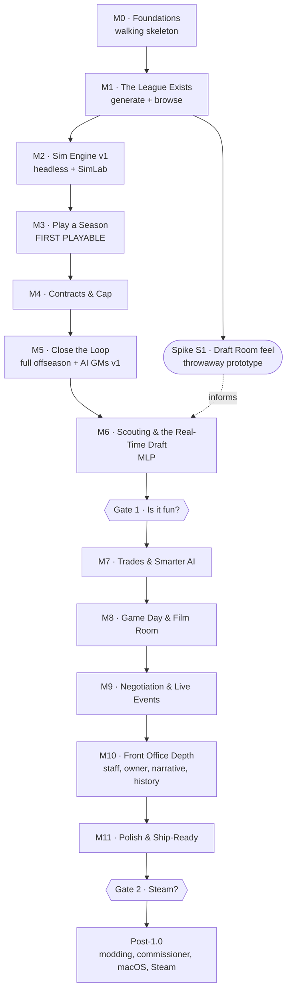

# Roadmap

> **Status:** Draft v1 · 2026-10-13
>
> **No dates, by design.** This is the *order* of work: a path where each milestone builds on the last and ends with something you can play, watch or measure. Feature IDs refer to [FEATURES.md](FEATURES.md).

---

## Guiding principles

1. **Close the loop, then deepen.** A thin version of the *whole* annual cycle beats a perfect free agency system with no draft.
2. **Retire the biggest risks early.** The sim engine (M2) and AI/league health (M5) are proven before polish.
3. **Every milestone ends playable or measurable.** No milestone is "just plumbing" except M0, and even M0 boots.
4. **Headless before UI for the hard systems.** The engine, AI and live event logic run in SimLab and tests before screens are built on them.
5. **The design system grows with every milestone.** No screen ships with ad-hoc styling.
6. **Two "is it fun?" gates** decide whether to keep investing (after M6) and whether to pursue Steam (after M11).

---

## The path at a glance

| Milestone | Theme | Ends with | Key risk retired |
|---|---|---|---|
| **M0** | Foundations | An app that boots, logs, and creates/opens a save | Toolchain, desktop host, **transactions**, persistence model |
| **M1** | The league exists | A generated league to browse | Data model, design system basics, DataGrid |
| **S1** | Spike: Draft Room feel | A throwaway clock + board prototype | "Is real-time drafting fun?" |
| **M2** | Sim engine v1 | A SimLab calibration report inside the bands | **Sim believability** |
| **M3** | Play a season | **First playable**: a full season to a champion | Calendar, schedule, standings |
| **M4** | Contracts & cap | A working cap economy | Cap math correctness |
| **M5** | Close the loop | 30-season autoplay passes health checks | **AI and talent equilibrium** |
| **M6** | Scouting & real-time draft | **MLP**: the hallmark experience | **The hallmark is fun** |
| **M7** | Trades & smarter AI | AI that can't be fleeced | Trade exploitability |
| **M8** | Game day & Film Room | Watch games live and understand results | Engagement during the season |
| **M9** | Negotiation & Live Events | Agents, FA Frenzy, Deadline Day (if Frenzy proves it) | Generalizing live events |
| **M10** | Front office depth | Staff, owner, narrative, records, HoF | Long-term stakes |
| **M11** | Polish & ship-ready | An installable, onboarded, accessible 1.0 | Release quality |

---

## M0 · Foundations ("walking skeleton")

**Goal:** the toolchain, host, logging, persistence (with transactions you can trust) and design system basics all work end to end.

**Stack decided** (2026-10-13): WPF + BlazorWebView host ([D-021](DECISIONS.md#d-021-host-wpf--blazorwebview-maui-removed)), EF Core with the GFO unit of work ([D-024](DECISIONS.md#d-024-data-access-ef-core-with-the-gfo-unit-of-work)), and Fluent UI Blazor v5 ([D-025](DECISIONS.md#d-025-ui-component-library-fluent-ui-blazor-v5)).

**Spikes to run first** (short, and they de-risk the decided stack):

| Spike | Proves | Exit |
|---|---|---|
| **S0a: EF Core proof** | The unit of work holds up: the 4 representative operations plus the torture tests ([DATA_ACCESS_OPTIONS.md §5](architecture/DATA_ACCESS_OPTIONS.md#5-recommendation-and-the-spike-that-decides-it), [DATA_ACCESS_GUIDE.md §9](architecture/DATA_ACCESS_GUIDE.md#9-proving-it-the-torture-tests-m0-run-on-every-build)) | All torture tests green. Week bulk persist < 1 s. |
| **S0b: Fluent UI v5 fit check** | Runtime brand color from team colors, light/dark, font and radius token overrides. `FluentDataGrid` with 2,000 rows: **virtualized + pinned first column + sticky header + compact rows + Razor cell templates + keyboard**. A drawer (peek sheet), a dialog, toasts. Confirm the exact v5 API names used in the docs. | Grid passes the P0 items in [UI_DESIGN_SYSTEM.md §5.3](architecture/UI_DESIGN_SYSTEM.md#53-datagridt-a-gfo-wrapper-over-fluentdatagrid), or the fallback grid is chosen |
| **S0c: Host shell** | WPF window with the chosen title bar approach (native caption strip vs. HTML `app-region`), ReadyToRun publish, startup time on the real shell | A title bar approach recorded in DECISIONS |
| ~~Visual design doc~~ | **Done:** [VISUAL_DESIGN.md](VISUAL_DESIGN.md), Stadium, dark default ([D-031](DECISIONS.md#d-031-visual-direction-stadium-light--dark-dark-by-default)) | S0b now also confirms that the Stadium values map onto Fluent tokens (radii, fonts, neutral overrides) and checks the Fluent System Icons next to Archivo |

**Scope**
- Repo hygiene: `.slnx`, `Directory.Build.props`, `Directory.Packages.props`, `global.json`, `.editorconfig`, `.gitignore`, banned API analyzers (including transaction APIs outside `SaveWriter`), the root **`CLAUDE.md`** (already written; keep it current), and a local **`build.ps1`** (build with warnings as errors + fast tests; `-Full` adds the slow gates). CI comes later with **F-30**.
- All projects scaffolded with the `GridironFrontOffice.*` naming ([D-028](DECISIONS.md#d-028-project-naming-gridironfrontoffice)), dependency rules and **architecture tests**.
- `GridironFrontOffice.Desktop`: the **WPF + BlazorWebView** host with the chosen title bar approach, minimum size, remembered window position, single-instance mutex.
- `GridironFrontOffice.DevHost`: a browser host with a `/_gallery` route.
- **Logging (F-00):** Serilog writing to `gfo-YYYYMMDD.log`, the startup banner, global exception hooks, JS error forwarding, the crash dialog, "Open logs folder".
- **Persistence (F-01, minimal):** create a `.gfo`, set the pragmas (WAL), `SaveInfo`, migrations on open, the single-writer `ISaveWriter` as the **only transaction owner** (it also bumps `SaveInfo.Generation` on each commit, groundwork for D-026), **transaction torture tests**, `VACUUM INTO` snapshots, the save catalog (load screen), delete to the Recycle Bin.
- **Design system v0 on Fluent UI Blazor v5:** `GfoThemeService` (brand color + mode from settings), GFO extension tokens, the `Icon` mapping, `IGfoDialogs`/`IGfoToasts`, `DataGrid<T>` v0 (wrapping `FluentDataGrid`), `AppShell` (Fluent nav + top bar), `EmptyState`, `Stat`, `Kbd`. Gallery pages show light/dark and team tint on and off.
- Settings store (`settings.json`) with a theme switch.

**Exit criteria**
- [ ] Launch → main menu in under 3 s. Create a save → it appears on the load screen → reopen it → close it. The file is unlocked (it can be deleted).
- [ ] **All transaction torture tests pass**, including killing the process mid-transaction and reopening with no partial data.
- [ ] Log file contains the banner, the lifecycle events, and a forced test exception with a stack trace.
- [ ] A snapshot can be taken and restored.
- [ ] `./build.ps1` is green, and the architecture tests fail if a forbidden reference or a stray `BeginTransaction` is added.
- [ ] The gallery shows every v0 component in both themes.

**Not in scope:** any football.

---

## M1 · The League Exists

**Goal:** generate a believable fictional league and browse every team and player.

**Specs (accepted):** [F-02 League & teams](features/F-02_LEAGUE_AND_TEAMS.md), [F-03 Players](features/F-03_PLAYERS.md).

**Scope**
- **F-02:** 32 curated team identities in real cities with original nicknames ([D-033](DECISIONS.md#d-033-default-teams-32-curated-franchises-real-cities-original-nicknames)), conferences and divisions, **generated SVG crests**, stadiums.
- **League data files:** teams and fictional colleges (with region and tier) load from **versioned JSON files with a published schema** ([D-035](DECISIONS.md#d-035-fictional-colleges-teams-and-colleges-as-data-files-user-import-in-m11)). No user import yet (that's M11).
- **F-03:** the player model (positions, attributes, hidden traits, measurables, bio), overall formulas, archetypes, the generator with distribution targets, the name blocklist.
- Simple **contracts** (one row per player with a cap hit) so rosters look complete. Real contract math comes in M4.
- **F-01:** the New League wizard **v0**: name and seed → generate (with progress) → pick a team. No rule steps yet; each arrives with its milestone. The league starts at Training Camp until M5.
- Screens: **Home** (stub dashboard), **Team** page, **Roster** (**DataGrid v1**: virtualized, sticky header and first column, sorting, keyboard navigation), **Player** page + **PlayerPeekSheet**, **League** (all teams).
- `RatingChip`/`RatingBar` with **range support** (σ = 0 for now) and letter-grade potential, per [D-032](DECISIONS.md#d-032-fog-of-war-your-roster-exact-other-pros-slightly-fuzzy-prospects-scouted) and [D-034](DECISIONS.md#d-034-ratings-display-099-with-ranges-letter-grades-for-potential).
- **Team-tinted accent** theming.
- Command palette **v0** (jump to player or team by name).

**Exit criteria**
- [ ] Same seed → identical league (golden test). A different seed → a different, equally plausible league.
- [ ] Generating a new league takes < 5 s, with progress.
- [ ] Every attribute has a planned consumer in the attribute → resolver matrix ([D-050](DECISIONS.md#d-050-every-player-attribute-must-be-read-by-the-sim)). The test that enforces it lands with the engine in M2.
- [ ] Rating distributions per position match their targets (a test).
- [ ] Sorting and scrolling a 2,000-player grid stays under budget.
- [ ] Every player name is a link that opens a peek sheet.

---

## Spike S1 · Draft Room feel (throwaway)

**Goal:** answer "is real-time drafting fun, and how long should the clock be?" **before** investing in M6.

**Scope (one or two short sessions, code may be thrown away):** a DevHost page using M1-generated prospects. A big clock, a prospect grid with fake "scout ranges", AI picks arriving every few seconds, a Big Board column, a Send In button. No persistence, no trades.

**Exit:** a written note in `docs/features/F-18_DRAFT.md` (pre-spec) with findings: clock length feel, information you wished you had, what was stressful in a good vs. bad way.

---

## M2 · Simulation Engine v1 (headless)

**Goal:** a calibrated, deterministic engine, before any season UI depends on it.

**Scope**
- **F-07 v0.1–v0.2:** the game state machine, run and pass pipelines, special teams, penalties (top 6), injuries (basic), fatigue, the situational play-calling AI, **deciding matchups recorded**, stats derived from events.
- `SimTuning.json` with versioning.
- **SimLab:** `calibrate`, `bench`. Markdown reports.
- Determinism tests, golden games, monotonicity property tests, benchmarks.
- A dev-only "Quick Game" page in DevHost: pick two teams → see the box score and play-by-play text. Proves the integration.

**Exit criteria**
- [ ] All **calibration bands** pass on 200 simulated seasons ([SIMULATION_ENGINE.md §9.2](architecture/SIMULATION_ENGINE.md#92-initial-target-bands)), with the bands first verified against a real reference source.
- [ ] Equal teams win 50% ± the home edge. The dominance curve looks sane.
- [ ] < 50 ms per game (benchmark).
- [ ] Byte-identical results on re-run.

---

## M3 · Play a Season ("first playable")

**Goal:** play a full season, from Week 1 to a champion, in one sitting.

**Scope**
- **F-05 (season phases):** the phase machine, stops, the Advance button, "sim to…", blocking issues with auto-fix, the **step journal** and resume.
- **F-06:** schedule generation, standings, **tiebreakers**, playoffs (7 seeds).
- **F-04:** the depth chart by position with derived packages and optional overrides ([D-052](DECISIONS.md#d-052-depth-chart-position-depth-drives-every-package-with-optional-overrides)), drag-and-drop + keyboard, auto depth chart, locks, roster limits.
- **F-08 (basic):** 3 game plan settings plus the Coach's plan.
- **F-09 (basic):** box scores, play-by-play list, weekly scoreboard, and a **minimal text replay** of your game ([D-053](DECISIONS.md#d-053-m3-game-day-a-minimal-text-replay)).
- **F-10 (basic):** season stats, league leaders, a stats grid.
- **F-11 (basic):** injuries with timelines, IR, auto substitution, and the injury frequency setting ([D-037](DECISIONS.md#d-037-injury-frequency-setting-locked-at-creation)).
- **Training Camp has no preseason games** ([D-038](DECISIONS.md#d-038-no-preseason-games-in-10)).
- **F-24 (basic):** the **Front Office Briefing** and the news feed. The inbox waits for M7 ([D-055](DECISIONS.md#d-055-m3-messaging-briefing--news-feed-the-inbox-arrives-in-m7)).
- AI: depth charts, inactives, IR moves, basic free agent fill-ins for injuries.
- Weekly snapshots and the Time Machine UI. **Export, import and duplicate** (F-01).

**Exit criteria**
- [ ] A full 18-week season + playoffs → a champion recorded, with no crash and a clean log.
- [ ] Week sim under 3 s, including persistence.
- [ ] Tiebreaker test suite passes (including 3-team ties).
- [ ] Kill the app mid-advance → reopen → the advance completes with identical results.
- [ ] Play log size per season is measured and recorded ([D-039](DECISIONS.md#d-039-play-by-play-is-kept-measure-before-pruning)).
- [ ] **You actually want to play the next week.** (Subjective, but write down why or why not.)

---

## M4 · Contracts & Salary Cap

**Goal:** a correct, understandable cap economy.

**Scope**
- **F-12 MVP:** multi-year contracts, proration, guarantees, dead money on release, cap per league year with growth, rollover, minimum salaries, the rookie wage scale, the franchise tag, extensions, the offseason **Top 51** rule ([D-056](DECISIONS.md#d-056-the-offseason-top-51-cap-rule-is-in-amends-d-040)).
- The **cap sheet** screen (multi-year), a "cut preview" (dead money and savings), the contract builder component.
- **F-13 v1:** the valuation model for contracts (market average per year by position, age and rating), including the **expected aging curves by position** that F-20 reuses in M5.
- Regenerate initial league contracts with the real model (realistic cap tables per team).

**Exit criteria**
- [ ] Cap math has exhaustive unit tests (proration edge cases, release timing).
- [ ] The generated league has every team under the cap with a plausible distribution of cap space.
- [ ] Market values by position sit inside the bands.

---

## M5 · Close the Loop (full offseason + AI GMs v1)

**Goal:** play season after season. The league stays healthy for decades without you.

**Scope**
- **F-05 (offseason phases):** Season Wrap → Re-sign window → Combine → Free Agency → Pre-Draft → Draft → Offseason Program → Camp.
- **F-20:** annual progression, aging and decline, development focus, retirement.
- **F-14 (basic):** re-signing with ask/offer/counter and the interest meter.
- **F-15 (basic):** turn-based free agency with AI bidding.
- **F-16:** waivers, cut-down day, practice squad.
- **F-18 (headless draft):** draft order, AI picks, tradable future picks (owned, not yet tradable in the UI), rookie contracts, the UDFA window (one turn-based round of blind offers, [D-059](DECISIONS.md#d-059-the-udfa-window-is-one-turn-based-round-of-blind-offers)). The user picks from a simple list with **no clock yet**.
- **F-10:** awards, career stats, champions history, the transaction log, draft history.
- **F-21 v1:** AI re-signs, tags, cuts, bids, drafts, claims. Cap-healthy and rule-abiding.
- **SimLab autoplay** with the **league health gate** (nightly).
- **Ironman mode** ([D-026](DECISIONS.md#d-026-ironman-mode-requires-live-clock-mode)): a toggle at creation (requires Live), restore and duplicate guards in `SaveManager`, automatic corruption-only recovery, and the badge. About 2 days.
- **The offseason start** ([D-049](DECISIONS.md#d-049-a-new-league-starts-at-the-offseason-the-previous-gm-was-fired)): new leagues start at the Re-sign & Tag Window after a simulated prior season. "You've been hired" framing and the inherited situation in team selection. (Inherited prospect scouting arrives with F-17 in M6.)

**Exit criteria**
- [ ] **30-season autoplay** passes all league health metrics ([TESTING_AND_QUALITY.md §5](architecture/TESTING_AND_QUALITY.md#5-league-health-metrics-from-m5)) across 5 seeds.
- [ ] A human plays 3 consecutive seasons including offseasons without hitting a dead end or confusion, **starting from a new league's offseason start**.
- [ ] Generating a new league with its simulated prior season takes < 15 s, with progress.
- [ ] Save size after 10 autoplayed seasons is within budget. If play logs exceed 25% of it, the [D-039](DECISIONS.md#d-039-play-by-play-is-kept-measure-before-pruning) fallback pruning is switched on.
- [ ] 5-season autoplay smoke runs pass on the Low and High injury settings ([D-037](DECISIONS.md#d-037-injury-frequency-setting-locked-at-creation)).

---

## M6 · Scouting & the Real-Time Draft (MLP)

**Goal:** the hallmark experience, complete. **This is the Minimum Lovable Product.**

**Scope**
- **F-17:** fog-of-war perception per [D-032](DECISIONS.md#d-032-fog-of-war-your-roster-exact-other-pros-slightly-fuzzy-prospects-scouted) (your roster exact, other pros slightly fuzzy by a fixed amount, prospects scouted), the scouting department (scouts with accuracy and position expertise; no biases), the same capacity for every team ([D-041](DECISIONS.md#d-041-finances-owner-funded-staff-budget-in-m10-only)), **standing assignments (region or position) plus special assignments to specific prospects** ([D-058](DECISIONS.md#d-058-scouting-department-standing--special-assignments-no-biases-in-10)), inherited scouting for a new league ([D-049](DECISIONS.md#d-049-a-new-league-starts-at-the-offseason-the-previous-gm-was-fired)), combine, pro days, limited interviews, media consensus boards and mocks, the **Big Board**.
- AI perceptions follow the same model (their own roster exact, their own independent error on pros, their own prospect scouting). The valuation model switched to perceived ratings everywhere, with uncertain estimates discounted.
- **F-26 + F-18 live:** the `LiveEventRunner`, the Draft Room, the **real-time clock with presets ([D-044](DECISIONS.md#d-044-draft-clock-presets-tiered-changeable-before-the-draft), times tuned from Spike S1) and the clock mode (Live / Pausable)**, the taskbar flash when you go on the clock ([D-047](DECISIONS.md#d-047-sound-all-off-by-default-no-music)), AI deliberation and acceleration, the ticker, the **trade phone** (pick-for-pick trades during the draft), the pick queue, auto-pick, crash resume, "the pick is in" moments, the persistent ON THE CLOCK banner, media draft grades.
- The **draft class retrospective** (3- and 5-year re-grades).

**Exit criteria**
- [ ] All `FakeTimeProvider` scenario tests pass ([LIVE_EVENTS.md §9](architecture/LIVE_EVENTS.md#9-testing)).
- [ ] A full 7-round draft takes 20–40 min on the Standard preset.
- [ ] A crash or kill at any point during the draft resumes correctly.
- [ ] Autoplay remains healthy with fog of war on (AI teams draft "worse" than perfect information but plausibly).
- [ ] **Gate 1** (below).

### 🚦 Gate 1 · "Is it fun?"
Play 3 full seasons as a player, not as the developer. Then answer honestly, in writing:
1. Was the draft the best part of the year? Was it tense in a *good* way?
2. Did you want to start the next season?
3. What did you skip or automate because it was tedious?

**If no:** stop adding features. Fix the core loop first (draft feel, information clarity, pacing). **If yes:** continue to M7.

---

## M7 · Trades & Smarter AI

**Scope**
- **F-19:** the trade builder, legality checks, AI evaluation with a qualitative reaction scale and "what would it take?" (no value numbers, [D-061](DECISIONS.md#d-061-trade-feedback-is-qualitative-plus-what-would-it-take)), the trade block, AI-initiated offers, AI↔AI trades, the trade deadline. Player-for-pick trades also enabled in the Draft Room.
- **F-13 v2:** a star premium (superlinear) and GM personality modifiers.
- **F-21 v2:** GM personalities, rival GM memory, buyer/seller logic at the deadline.
- **F-24:** the **inbox**, starting with AI trade offers that expire.
- An **exploit test suite**: scripted attempts to fleece the AI (quantity-for-quality, the hidden-potential arbitrage, sign-and-trade loops).

**Exit criteria**
- [ ] The exploit suite finds no trade cycle that gains more than a small value threshold.
- [ ] AI↔AI trade volume per season is in a plausible band.

---

## M8 · Game Day & Film Room

**Scope**
- **F-08 full:** all game plan settings, the opponent scouting report, presets.
- **F-09 Game Center:** live replay with the scorebug, drive chart, play-by-play feed, WP chart, other-games ticker, speed control, the "Game final" moment.
- **F-07 v1.0:** EP/WP tables generated by SimLab, then the coaching AI switches its 4th-down and 2-point decisions from the heuristic chart to the tables (regenerate once and recalibrate), player grades.
- **F-25 Film Room:** the post-game report and season analytics.

**Exit criteria**
- [ ] Game plan A/B effect size within +2–5%.
- [ ] Every loss can be explained from the Film Room (spot-check 10 games).

---

## M9 · Negotiation & Live Events

**Scope**
- **F-14 full:** agents as characters with memory, player priorities, holdouts, extension timing.
- **F-15:** **FA Frenzy** live event (committed, [D-046](DECISIONS.md#d-046-live-events-fa-frenzy-committed-deadline-day-conditional)).
- **Mid-M9 checkpoint:** is FA Frenzy fun? Only if yes, build **F-19: Trade Deadline Day** (conditional).
- **F-26:** generalized scripts and Live Event toggles at league creation.
- **F-12 v2:** restructures, June 1 designations, the 5th-year option ([D-040](DECISIONS.md#d-040-salary-cap-realism-tiers)).

**Exit criteria**
- [ ] The FA Frenzy completes in its target duration. The market clears plausibly (≥ 90% of the top 100 FAs signed by Week 1).
- [ ] Live event resume tests pass for every live event type that was built.
- [ ] The Deadline Day go/no-go is recorded in DECISIONS.

---

## M10 · Front Office Depth

**Scope**
- **F-22:** head coach + offensive and defensive coordinators only ([D-062](DECISIONS.md#d-062-coaching-staff-is-head-coach--two-coordinators-only)), schemes and scheme fit, the coaching carousel.
- **F-23:** owner personalities, goals, job security, the staff budget (scouting and coaching), **getting fired at the owner review and the career continuing**, AI GMs fired and replaced by the same logic, retiring by choice, and the "career can end" setting ([D-063](DECISIONS.md#d-063-career-can-end-is-a-creation-setting-off-by-default)).
- **F-24:** storylines and the narrative engine.
- **F-10:** the records book, the Hall of Fame, milestones, the GM legacy page.
- **F-11 depth:** Questionable/Doubtful with playing hurt, re-injury ([D-054](DECISIONS.md#d-054-injury-status-is-available--out-until-playing-hurt-m10)). No medical staff ([D-062](DECISIONS.md#d-062-coaching-staff-is-head-coach--two-coordinators-only)).
- **F-20:** coaching influence on development.

**Exit criteria**
- [ ] Autoplay health still passes with schemes and coaching effects on.
- [ ] Getting fired → hired elsewhere works end to end, and so does the "career can end" path.
- [ ] Over a 30-season autoplay, AI GM turnover creates openings at a plausible rate.

---

## M11 · Polish & Ship-Ready

**Scope**
- **F-27:** help pages in Markdown ([D-051](DECISIONS.md#d-051-onboarding-is-help-pages-only-authored-in-markdown)), glossary tooltips everywhere, an accessibility **audit** and fixes (accessibility is built per screen from M1), shortcut cheat sheet.
- **F-01 league data import:** a "League data" step in the New League wizard for custom team sets and college lists, with validation errors ([D-035](DECISIONS.md#d-035-fictional-colleges-teams-and-colleges-as-data-files-user-import-in-m11)).
- A performance pass against every budget. A memory soak test (a 4-hour session).
- **Packaging:** Velopack installer and updater, versioning, release notes, a code-signing decision.
- **Save migration hardening:** fixture saves for every schema since the first public build.
- Shareable cards (PNG export) if time allows.
- **Steam-readiness checklist:** licenses inventory (fonts, icons, packages), name and trademark check ([Q-22](OPEN_QUESTIONS.md#q-22-name--trademark-check)), achievements design, store page draft, Steam Deck research ([Q-23](OPEN_QUESTIONS.md#q-23-steam-deck)).

### 🚦 Gate 2 · "Steam?"
Is it fun for someone who isn't you? Have 3–5 external playtesters play two seasons. If they voluntarily keep playing, start F-29 (Steam integration). If not, it's still your game. That was always the first goal.

---

## Post-1.0 (unordered backlog)
- F-28 Commissioner mode, editors, league rule edits, modding
- F-29 Steam integration (achievements, cloud, Workshop)
- Halftime adjustments ([D-048](DECISIONS.md#d-048-halftime-adjustments-post-10-engine-split-kept-possible)), a RedZone multi-game view
- macOS (Mac Catalyst) build ([Q-06](OPEN_QUESTIONS.md#q-06-macos-ever))
- Multiple user-controlled teams
- Weather and surface effects in the engine
- Everything parked in [IDEAS.md](IDEAS.md) (compensatory picks, RFA, void years, preseason games, difficulty presets, …), promoted only at a gate

---

## Parallel tracks (continuous)

| Track | What happens continuously |
|---|---|
| **Design system** | Components are added as each milestone needs them. The gallery stays complete. Visual polish happens in every milestone. |
| **Calibration** | Nightly SimLab reports. Retune whenever new engine features land. |
| **AI** | Every new feature ships with its AI counterpart. The autoplay health gate runs nightly from M5. |
| **Docs** | A feature spec before each milestone. DECISIONS updated as questions close. |
| **Performance** | Budgets checked as screens and systems land, not just in M11. |

## Deferred engineering tasks (schedule when ready)

| Task | When | Why that timing |
|---|---|---|
| **F-30: Source hosting & CI** ([FEATURES.md](FEATURES.md#f-30-source-hosting--ci)) | **Recommended before M5. Required before M11.** | M5 starts the 30-season autoplay health gate, which is long and easy to skip by hand. Before any external playtest, builds must be reproducible. Until then, `build.ps1` covers the same gates locally. |
