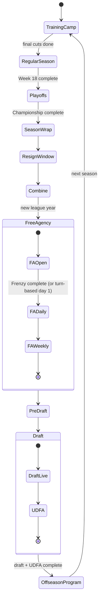

# Calendar, Phases & the Advance Flow

> **Status:** Proposed · 2026-10-13 · Related: [ARCHITECTURE.md §6.6](../ARCHITECTURE.md#66-two-clocks), [LIVE_EVENTS.md](LIVE_EVENTS.md), F-05 in [FEATURES.md](../FEATURES.md)

---

## 1. Concepts

| Term | Meaning |
|---|---|
| **League date** | An in-game `DateOnly`. It moves **only** when the user advances (or AI autoplay does). |
| **League year** | Begins when free agency opens (March), like the real league. Contracts, the cap and "seasons" of experience roll over then. |
| **Season** | The football season labeled by its starting year (the "2027 season" runs Sep 2027 – Feb 2028). |
| **Phase** | A coarse state of the league year (Regular Season, Draft, …). |
| **Stop** | A calendar event the Advance button moves to next (a game week, the FA opening, the draft day, …). |
| **Live event** | A phase step that runs in **wall-clock time** (the draft; later FA Frenzy and Deadline Day). |

---

## 2. The annual calendar

The fictional league mirrors the real one so it feels familiar. Dates are approximate anchors computed per year (e.g., "the first Thursday after Labor Day").

| # | Phase | Anchor (approx.) | Stops inside the phase | Key processing |
|---|---|---|---|---|
| 1 | **Training Camp** | Late July | Camp open → Final cuts | Annual progression applied at camp open, development focus, **cut to 53**, waivers, practice squad. No preseason games ([D-038](../DECISIONS.md#d-038-no-preseason-games-in-10)). |
| 2 | **Regular Season** | Early Sept → early Jan | Weeks 1–18 (17 games + 1 bye) | Weekly: AI prep → sim → stats → injuries → waivers → news. **Trade deadline** after Week 9 (Deadline Day live event later, if built, [D-046](../DECISIONS.md#d-046-live-events-fa-frenzy-committed-deadline-day-conditional)). |
| 3 | **Playoffs** | Mid Jan → early Feb | Wild Card → Divisional → Conference → (bye week) → Championship | 7 seeds per conference, #1 gets a bye, reseeding |
| 4 | **Season Wrap** | Feb | Awards → Retirements → Owner review → (Coaching carousel, M10) | Records, Hall of Fame vote, season-end snapshot. (Play-by-play pruning only if the [D-039](../DECISIONS.md#d-039-play-by-play-is-kept-measure-before-pruning) fallback is switched on.) |
| 5 | **Re-sign & Tag Window** | Late Feb → early Mar | Window open → Tag deadline | Extensions, franchise tags, releases (cap clearing) |
| 6 | **Combine** | Late Feb / early Mar | Combine | Prospect measurables revealed → scouting updates |
| 7 | **Free Agency** | Mid March (**new league year**) | FA open (**FA Frenzy** live event, M9) → Day 2…14 → Weekly | Cap rollover, contract years advance, UFAs hit the market, AI bidding |
| 8 | **Pre-Draft** | Late Mar → April | Pro days → Visits → Final board | Interviews, mock drafts, Big Board finalization |
| 9 | **Draft** | Late April | **The Draft** (live event) → UDFA window | 7 rounds real-time, rookie contracts |
| 10 | **Offseason Program** | May → July | OTAs → Minicamp → Quiet period | Light: holdouts, extensions, late FA signings. One click to camp. |



> **New-league setup:** a new league starts at **Training Camp** with generated rosters and contracts, an already-scouted (generated) draft class for next spring, and fresh schedules. A "Start at offseason" option (begin with free agency and the draft) is a nice-to-have.

---

## 3. The Advance button

The top bar always shows **one primary action** that names the next stop:

| Current state | Button |
|---|---|
| Regular season, before Week 7 games | **Play Week 7 ▶** |
| After Week 18 | **Start Playoffs ▶** |
| Re-sign window | **Advance to Combine ▶** |
| Pre-draft | **Enter the Draft Room ▶** |
| Draft live | *(hidden; the draft drives itself)* |

**Advance options** (dropdown next to the button):
- *Advance to next stop* (default)
- *Sim to end of regular season* / *Sim to trade deadline* / *Sim to playoffs* / *Sim to draft*

**Multi-stop advances stop early** when:
1. a **live event** is reached (always),
2. a **blocking issue** appears (§4),
3. an **important inbox item** arrives (a configurable filter: trade offers, major injuries to starters, owner messages),
4. the user's game is a playoff game (optional setting).

---

## 4. Blocking issues and warnings

Before any advance, the phase handler returns `BlockingIssue[]`:

| Severity | Examples | Behavior |
|---|---|---|
| **Error** (must fix) | Roster over 53 at final cuts · Over the salary cap · Empty required depth chart slot (no QB/K/P) · Fewer than the minimum active players | Advance is disabled. The panel lists the issues with **Fix** links and an **Auto-fix** where safe. |
| **Warning** (can proceed) | An unsigned draft pick · A starter injured and still on the depth chart · Expiring contracts not addressed · A trade offer expiring | Shown in a confirm sheet: "Advance anyway?" |

**Auto-fix** never makes irreversible decisions silently. For example, auto-cut shows the proposed list of players to release and their dead money, and asks for confirmation.

---

## 5. Phase handler design

```csharp
public interface IPhaseHandler
{
    Phase Phase { get; }

    /// Called once when the league enters the phase (inside a write transaction).
    Task OnEnterAsync(PhaseContext ctx, CancellationToken ct);

    /// What stops exist in this phase from the current date.
    IReadOnlyList<CalendarStop> GetStops(PhaseContext ctx);

    /// Validation before leaving the current stop.
    Task<IReadOnlyList<BlockingIssue>> GetBlockingIssuesAsync(PhaseContext ctx, CancellationToken ct);

    /// Executes the work between the current stop and the next, as journaled steps.
    IReadOnlyList<AdvanceStep> PlanAdvance(PhaseContext ctx, CalendarStop from, CalendarStop to);
}

public sealed record AdvanceStep(string Name, Func<StepContext, CancellationToken, Task> Run, bool IsLiveEvent = false);
```

- `CalendarService.AdvanceAsync(target, progress, ct)`: plan the steps → for each step, run it inside `ISaveWriter.ExecuteAsync` → journal it → report progress → stop at live events, blocking issues or interrupts.
- **The AI runs in the same pipeline.** Each relevant step has an "AI teams act" sub-step (re-sign, bid, cut, claim, trade). The AI uses the same commands and validation as the user.

### Example: Play Week 7

| # | Step | Transaction | Notes |
|---|---|---|---|
| 1 | Snapshot `S2027-W07` | — (`VACUUM INTO`) | Off the UI thread |
| 2 | AI pre-game | One per team or batched | Depth charts, game plans, inactive lists |
| 3 | Simulate games | **None** (pure, in memory, parallel) | Deterministic. Re-runnable if a later step fails. |
| 4 | Persist results | **One** | Scores, box scores, player stats (bulk), play logs, injuries, standings |
| 5 | Post-week processing | One | Season aggregates, injury timelines, player grades, records check |
| 6 | Projections | One | News items, inbox messages, awards race |
| 7 | AI post-week | Several | Waiver claims, signings, IR moves, (trade offers to the user) |
| 8 | Advance the date | One | `SaveInfo.CurrentDate = next stop` |

---

## 6. Resumable advance: the step journal

Long advances (a week, an offseason phase with 31 AI teams acting) are split into **committed steps**. Each step's completion is written to `AdvanceJournal` **in the same transaction** as the step's work.

- **Crash mid-advance** → on next open, `CalendarService` sees an operation with an incomplete step and **resumes from the next step**, so no step runs twice.
- **Step 3 (simulate)** is pure and doesn't commit. If the app dies between steps 3 and 4, step 3 runs again on resume and produces **the same results**, because simulation is deterministic and seeded by game ID.
- The UI shows: "Finishing an interrupted advance (Week 7)…".

---

## 7. AI processing schedule

| Phase / stop | AI teams do |
|---|---|
| Training camp | Development focus, depth charts, cut to 53, claim waivers, sign practice squads |
| Each regular-season week | Depth chart, game plan, IR moves, waiver claims, FA fill-ins, trade talks (until the deadline) |
| Trade deadline | Buyer/seller decisions, trades |
| Season wrap | Coaching changes (M10), retirements (players decide) |
| Re-sign window | Extensions, franchise tags, cap-clearing releases |
| Combine / pre-draft | Scouting updates (derived perception), board building |
| Free agency | Bids, signings, priority-based market behavior |
| Draft | Picks and trades (live, through the live event runner) |
| Offseason program | Late signings, extensions |

---

## 8. Calendar edge cases

- **The bye week** gives the user's team no game. "Play Week 9" still sims the rest of the league and shows "Bye week".
- **Ties** are allowed in the regular season (OT rules). Playoffs continue overtime until there's a winner.
- **The championship** is at a neutral site, with a bye week before it.
- **A trade deadline on a bye week** is still keyed to the calendar date, not the team's schedule.
- **Fired mid-season (M10):** the user's career moves to a "between jobs" state. The league continues to advance through AI autoplay until a job offer arrives (an end-of-season interview).
- **Retired player un-retires:** rare event, supported by status transitions.

---

## 9. Testing
- **Phase machine tests:** every transition from every phase, including invalid ones.
- **Journal resume tests:** inject a failure after each step and verify the final state equals an uninterrupted run (using a fixed seed).
- **Calendar generation:** dates are correct for 30 future years (anchors, no overlaps, bye weeks between Weeks 5 and 14).
- **Autoplay:** `simlab autoplay --seasons 30` passes through every phase without user input.
