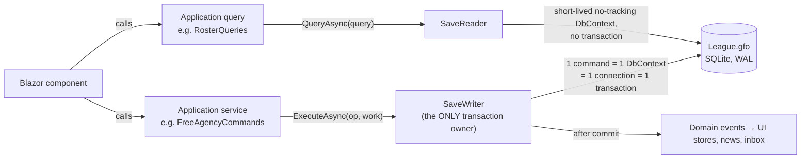

# Data Access Guide: EF Core + SQLite in GFO

> **Status:** Accepted · 2026-10-13 · **Built in M0 WP6 (2026-10-16)** · Decision: [D-024](../DECISIONS.md#d-024-data-access-ef-core-with-the-gfo-unit-of-work) · Background and alternatives: [DATA_ACCESS_OPTIONS.md](DATA_ACCESS_OPTIONS.md)
>
> Owner: *"I think I implemented it wrong, let's be sure to detail and make it clear how to utilize it in this app."*
>
> **This is the how-to.** If you touch the database, read this first. The short version:
>
> **Reads go through `ISaveReader`. Writes go through `ISaveWriter.ExecuteAsync`. Nothing else ever creates a `DbContext`, opens a connection, or starts a transaction.**

---

## 1. The mental model (one picture)



| Concept | What it is | Lifetime |
|---|---|---|
| **Command** | One user or AI action that changes data: sign a player, make a pick, persist a week | One `ExecuteAsync` call |
| **Unit of work (`IUnitOfWork`)** | What a command receives: a tracked `ILeagueDb` bound to the command's transaction, plus a raw-SQL escape hatch and an event sink | Exactly one command |
| **`SaveWriter`** | Serializes commands (one at a time), creates the context, begins, commits or rolls back the transaction, publishes events | Singleton per league session |
| **`SaveReader`** | Runs read-only queries on a fresh no-tracking context | Singleton per league session |
| **`LeagueSession`** | The open save: its path and EF options | From open to close |

**Why it works:** SQLite allows **one writer at a time**. Instead of fighting that with retries and locks, GFO embraces it. All writes queue through one door, so there are no write conflicts, no nested transactions, and no "database is locked".

---

## 2. What probably went wrong before (and the fix for each)

These are the patterns behind nearly every "SQLite transactions don't work in my .NET app" story. If any look familiar, that's the cause.

### ❌ W1: A `DbContext` injected into components or services
```csharp
// WRONG: registered with AddDbContext (scoped). In Blazor Hybrid, "scoped" ≈ the whole app lifetime.
public class RosterService(LeagueDbContext db)
{
    public async Task CutPlayerAsync(int playerId) { /* uses the same long-lived db */ }
}
```
**What happens:** two async UI actions overlap, which causes `A second operation was started on this context instance...`. A failed `SaveChanges` leaves broken entities tracked, so *every later save fails too*. Stale data accumulates.
**✅ Fix:** there is **no** `AddDbContext` in GFO. Contexts are created per command and per query by `SaveWriter`/`SaveReader` and disposed immediately.

### ❌ W2: Expecting several `SaveChanges` calls to be atomic
```csharp
// WRONG: each SaveChanges is its own transaction. A crash or exception between them = half-saved.
player.TeamId = teamId;           await db.SaveChangesAsync();
db.Contracts.Add(contract);       await db.SaveChangesAsync();   // throws → player moved, no contract
```
**✅ Fix:** all work for one action happens inside **one** `ExecuteAsync`. `SaveWriter` wraps it in a single transaction and commits once at the end.

### ❌ W3: Services starting their own transactions
```csharp
// WRONG: SignFreeAgent begins a transaction, then calls CreateContract, which begins another.
using var tx = await db.Database.BeginTransactionAsync();   // in both methods
```
**What happens:** `The connection is already in a transaction and cannot participate in another transaction` (EF), or `SqliteConnection does not support nested transactions` (raw ADO).
**✅ Fix:** only `SaveWriter` begins transactions (it's enforced by an analyzer, see §8). Reusable logic is written as **operations that take the existing `IUnitOfWork`** (§5.3).

### ❌ W4: Raw SQL on a *new* connection while EF has a transaction open
```csharp
// WRONG: a second connection tries to write while EF's transaction holds the write lock.
using var conn = new SqliteConnection(connString);
conn.Open();
new SqliteCommand("INSERT INTO PlayerGameStats ...", conn).ExecuteNonQuery();   // waits → "database is locked"
```
**✅ Fix:** raw SQL goes through `uow.CreateCommand(sql)`, which uses **the same connection and transaction** as EF.

### ❌ W5: Catch-and-continue inside a unit
```csharp
// WRONG: swallow the failure, then commit whatever made it.
try { await db.SaveChangesAsync(); } catch (DbUpdateException) { /* log and move on */ }
await tx.CommitAsync();
```
**✅ Fix:** inside a command, **never catch persistence exceptions**. Let them bubble up. `SaveWriter` rolls back everything. For *expected* failures (over the cap, roster full), return `Result.Fail(...)` and `SaveWriter` rolls back too.

### ❌ W6: Fire-and-forget writes and `async void`
```csharp
// WRONG: not awaited. Overlaps with the next action, and exceptions vanish.
_ = rosterService.CutPlayerAsync(id);
async void OnClick() { await rosterService.CutPlayerAsync(id); }   // exceptions crash or disappear
```
**✅ Fix:** always `await`. Blazor handlers return `Task` (`@onclick="CutAsync"` with `private async Task CutAsync()`). `SaveWriter` serializes commands anyway, but awaiting gives you the result and the error.

### ❌ W7: Default journal mode plus a lingering reader
In SQLite's default (rollback journal) mode, an open `DataReader` or read transaction **blocks writers**.
**✅ Fix:** GFO saves are created in **WAL** mode (readers never block the writer), and readers are always disposed (`SaveReader` owns their lifetime).

---

## 3. The building blocks (the code you'll write once, in M0)

> **As built (M0 WP6).** The code below is the design; the shipped versions follow it closely. Where they differ, the notes in each section say so.
>
> | Where | What |
> |---|---|
> | `Core/Results/Result.cs` | `Result<T>`, `Result.Ok`/`Result.Fail`, `DomainError(Code, Message)`, `Unit` |
> | `Core/Ids/IStronglyTypedId.cs`, `Core/Leagues/SaveInfo.cs` | The typed-ID marker; the `SaveInfo` entity and the creation-setting enums |
> | `Application/Data/DataContracts.cs` | `ILeagueDb`, `ILeagueReadDb`, `IUnitOfWork`, `ISaveWriter`, `ISaveReader`, `IDomainEvent`, `IDomainEventDispatcher` |
> | `Application/Saves/ISaveManager.cs` | `ISaveManager`, `OpenSave`, `SaveOpened`/`SaveClosed`, `SaveErrors` |
> | `Infrastructure/Data/` | `LeagueDbContext`, `Configurations/`, `TypedIds`, `LeagueSession` + accessor + `SqlitePragmaInterceptor`, `SaveWriter` + `UnitOfWork` + `SaveReader`, `DomainEventDispatcher`, `DataLog`, `Migrations/` |
> | `Infrastructure/Saves/` | `SaveManager`, `SqliteFile` (the format check, creation pragmas, `VACUUM INTO`, checkpoint and release) |
> | `Infrastructure/InfrastructureServices.cs` | `AddGfoInfrastructure(paths, app)` |

### 3.1 Projects and references
| Project | References | Contains |
|---|---|---|
| `GridironFrontOffice.Core` | nothing | Entities (POCOs), value objects, pure rules |
| `GridironFrontOffice.Application` | Core, Simulation, **`Microsoft.EntityFrameworkCore`** (no provider) | `ILeagueDb`, `ILeagueReadDb`, `IUnitOfWork`, `ISaveWriter`, `ISaveReader`, `Result<T>`, commands, queries, operations |
| `GridironFrontOffice.Infrastructure` | Application, `Microsoft.EntityFrameworkCore.Sqlite`, `Microsoft.Data.Sqlite` | `LeagueDbContext`, Fluent API configurations, migrations, `SaveWriter`, `SaveReader`, `UnitOfWork`, pragma interceptor, `SaveManager` |
| `GridironFrontOffice.UI` | Application | Calls commands and queries. **No EF reference at all.** |

> Why Application references EF Core: so commands can use LINQ and `DbSet<T>` directly, without a hand-written repository layer (the biggest boilerplate trap for solo projects). The *provider* (SQLite) and all transaction control stay in Infrastructure.

### 3.2 Application-side contracts

```csharp
// GridironFrontOffice.Application/Data/ILeagueDb.cs: tracked access, only ever handed out inside a command
public interface ILeagueDb
{
    DbSet<Player> Players { get; }
    DbSet<Contract> Contracts { get; }
    DbSet<ContractYear> ContractYears { get; }
    DbSet<DraftPick> DraftPicks { get; }
    DbSet<TransactionLogEntry> TransactionLog { get; }
    // … one DbSet per aggregate
    Task<int> SaveChangesAsync(CancellationToken ct = default);   // optional mid-command flush (e.g., to get generated IDs)
}

// GridironFrontOffice.Application/Data/ILeagueReadDb.cs: no-tracking queryables for screens and AI snapshots
public interface ILeagueReadDb
{
    IQueryable<Player> Players { get; }
    IQueryable<Contract> Contracts { get; }
    // …
}

// GridironFrontOffice.Application/Data/IUnitOfWork.cs
public interface IUnitOfWork
{
    ILeagueDb Db { get; }                         // bound to THIS command's transaction
    DbCommand CreateCommand(string sql);          // raw SQL on the SAME connection + transaction (hot paths only)
    void Raise(IDomainEvent domainEvent);         // delivered only if the command commits
}

// GridironFrontOffice.Application/Data/ISaveWriter.cs
public interface ISaveWriter
{
    Task<Result<T>> ExecuteAsync<T>(string operation,
        Func<IUnitOfWork, CancellationToken, Task<Result<T>>> work,
        CancellationToken ct = default);
}

// GridironFrontOffice.Application/Data/ISaveReader.cs
public interface ISaveReader
{
    Task<T> QueryAsync<T>(Func<ILeagueReadDb, CancellationToken, Task<T>> query,
        CancellationToken ct = default);
}
```

`Result<T>` is a small in-house type in Core: `Result.Ok(value)`, `Result.Ok()` for `Result<Unit>`, or `Result.Fail<T>(new DomainError("OverCap", "…"))`. Features keep their errors as factories (e.g. `SaveErrors.NotFound(file)`). **Expected business failures are results, not exceptions.** Reading `.Value` from a failed result throws, because that's a bug.

**In M0, `ILeagueDb`/`ILeagueReadDb` expose only `SaveInfo`.** Each feature adds its own sets.

### 3.3 Infrastructure: the context and the session

```csharp
// GridironFrontOffice.Infrastructure/Data/LeagueDbContext.cs
internal sealed class LeagueDbContext(DbContextOptions<LeagueDbContext> options)
    : DbContext(options), ILeagueDb, ILeagueReadDb
{
    public DbSet<Player> Players => Set<Player>();
    public DbSet<Contract> Contracts => Set<Contract>();
    // …
    IQueryable<Player> ILeagueReadDb.Players => Players;     // read side: tracking is off at the context level
    IQueryable<Contract> ILeagueReadDb.Contracts => Contracts;

    protected override void OnModelCreating(ModelBuilder b) =>
        b.ApplyConfigurationsFromAssembly(typeof(LeagueDbContext).Assembly);   // Fluent API keeps Core EF-free
}

// Built once when a save is opened (SaveManager.OpenAsync), dropped when it's closed.
internal sealed class LeagueSession
{
    public required string SavePath { get; init; }
    public required DbContextOptions<LeagueDbContext> Options { get; init; }

    public static LeagueSession Open(string path, SqlitePragmaInterceptor pragmas) => new()
    {
        SavePath = path,
        Options = new DbContextOptionsBuilder<LeagueDbContext>()
            .UseSqlite($"Data Source={path};Mode=ReadWrite;Foreign Keys=True;Pooling=True")
            .AddInterceptors(pragmas)      // PRAGMA synchronous=NORMAL, temp_store, cache_size, busy_timeout on each open
            .Options
    };
}
```

> **No `AddDbContext` or `AddDbContextFactory` in DI.** The save file changes when the user loads a different league, so the options live on the `LeagueSession`. EF caches the *model* per context type, so building a context per command is cheap, and Microsoft.Data.Sqlite pools the connections.

**As built:**
- **The session accessor is Infrastructure-internal.** It holds EF types, so Application can't see it. `LeagueSessionAccessor` throws "No save is open" when the data layer is used at the main menu. Application code that needs to know *which* save is open reads `ISaveManager.Current`.
- **The session's connection uses `Mode=ReadWrite`, not `ReadWriteCreate`.** A save that vanished must fail rather than reappear empty. Only `SaveManager` creates files.
- **Enums are stored by name:** `configurationBuilder.Properties<Enum>().HaveConversion<string>()`. Reordering an enum can never change what an existing save means.

**Strongly typed IDs (D-015), as proven in Spike S0a.** One converter for every ID type, plus one convention the provider doesn't apply by itself:

```csharp
// In LeagueDbContext
protected override void ConfigureConventions(ModelConfigurationBuilder b)
{
    foreach (var idType in IdTypes)   // every readonly record struct implementing IStronglyTypedId
        b.Properties(idType).HaveConversion(typeof(IdConverter<>).MakeGenericType(idType));
}

// At the end of OnModelCreating: EF's SQLite convention adds AUTOINCREMENT only to plain int keys.
// A converted (typed-ID) key gets a bare INTEGER PRIMARY KEY, and SQLite may then REUSE the highest ID after a
// delete, while IDs are referenced from history. EF Core 10 ignores the old "Sqlite:Autoincrement" annotation,
// so use the value-generation strategy API:
foreach (var (entity, key) in GeneratedTypedIdKeys(modelBuilder))
    modelBuilder.Entity(entity.ClrType).Property(key.Name).UseAutoincrement();
```

### 3.4 Infrastructure: `SaveWriter` (the only transaction owner)

```csharp
// GridironFrontOffice.Infrastructure/Data/SaveWriter.cs
internal sealed class SaveWriter(ILeagueSessionAccessor sessions, IDomainEventDispatcher events,
                                 ILogger<SaveWriter> log) : ISaveWriter
{
    private readonly SemaphoreSlim _gate = new(1, 1);              // ONE writer at a time
    private static readonly AsyncLocal<bool> InCommand = new();     // detects nested ExecuteAsync

    public async Task<Result<T>> ExecuteAsync<T>(string operation,
        Func<IUnitOfWork, CancellationToken, Task<Result<T>>> work, CancellationToken ct = default)
    {
        if (InCommand.Value)
            throw new InvalidOperationException(
                $"Nested ISaveWriter.ExecuteAsync ('{operation}'). Compose with the existing IUnitOfWork instead.");

        await _gate.WaitAsync(ct);
        InCommand.Value = true;
        var started = Stopwatch.GetTimestamp();
        try
        {
            await using var db = new LeagueDbContext(sessions.Current.Options);
#pragma warning disable RS0030 // Banned API: SaveWriter is the one allowed place to begin transactions.
            await using var tx = await db.Database.BeginTransactionAsync(ct);
#pragma warning restore RS0030
            var uow = new UnitOfWork(db);
            try
            {
                var result = await work(uow, ct);

                if (result.IsFailure)                                // expected business failure
                {
                    await tx.RollbackAsync(CancellationToken.None);  // nothing persisted
                    log.LogInformation("{Operation} rejected: {Error}", operation, result.Error);
                    return result;
                }

                await db.SaveChangesAsync(ct);                       // flush anything still pending
                await db.Database.ExecuteSqlRawAsync(                // save generation (D-026 groundwork)
                    "UPDATE SaveInfo SET Generation = Generation + 1", ct);
                await tx.CommitAsync(CancellationToken.None);        // ← the ONLY commit in the codebase
                log.LogInformation("{Operation} committed in {ElapsedMs:F0} ms", operation,
                    Stopwatch.GetElapsedTime(started).TotalMilliseconds);

                events.Dispatch(uow.RaisedEvents);                   // after commit only
                return result;
            }
            catch (Exception ex)
            {
                await tx.RollbackAsync(CancellationToken.None);      // unexpected failure: undo everything
                log.LogError(ex, "{Operation} rolled back", operation);
                throw;
            }
        }
        finally
        {
            InCommand.Value = false;
            _gate.Release();
        }
    }
}
```

> Commit and rollback deliberately use `CancellationToken.None`. Once the work is done, we don't want a cancellation to leave the transaction half-handled.

**As built, `SaveWriter` differs from the sketch in five ways:**
1. **Events are dispatched after the commit *and* after the gate is released.** A subscriber may start a new command, and that isn't "nested" (tested).
2. **Logging stays quiet for routine commits, so the log stays under 1 MB/hour even during a live draft:**
   - commits at **Debug** (2000);
   - rejections (`Result.Fail`) at Information (2001);
   - rollbacks after an exception at Error (2002);
   - any command over **1 s** at Warning (2003).
3. **A failed rollback is logged (2004) and never hides the original exception.**
4. **`ConfigureAwait(false)` throughout Infrastructure.** Event handlers run on the thread that finished the command, not the UI thread, so a Blazor store marshals with `InvokeAsync`.
5. **`RunExclusiveAsync`** (internal) lets `SaveManager` swap or release the session while no command can run. It waits for the running command first.

### 3.5 Infrastructure: `UnitOfWork` and `SaveReader`

```csharp
internal sealed class UnitOfWork(LeagueDbContext db) : IUnitOfWork
{
    private readonly List<IDomainEvent> _events = [];
    public ILeagueDb Db => db;
    public IReadOnlyList<IDomainEvent> RaisedEvents => _events;
    public void Raise(IDomainEvent e) => _events.Add(e);

    public DbCommand CreateCommand(string sql)
    {
        var cmd = db.Database.GetDbConnection().CreateCommand();
        cmd.Transaction = db.Database.CurrentTransaction!.GetDbTransaction();   // same transaction, always
        cmd.CommandText = sql;
        return cmd;
    }
}

internal sealed class SaveReader(ILeagueSessionAccessor sessions) : ISaveReader
{
    public async Task<T> QueryAsync<T>(Func<ILeagueReadDb, CancellationToken, Task<T>> query,
        CancellationToken ct = default)
    {
        await using var db = new LeagueDbContext(sessions.Current.Options);
        db.ChangeTracker.QueryTrackingBehavior = QueryTrackingBehavior.NoTracking;
        return await query(db, ct);           // WAL: runs alongside a writer without blocking it
    }
}
```

### 3.6 DI registration

```csharp
// GridironFrontOffice.Infrastructure/InfrastructureServices.cs (as built). Both hosts call it.
services.AddGfoInfrastructure(paths, app);   // app: the AppIdentity, stamped into SaveInfo's app versions
// Registers: IAppPaths, AppIdentity, TimeProvider (TryAdd), SqlitePragmaInterceptor, LeagueSessionAccessor,
// DomainEventDispatcher/IDomainEventDispatcher, SaveWriter/ISaveWriter, ISaveReader, SaveManager/ISaveManager.
// Deliberately absent: AddDbContext<…>, AddDbContextFactory<…> (a test checks the container).
```

---

## 4. Reading data (screens, AI snapshots)

```csharp
// GridironFrontOffice.Application/Rosters/RosterQueries.cs
public sealed class RosterQueries(ISaveReader reader)
{
    public Task<IReadOnlyList<RosterRow>> GetRosterAsync(TeamId teamId, int season, CancellationToken ct = default) =>
        reader.QueryAsync<IReadOnlyList<RosterRow>>(async (db, ct) =>
            await db.Players
                .Where(p => p.TeamId == teamId && p.Status == PlayerStatus.Active)
                .OrderBy(p => p.Position).ThenByDescending(p => p.Overall)
                .Select(p => new RosterRow(                       // project to a DTO, never return entities
                    p.Id, p.FirstName + " " + p.LastName, p.Position, p.BirthDate, p.Overall,
                    p.Contracts.Where(c => c.IsActive)
                               .SelectMany(c => c.Years)
                               .Where(y => y.Season == season)
                               .Select(y => y.CapHit).FirstOrDefault(),
                    p.Injuries.Any(i => i.ActualReturn == null)))
                .ToListAsync(ct), ct);
}
```
**Rules for reads**
- Always **project to a DTO** (`Select(new …)`). The UI never sees entities.
- Never call `SaveChangesAsync` from a reader. The read interface doesn't even expose it.
- Reads can run while a write is in progress (WAL). They see the last *committed* state.

---

## 5. Writing data: the patterns

### 5.1 A simple command
```csharp
// GridironFrontOffice.Application/DepthCharts/DepthChartCommands.cs
public sealed class DepthChartCommands(ISaveWriter writer)
{
    public Task<Result<Unit>> SetStarterAsync(TeamId team, DepthSlot slot, PlayerId player, CancellationToken ct = default) =>
        writer.ExecuteAsync("DepthChart.SetStarter", async (uow, ct) =>
        {
            var entry = await uow.Db.DepthChartSlots.SingleAsync(s => s.TeamId == team && s.Slot == slot && s.Order == 1, ct);
            entry.PlayerId = player;                       // tracked change; SaveWriter saves + commits
            uow.Raise(new DepthChartChanged(team));
            return Result.Ok(Unit.Value);
        }, ct);
}
```

### 5.2 A multi-table command with a business rule (all-or-nothing)
```csharp
// GridironFrontOffice.Application/FreeAgency/FreeAgencyCommands.cs
public Task<Result<ContractId>> SignAsync(SignFreeAgent cmd, CancellationToken ct = default) =>
    writer.ExecuteAsync("FreeAgency.Sign", async (uow, ct) =>
    {
        var player = await uow.Db.Players.SingleAsync(p => p.Id == cmd.PlayerId, ct);
        if (player.Status != PlayerStatus.FreeAgent)
            return Result.Fail<ContractId>(DomainError.NotAFreeAgent(player.Id));

        var capSpace = await CapOperations.CapSpaceAsync(uow, cmd.TeamId, cmd.Season, ct);
        if (cmd.Offer.CapHitFor(cmd.Season) > capSpace)
            return Result.Fail<ContractId>(DomainError.OverCap(cmd.TeamId));   // → SaveWriter rolls back

        player.TeamId = cmd.TeamId;
        player.Status = PlayerStatus.Active;
        var contract = await ContractOperations.CreateAsync(uow, player, cmd.TeamId, cmd.Offer, ct);
        TransactionLogOperations.Append(uow, TransactionKind.Signing, cmd.TeamId, player.Id);

        uow.Raise(new PlayerSigned(player.Id, cmd.TeamId, contract.Id));
        return Result.Ok(contract.Id);
    }, ct);
```
If *anything* fails (a `Fail` result or an exception), **nothing** above is persisted: not the team change, not the contract, not the log entry.

### 5.3 Reusing logic across commands: operations, not nested commands
Signing a free agent, re-signing, rookie contracts and trades all create contracts. Put shared logic in **operations**: static or injected helpers that take the **existing** `IUnitOfWork`.

```csharp
// GridironFrontOffice.Application/Contracts/ContractOperations.cs
internal static class ContractOperations
{
    public static async Task<Contract> CreateAsync(IUnitOfWork uow, Player player, TeamId team,
                                                   ContractOffer offer, CancellationToken ct)
    {
        var contract = Contract.From(player.Id, team, offer);        // pure Core logic builds years + cap hits
        uow.Db.Contracts.Add(contract);
        await uow.Db.SaveChangesAsync(ct);                            // OK: flush to get contract.Id; same transaction
        return contract;
    }
}
```

| ✅ Do | ❌ Don't |
|---|---|
| Call `ContractOperations.CreateAsync(uow, …)` from inside a command | Call `contractCommands.CreateAsync(…)` (another `ExecuteAsync`) from inside a command. It **throws** "Nested ISaveWriter.ExecuteAsync". It would deadlock on the single-writer gate otherwise. |
| Call `uow.Db.SaveChangesAsync()` mid-command when you need generated IDs | Call `BeginTransaction` anywhere (banned) |

> Calling `SaveChangesAsync` inside a command is safe. EF sees the command's transaction is already open, so the changes stay uncommitted until `SaveWriter` commits. (EF also takes an automatic savepoint around each `SaveChanges` inside an existing transaction. Don't rely on it. A failure still aborts the whole command.)

### 5.4 Bulk writes (hot paths)
Change tracking is too slow for ~26k stat rows per week. Use the raw-SQL escape hatch. It's still the same connection and the same transaction.

```csharp
// GridironFrontOffice.Application/Season/GameResultWriter.cs (called inside the "Season.PersistWeek" command)
internal static async Task InsertPlayerStatsAsync(IUnitOfWork uow, IReadOnlyList<PlayerGameStatLine> lines, CancellationToken ct)
{
    await using var cmd = uow.CreateCommand(
        "INSERT INTO PlayerGameStats (GameId, PlayerId, TeamId, PassAtt, PassCmp, PassYds /* … */) " +
        "VALUES ($game, $player, $team, $att, $cmp, $yds /* … */)");
    DbParameter Param(string name) { var p = cmd.CreateParameter(); p.ParameterName = name; cmd.Parameters.Add(p); return p; }
    var pGame = Param("$game"); var pPlayer = Param("$player"); /* … */
    cmd.Prepare();                                         // compile once, execute many
    foreach (var l in lines)
    {
        pGame.Value = l.GameId; pPlayer.Value = l.PlayerId; /* … */
        await cmd.ExecuteNonQueryAsync(ct);
    }
}
```
> **What counts as a bulk path (measured in Spike S0a):** EF change tracking costs about **100 µs per inserted entity** (a 10,500-entity league seed took 1.1 s warm), while raw prepared statements cost about **3 µs per row**. So stats, play logs, **league generation and yearly draft classes** all use `uow.CreateCommand`. Awaiting `ExecuteNonQueryAsync` per row costs within about 12% of the sync call, so keep the async form; no analyzer suppression is needed.

> Mixing EF changes and raw SQL in one command is fine and atomic. Both use the same transaction. The only rule is to call `uow.Db.SaveChangesAsync()` *before* raw SQL that depends on rows EF hasn't flushed yet.

### 5.5 Live events: commands that can race
Real-time commands carry the **version** they expect, and the check happens **inside** the transaction:

```csharp
public Task<Result<Unit>> MakePickAsync(int pickNo, long expectedVersion, PlayerId playerId, bool isAuto, CancellationToken ct = default) =>
    writer.ExecuteAsync("Draft.MakePick", async (uow, ct) =>
    {
        var state = await uow.Db.DraftState.SingleAsync(ct);
        if (state.CurrentPick != pickNo || state.Version != expectedVersion)
            return Result.Fail<Unit>(DomainError.PickAlreadyMade(pickNo));   // the other command won the race

        /* … select the player, write the pick, rookie contract via ContractOperations … */
        state.CurrentPick++;
        state.Version++;
        return Result.Ok(Unit.Value);
    }, ct);
```
The user's "Send it in" and the clock's auto-pick both call this. The single writer runs them one after the other. The second sees the bumped version and returns `PickAlreadyMade`. **No double pick, ever.**

### 5.6 Long operations: many short commands
"Play Week 7" is **not** one giant transaction. It's a sequence of commands, each recorded in the step journal ([CALENDAR_AND_PHASES.md §6](CALENDAR_AND_PHASES.md#6-resumable-advance-the-step-journal)):

```csharp
await writer.ExecuteAsync("Week7.AiPregame",  (uow, ct) => AiPregame.RunAsync(uow, week, ct), ct);
var results = await simulator.SimulateWeekAsync(inputs, ct);              // pure, in memory, NOT in a transaction
await writer.ExecuteAsync("Week7.PersistResults", (uow, ct) => GameResultWriter.PersistAsync(uow, results, ct), ct);
await writer.ExecuteAsync("Week7.PostWeek", (uow, ct) => PostWeek.RunAsync(uow, week, ct), ct);
```
Each step commits on its own and records itself in `AdvanceJournal` *in the same transaction*. A crash resumes at the next step.

### 5.7 Calling commands from the UI
```razor
@inject FreeAgencyCommands FreeAgency
@inject IGfoToasts Toasts

<FluentButton OnClick="SignAsync" Loading="@_busy">Sign</FluentButton>

@code {
    bool _busy;
    async Task SignAsync()                                  // Task, never async void
    {
        _busy = true;
        var result = await FreeAgency.SignAsync(new SignFreeAgent(/* … */));
        _busy = false;
        if (result.IsFailure) await Toasts.ShowErrorAsync(result.Error.Message);   // e.g., "Over the cap by $2.1M"
        // On success, no manual refresh: the PlayerSigned event updates the stores.
    }
}
```
(`FluentButton.Loading` was verified in Spike S0b. `IGfoToasts` is GFO's thin service over Fluent's `INotificationService.ShowToastAsync`, see [UI_DESIGN_SYSTEM.md §5.1](UI_DESIGN_SYSTEM.md#51-from-fluent-ui-blazor-v5-use-directly-in-pages).)

---

## 6. Do and don't (the cheat sheet)

| ✅ Do | ❌ Don't |
|---|---|
| One user or AI action = one `ExecuteAsync` | Spread one action across several `ExecuteAsync` calls and hope |
| Return `Result.Fail` for business rule failures | Throw for business rules, or catch-and-continue on persistence errors |
| Share logic through operations that take `IUnitOfWork` | Call a command from inside a command |
| Raw SQL via `uow.CreateCommand` | `new SqliteConnection(...)` anywhere outside Infrastructure |
| Project reads to DTOs through `ISaveReader` | Return tracked entities to the UI, or keep them in component state |
| `await` every command. Blazor handlers return `Task`. | `_ = DoAsync()`, `async void`, `.Result`, `.Wait()` |
| Keep commands short. Long work is journaled steps. | Run the simulator or AI thinking *inside* a write transaction |
| Snapshot and export with `VACUUM INTO` | Copy a live `.gfo` file |

---

## 7. Troubleshooting: error message → cause → fix

| Error | Cause | Fix |
|---|---|---|
| `SQLite Error 5: 'database is locked'` | A second connection is writing, or a reader is open in non-WAL mode | Use `ISaveWriter` (single writer). Confirm `journal_mode=wal`. Dispose readers. |
| `The connection is already in a transaction and cannot participate in another transaction` | `BeginTransaction` called inside a command | Remove it. `SaveWriter` already owns the transaction. |
| `SqliteConnection does not support nested transactions` | Raw ADO `BeginTransaction` inside an open transaction | Same as above |
| `Execute requires the command to have a transaction object…` | A raw command was created without the transaction | Use `uow.CreateCommand(sql)` |
| `A second operation was started on this context instance…` | A shared or long-lived `DbContext` | Never inject a context. Use commands and queries only. |
| `The instance of entity type 'X' cannot be tracked because another instance with the key value … is already being tracked` | A long-lived context, or attaching entities that came from a read | Load inside the command. Don't reuse entities across commands. |
| `Nested ISaveWriter.ExecuteAsync ('…')` (ours) | A command called another command | Extract an operation that takes `IUnitOfWork` |
| Data "half saved" | Work split across commands, or an exception swallowed | One action = one command. Never catch persistence exceptions inside one. |

---

## 8. How the rules are enforced (so you can't do it wrong by accident)

| Guard | Mechanism |
|---|---|
| No `BeginTransaction`, `UseTransaction` or `TransactionScope` outside `SaveWriter` | **BannedApiAnalyzers** (`BannedSymbols.txt`, diagnostic `RS0030` as an error). `SaveWriter` alone suppresses it, with a justification comment. |
| No `new SqliteConnection` outside Infrastructure | Banned API in Application, UI and Core |
| UI can't touch EF | Architecture test: `GridironFrontOffice.UI` has no reference to `Microsoft.EntityFrameworkCore` |
| No context in DI | Architecture test: no type registered as `DbContext`. No constructor anywhere takes `LeagueDbContext` except Infrastructure internals. |
| No nested commands | `SaveWriter` throws (an `AsyncLocal` flag) |
| No `async void` | Analyzer (e.g., VSTHRD100 from Microsoft.VisualStudio.Threading.Analyzers, MIT) |

The real lists are `build/BannedSymbols.Transactions.txt` (every project) and `build/BannedSymbols.RawSqlite.txt` (every project except Infrastructure), proven to fail the build in M0 WP1. Excerpt (each overload listed in documentation-ID format):
```
M:Microsoft.EntityFrameworkCore.Infrastructure.DatabaseFacade.BeginTransaction;Only SaveWriter begins transactions (see DATA_ACCESS_GUIDE.md)
M:Microsoft.EntityFrameworkCore.Infrastructure.DatabaseFacade.BeginTransactionAsync(System.Threading.CancellationToken);Only SaveWriter begins transactions
T:System.Transactions.TransactionScope;Explicit transactions only, via ISaveWriter
M:System.Data.Common.DbConnection.BeginTransaction;Only SaveWriter begins transactions
M:Microsoft.Data.Sqlite.SqliteConnection.#ctor(System.String);Use ISaveWriter / ISaveReader
```

---

## 9. Proving it: the torture tests (M0, run on every build)

**As built** (`tests/Infrastructure.Tests/Data/`, about 3.5 s in total, and stable over repeated runs). Each test runs against a real save created through `ISaveManager` in a temp folder, and reads the file back through its own connection rather than trusting the code under test.

- **`TransactionTortureTests` (9):**
  - an exception midway persists nothing;
  - a domain failure persists nothing;
  - EF + raw SQL commit together;
  - a read during an open write isn't blocked and sees the last commit;
  - the transaction holds the write lock from `BEGIN`;
  - a nested command throws and releases the gate;
  - 50 concurrent read-modify-write commands lose no update;
  - racing versioned commands record exactly one;
  - events arrive only after a commit, and a subscriber can start a command.
- **`SaveManagerTests` (13):**
  - a new save is WAL, signed `GFO1`, with `user_version` and its `SaveInfo` row;
  - names are validated, and file names never collide;
  - close releases the file and records the session;
  - a closed save reopens;
  - opening another save closes the current one first;
  - refusals: a missing file, a file that isn't SQLite, another app's database, a damaged save, a save from a newer app (released afterwards);
  - with no save open, the data layer says so;
  - **no `DbContext` in DI**;
  - **a process killed mid-command leaves the save intact and unchanged.** The `Infrastructure.Tests.Crasher` inserts 50,000 rows inside one command, is killed, and the file then passes `integrity_check`, has zero rows added, and still opens.
- **`TypedIdConventionTests` (2):** a generated typed-ID key is an `AUTOINCREMENT` integer, and a deleted top ID is never reused.
- **Not yet:** upgrading an older save. There's only one migration, so the test lands with the first real schema change in M1 (and the fixture saves at release time, PERSISTENCE.md §7).

The original sketch:

```csharp
public sealed class TransactionTortureTests : IAsyncLifetime   // each test gets a fresh temp .gfo
{
    [Fact] public async Task Exception_midway_persists_nothing()
    {
        await Assert.ThrowsAsync<InvalidOperationException>(() => _writer.ExecuteAsync<Unit>("t", async (uow, ct) =>
        {
            uow.Db.Players.Add(TestData.Player("A"));
            await uow.Db.SaveChangesAsync(ct);                 // flushed, but not committed
            throw new InvalidOperationException("boom");
        }));
        (await CountPlayers()).ShouldBe(0);
    }

    [Fact] public async Task Domain_failure_persists_nothing() { /* Result.Fail after changes → count unchanged */ }
    [Fact] public async Task Ef_and_raw_sql_in_one_command_are_atomic() { /* add entity + raw INSERT, then fail → neither exists */ }
    [Fact] public async Task Reader_during_write_does_not_lock() { /* hold an open read while a long write commits */ }
    [Fact] public async Task Nested_execute_throws_instead_of_deadlocking() { /* inner ExecuteAsync → InvalidOperationException */ }
    [Fact] public async Task Concurrent_commands_are_serialized() { /* 50 parallel increments → final value 50 */ }
    [Fact] public async Task Racing_picks_record_exactly_one() { /* two MakePickAsync with the same version → one Ok, one PickAlreadyMade */ }
    [Fact] public async Task Transaction_holds_the_write_lock_from_begin() { /* hold a command open without writing → a second BEGIN IMMEDIATE gets SQLITE_BUSY (S0a: confirmed) */ }

    [Fact] public async Task Killed_process_leaves_no_partial_write()
    {
        // GridironFrontOffice.Infrastructure.Tests.Crasher (tiny console app): opens the save, starts ExecuteAsync inserting 100k rows,
        // prints "WRITING" mid-command, then keeps going. The test waits for "WRITING", calls Process.Kill(), reopens:
        //   PRAGMA integrity_check == "ok", and row count == count before the command.
    }
}
```

---

## 10. Code review checklist (run through it before committing data changes)

- [ ] Every mutation is inside exactly one `ISaveWriter.ExecuteAsync`
- [ ] No `DbContext`, connection or transaction created or injected outside Infrastructure
- [ ] Business rule failures return `Result.Fail`. Nothing catches persistence exceptions inside a command.
- [ ] Shared logic is an operation taking `IUnitOfWork`. No command calls another command.
- [ ] Reads project to DTOs through `ISaveReader`
- [ ] No simulation, AI deliberation or I/O wait inside a write transaction
- [ ] Every async call is awaited. No `async void`.
- [ ] Bulk inserts use `uow.CreateCommand` with prepared parameters
- [ ] Domain events raised with `uow.Raise` (never dispatched manually)
- [ ] New schema → a migration plus an updated fixture save (at release time)
