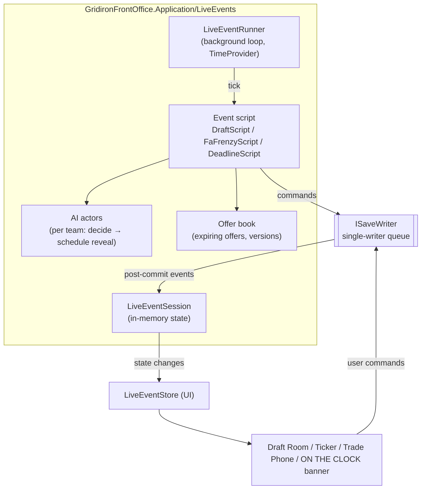
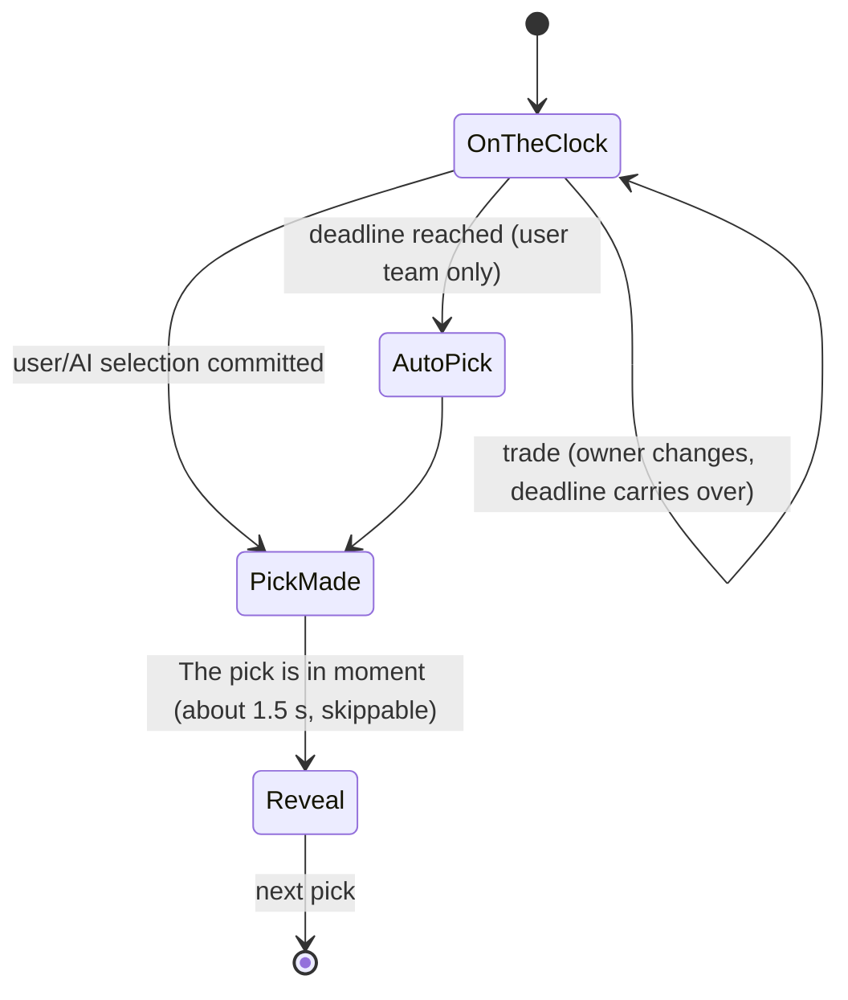

# Live Events: the Real-Time Engine

> **Status:** Proposed · 2026-10-13 · Related: [D-010](../DECISIONS.md#d-010-draft-clock-ai-picks-fast-users-clock-real), [STANDOUT_FEATURES.md §1](../STANDOUT_FEATURES.md#1-the-real-time-draft-the-clock-never-stops), [§B](../STANDOUT_FEATURES.md#b-live-events-the-draft-engine-reused)
>
> The draft is the first live event (M6). The same engine powers FA Frenzy and Trade Deadline Day later (M9).

---

## 1. The rules the engine enforces

1. **Clock mode is a per-save setting** ([D-022](../DECISIONS.md#d-022-clock-mode-is-a-per-save-setting-live--pausable)). In **Live** mode (the default), time can be accelerated, never paused. In **Pausable** mode, the user can pause the whole event (§5.1).
2. The **user's clock always runs at 1×** in real wall-clock time while the event is running.
3. **AI deliberation delays** scale with the acceleration setting (1×/2×/4×).
4. Every state change is a **committed command** through the single-writer queue.
5. **Restore, duplicate, export and calendar advance are disabled** while an event is running.
6. A crash or close **never costs the user an action they didn't take**. The event resumes where it left off ([Q-08](../OPEN_QUESTIONS.md#q-08-app-closed-while-on-the-clock)).

---

## 2. Components

| Component | Responsibility |
|---|---|
| `LiveEventRunner` | Owns the loop: `PeriodicTimer(TimeSpan.FromMilliseconds(100), timeProvider)`. Each tick, computes `now` and calls `script.OnTickAsync(now)`. Starts, stops and resumes. |
| `LiveEventSession` | The authoritative in-memory state: current step (e.g., pick #), whose turn it is, the **deadline** (monotonic timestamp), pending AI reveals, offers. It's rebuilt from the database on resume. |
| `IEventScript` | Event-specific rules. `DraftScript`: on-the-clock rotation, expiry → auto-pick, trade handling. |
| AI actors | Decide immediately (< 200 ms) on a background task, then **schedule the reveal** at `now + deliberationDelay / acceleration`. |
| Offer book | Expiring offers with an `OfferId` and a `Version`. Accept and expire race through the writer. |
| `LiveEventStore` (UI) | Holds a UI-friendly projection. It pushes changes to components on events only, never on every tick. |

---

## 3. Time handling

- **Authoritative time comes from `TimeProvider.GetTimestamp()`** (monotonic). Wall-clock UTC is used only for logging and persistence.
- **The deadline model:** when the user goes on the clock, `deadline = now + clockLength`. Remaining time is `deadline - now`. There's no "decrement every tick", which avoids drift.
- **Expiry check:** each 100 ms tick, `if (now >= deadline && !session.PickMade) → enqueue AutoPick(pickNo, version)`.
- **UI rendering:** the server sends the deadline (as remaining milliseconds at a known instant). The `DraftClock` component animates the countdown **client-side** (`requestAnimationFrame` in a tiny JS module, or a CSS animation keyed on duration). Blazor doesn't re-render 10 times a second. The display re-syncs on every state push.
- **Final 10 seconds:** a visual escalation and an optional tick sound. Both are client-side.
- **System sleep or suspend:** if two consecutive ticks are more than 5 s apart, the gap is treated as a suspension. Only 1 s of the gap is charged to the clock and an Information log is written. *(This means sleeping the PC is effectively a pause. That's accepted as harmless. The alternative of auto-picking after a laptop lid closes would feel unfair.)*

---

## 4. Race conditions and how they resolve

Every mutating command carries the **expected version** of what it acts on. Version checks happen **inside** the write transaction.

| Race | Resolution |
|---|---|
| User sends in the pick at 0:00.05; the expiry auto-pick fires at 0:00.00 | Both commands carry `PickNo = 15`, `Version = v`. Whichever is dequeued first commits and bumps the version. The second fails with `PickAlreadyMade`. The UI shows the actual result ("Auto-pick: R. Mensah"). |
| User accepts a trade offer as it expires | `AcceptOffer(offerId, version)` vs. `ExpireOffer(offerId, version)`: first committed wins. |
| User trades down while on the clock | The trade commit transfers pick ownership. **The deadline carries over** (no reset). The session switches the on-the-clock team. |
| An AI reveal is scheduled for pick 15, but the user traded into pick 15 | The scheduled reveal carries `(pickNo, ownerTeamId, version)`. It's discarded if stale at execution. |
| The user's queued pick target was just taken | The pick queue resolves at your turn with the next available entry. At expiry, the Big Board → BPA fallback applies. |

---

## 5. Persistence and resume

| What | When persisted | Where |
|---|---|---|
| Each pick, trade, offer accept/decline | On commit (it's the command) | Domain tables (`DraftPicks`, `Trades`, …) + `Transactions` |
| Session state (current pick, whose clock, offer book, pending reveals) | On every state change | `LiveEventState.StateJson` |
| **User clock remaining** | **Heartbeat every 1 s** while the user is on the clock, plus on every state change | `LiveEventState.ClockRemainingMs`, `LastHeartbeatUtc` |

**Resume algorithm** (on opening a save with `LiveEventState.Status = Running`):
1. Rebuild the `LiveEventSession` from domain tables plus `StateJson`.
2. **If the user was on the clock:** `deadline = now + ClockRemainingMs` (proposed policy, [Q-08](../OPEN_QUESTIONS.md#q-08-app-closed-while-on-the-clock)).
3. **If an AI team was on the clock:** re-decide (deterministically, from `(seed, pickNo)`) and schedule a short reveal (≤ 3 s).
4. Pending offers: expire any offer older than its window. Otherwise restore it with its remaining time.
5. Show "**Draft resumed** · Round 2, Pick 47 · You have 1:12" with a 3-second "get ready" countdown before the clock restarts. The countdown is a courtesy that isn't charged to the user. *(Proposed. It's a tiny grace period, not a pause, because it only happens on resume.)*

### 5.1 Pause (Pausable clock mode only)
Pause reuses the resume machinery, which is why it's cheap:

| Step | Pause | Resume |
|---|---|---|
| 1 | A `PauseLiveEvent(version)` command goes through the single-writer queue (so it can't race a pick) | A `ResumeLiveEvent(version)` command |
| 2 | Persist `ClockRemainingMs`, each offer's remaining time, and each pending AI reveal's remaining delay. Set `Status = Paused`. | Rebuild the deadlines as `now + remaining` |
| 3 | The runner stops ticking. The UI shows a full-width **PAUSED** state. Browsing is allowed, but picks and trades are disabled while paused. | The runner restarts. Same 3-second "get ready" countdown as a resume. |

- In **Live** saves, the `PauseLiveEvent` command doesn't exist in the UI and is rejected by the Application layer (`ClockModeIsLive`) as defense in depth.
- **Decision to confirm:** while paused, can the user still *browse* (scouting reports, the Big Board)? *Recommendation:* yes for browsing, no for picks and trades. Pausable is about interruptions, not extra free thinking time with full actions.

---

## 6. Draft script specifics

### 6.1 State machine per pick

### 6.2 AI draft decision (per pick, < 200 ms)
1. Candidate pool = available prospects.
2. Score = `perceivedValue(team's own scouting) × positionalValue × needWeight(GM personality) × schemeFit (M10) + noise(seed)`.
3. **Trade consideration:**
   - *Trade up* if a prospect the team graded highly is falling and value-chart cost is within its aggressiveness budget.
   - *Trade down* if the team's board is flat (top N are close in value).
   - AI↔AI trades: limited frequency (about 2–5 per round 1), resolved instantly with ticker news.
   - AI→user offers: generated when the user owns the current or next pick and an AI wants it. Expire in 15–30 s.
4. Return `(selection | tradeIntent, deliberationDelay)`.

### 6.3 Draft value chart
An in-house curve (exponential decay from pick 1) used by both the AI and the "trade value" hint in the UI. It's tunable in data. Future-year picks are discounted (about one round per year of delay) and valued at the projected pick slot from the team's current strength.

---

## 7. Generalizing: FA Frenzy and Deadline Day (M9)

| Concept | Draft | FA Frenzy | Deadline Day |
|---|---|---|---|
| Turn structure | Sequential picks | Concurrent: many players, many bidders | Concurrent: many trade conversations |
| User clock | On your pick | Agent deadlines per player ("decides in 0:45") | Offer expirations |
| AI actors | Pick and trade | Bid, raise, withdraw | Shop, offer, accept |
| End condition | Last pick + UDFA | Frenzy timer (e.g., 12 min real ≈ 72 in-game hours) | Deadline timer (e.g., 8 min real) |
| After the event | Back to the calendar | Turn-based FA continues day by day | The trade window closes |

The runner, offer book, persistence and resume logic are shared. Only the **script** differs.

---

## 8. Logging

- Information: event start and end, every pick (`pickNo`, team, player, `wasAuto`, `clockLeftMs`), every trade (assets, `valueA`, `valueB`), every expired offer, resume (with gap length).
- Debug: AI top-5 candidates and scores per pick.
- Warning: tick lag > 500 ms, a stale command rejected (expected occasionally, but worth tracking).

---

## 9. Testing

Everything is testable deterministically with **`FakeTimeProvider`**:

| Scenario | Assertion |
|---|---|
| User picks at 1:59 | Pick recorded as the user's choice, `clockLeft ≈ 1 s` |
| Clock expires | Auto-pick = top of the Big Board, `WasAutoPick = true` |
| User pick and expiry race (both queued) | Exactly one pick recorded. The other command returns `PickAlreadyMade`. |
| Trade down at 0:30 left | The new owner has 0:30 left. The user's next pick is later. |
| Offer accepted at expiry | Exactly one outcome |
| Kill after pick 33 (simulate a crash), then resume | State equals pre-crash. The clock is restored from the heartbeat. |
| 4× acceleration | AI reveals 4× faster. User clock unaffected. |
| 224-pick headless autoplay draft | Completes. Every team has 7 or more picks or valid trades. No duplicate selections. |
| Suspend gap (FakeTimeProvider jump of 60 s) | Only 1 s charged |
| Pausable save: pause at 0:45 left, advance fake time 10 min, resume | 0:45 left. Offers and AI reveals keep their remaining time. |
| Live save: a pause command is sent anyway | Rejected with `ClockModeIsLive`. The clock is unaffected. |
| Pause command and pick command race | Exactly one applies first. The state stays consistent. |
