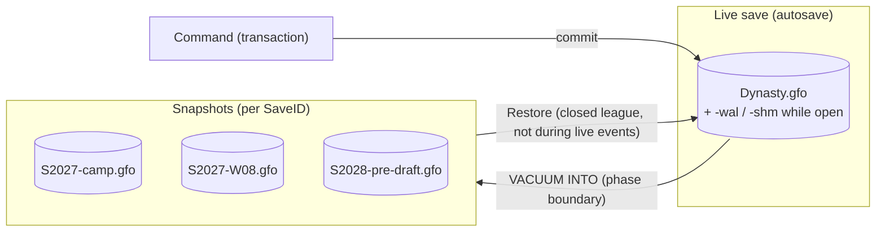
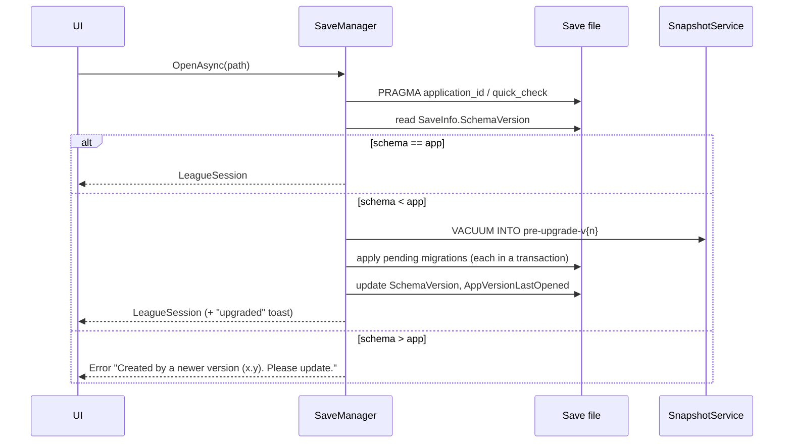

# Persistence: SQLite Save Files

> **Status:** Proposed · 2026-10-13 · Save file core built in M0 WP6 (2026-10-16), save lifecycle in WP7 (2026-10-18) · Related: [D-004](../DECISIONS.md#d-004-save-model-autosave--snapshots), [D-005](../DECISIONS.md#d-005-saves-live-in-localappdata-not-documents), [D-006](../DECISIONS.md#d-006-ef-core-for-the-model-raw-ado-for-bulk-paths) (reopened)
>
> **Data access: EF Core with the GFO unit of work** ([D-024](../DECISIONS.md#d-024-data-access-ef-core-with-the-gfo-unit-of-work)). **How to read and write** (transactions, patterns, troubleshooting) is in **[DATA_ACCESS_GUIDE.md](DATA_ACCESS_GUIDE.md)**. This doc covers the save file itself.

---

## 1. Principles

1. **One league = one SQLite file** with the `.gfo` extension. The file *is* the save.
2. **Autosave by design.** Every committed command is persisted immediately. There's no Save button and no "unsaved changes".
3. **One transaction owner.** Only `SaveWriter` begins, commits or rolls back. One command = one connection = one transaction ([rules](DATA_ACCESS_OPTIONS.md#2-the-gfo-unit-of-work-library-agnostic)).
4. **A save is self-contained.** Everything needed to play the league is inside the file, including copies of reference data. App updates never change an existing league's identity.
5. **Never lose more than the in-flight action.** WAL journaling plus a transaction per command.
6. **Snapshots are deliberate, not save-scumming.** Automatic snapshots at phase boundaries can be restored on purpose, but never during a live event.
7. **Forward-only migrations.** Old saves upgrade on open, after an automatic pre-upgrade snapshot. Newer saves are refused by older apps.

---

## 2. Save model: autosave + snapshots



### 2.1 Snapshot policy (proposed defaults)

| Trigger | Snapshot name | Retention |
|---|---|---|
| League created | `created` | Keep 1 |
| Training camp opens | `S{yyyy}-camp` | Last 3 seasons |
| Before each regular-season week | `S{yyyy}-W{ww}` | Rolling last 4 weeks |
| Before the trade deadline | `S{yyyy}-deadline` | Last 2 |
| Playoffs begin | `S{yyyy}-playoffs` | Last 2 |
| Season complete (after the championship) | `S{yyyy}-end` | Last 5 seasons |
| Before free agency | `S{yyyy}-pre-fa` | Last 2 |
| **Before the draft starts** | `S{yyyy}-pre-draft` | Last 2 |
| Before a schema migration | `pre-upgrade-v{n}` | Until the next successful upgrade |
| Before a restore | `pre-restore` | Last 1 |

- **Total budget:** 2 GB per league by default (configurable). Rolling snapshots are pruned oldest-first until the total fits.
- Snapshots are taken off the UI thread with `VACUUM INTO`, which produces a compact, consistent, single file without closing the live database.
- **As built (M0 WP7):**
  - **The table is code:** `SnapshotTrigger` builds the names (`SnapshotTrigger.Week(2027, 8)` → `S2027-W08`) and `SnapshotPolicy` holds the keep counts and the pruning rule, as pure functions in Application with unit tests. M0 takes `created` (after a save is created), `pre-upgrade-v{n}` and `pre-restore`. The phase kinds are defined, but nothing triggers them until phases exist.
  - **Keep counts:** "last N" is the newest N of that kind; "until the next successful upgrade" is keep 1 (each new `pre-upgrade` replaces the older ones). Taking a snapshot whose name already exists replaces it.
  - **The budget:** only the phase snapshots (camp, weeks, deadline, playoffs, end, pre-FA, pre-draft) give way, oldest first. `created`, `pre-upgrade` and `pre-restore` are safety nets that are never pruned for the budget, and neither is the snapshot just taken. The budget is `SnapshotOptions.BudgetBytes` (2 GB); a user setting can come with the Time Machine.
  - **A snapshot's time is its file's write time.** There's no index file to get out of step with the folder. Files in the folder that don't match a snapshot name are ignored.
  - **Between commands:** `ISnapshotService.TakeAsync` holds the writer's gate, so a snapshot is always a point between two commands, and commands queued meanwhile simply wait.
  - **Snapshots are rollback-journal files.** `VACUUM INTO` doesn't keep WAL mode, so restore switches the file back to WAL.

### 2.2 Restore ("Time Machine" screen)
- Lists snapshots with season, phase, record and timestamp.
- **Restore flow:** close the league → snapshot the current state as `pre-restore` → replace the live file with the snapshot copy → reopen.
- **Disabled** while a live event (draft, FA Frenzy, Deadline Day) is in progress.
- **Disabled** in Ironman leagues ([D-026](../DECISIONS.md#d-026-ironman-mode-requires-live-clock-mode)). The check lives in `SaveManager`, not just the UI.
- **Ironman exception: corruption-only recovery.** Snapshots are still taken. If the live file fails its integrity check on open, or a schema migration fails, the app restores the **most recent good snapshot automatically**. The player never chooses the point in time.
- **As built (M0 WP7): `ISaveManager.RestoreAsync(snapshot)`**, the engine the M3 Time Machine will call.
  1. **Rules first:** the snapshot must belong to the open save. `SaveRules.CanRestore` refuses Ironman (`IronmanNoRestore`) and a running live event (`LiveEventRunning`, through `ILiveEventStatus`, which reports "none" until M2).
  2. **The snapshot is checked before anything closes:** it exists, it's a GFO file, `quick_check` passes, its `SaveID` matches, and its schema isn't newer. A bad snapshot leaves the save open and untouched.
  3. **Stage a copy:** `VACUUM INTO` from the snapshot to `{save}.restore-tmp`, switched to WAL. Staging first is what makes restoring `pre-restore` itself (undo) work, since step 5 replaces that snapshot.
  4. **Close** the save (recording the session).
  5. **Snapshot the current state as `pre-restore`.**
  6. **Replace:** delete any `-wal`/`-shm` (a stale WAL must never be replayed onto another file), then move the staged copy over the save.
  7. **Reopen** through the normal open path (an older snapshot is upgraded on the way). Then one command carries the play time over: real time played doesn't go back with the league.
- **Not built yet:** the corruption recovery (Standard's offer and Ironman's automatic restore) builds on the same engine and arrives with the Time Machine.

### 2.3 Duplicate and export
- **Duplicate league** (make a branch) and **Export** (a single-file copy for backup or sharing) both use `VACUUM INTO`.
- Both are **disabled during live events**. Otherwise you could duplicate before every pick and keep the best timeline.
- Export is allowed in Ironman leagues (for backup). An imported copy keeps the Ironman flag.

> **Honest limitation:** a determined user can always copy files in Explorer. These rules protect honest players from temptation. They don't stop adversaries, and that's fine for a single-player game.

---

## 3. Connection and pragmas

**Connection string (built by `LeagueSession.For`):**
```
Data Source={path};Mode=ReadWrite;Cache=Private;Pooling=True;Foreign Keys=True;Default Timeout=30
```
`ReadWrite`, not `ReadWriteCreate`: a save that vanished must fail, not reappear empty. Only `SaveManager.CreateAsync` creates files (`SqliteFile.InitializeNew`).

**Set once at creation (persistent in the file):**
```sql
PRAGMA journal_mode = WAL;     -- concurrent readers + one writer, crash-safe
PRAGMA page_size = 4096;
PRAGMA application_id = 0x47464F31;  -- 'GFO1' magic: lets us recognize our files
PRAGMA user_version = {schema};      -- mirrors schema version for quick checks
```
(`page_size`, `journal_mode` and `application_id` are set by `SqliteFile.InitializeNew` before the first table exists. `user_version` is set after every migration, on create and on upgrade.)

**Set on every connection open (an EF `DbConnectionInterceptor`, `SqlitePragmaInterceptor`, registered on the session's context options):**
```sql
PRAGMA synchronous = NORMAL;   -- safe with WAL against app crashes; may lose the last commit on power loss
PRAGMA temp_store = MEMORY;
PRAGMA cache_size = -32000;    -- ~32 MB page cache
PRAGMA busy_timeout = 5000;
```

**Closing a league:**
```sql
PRAGMA wal_checkpoint(TRUNCATE);
```
then `SqliteConnection.ClearPool(connection)`. Microsoft.Data.Sqlite pools connections and keeps the file locked until the pool is cleared. Delete, rename, restore and export all fail without this.

---

## 4. Data access strategy

> EF Core is decided ([D-024](../DECISIONS.md#d-024-data-access-ef-core-with-the-gfo-unit-of-work)). Every path below runs **inside** `ISaveWriter`/`ISaveReader`. Code for each path is in [DATA_ACCESS_GUIDE.md §4–5](DATA_ACCESS_GUIDE.md#4-reading-data-screens-ai-snapshots).

| Path | Technology | Why |
|---|---|---|
| Domain CRUD (rosters, contracts, picks, settings) | **EF Core 10** with change tracking, inside `ISaveWriter` transactions | Productivity, migrations, LINQ |
| Read models (screens) | EF Core `AsNoTracking()` + `Select` projections to DTOs | Fast, keeps entities away from the UI |
| Set-based updates (e.g., age every player) | EF Core `ExecuteUpdateAsync` / `ExecuteDeleteAsync` | No entity loading |
| **High-volume inserts** (player game stats, play logs, scouting reports) | **Raw `SqliteCommand`**, prepared once and executed in a loop within the transaction | 10–50× faster than change tracking at ~50k rows |
| Leaderboards and aggregates | Pre-aggregated tables (`PlayerSeasonStats`) updated each week | Fast queries without big `SUM`s |

**EF Core + SQLite gotchas to respect**
- **No `decimal`** (stored as TEXT, which breaks ordering and aggregates). Money is a `long` number of dollars.
- **No `DateTimeOffset` ordering** in SQL. In-game dates are `DateOnly` (ISO TEXT, which sorts correctly). Real timestamps are UTC `DateTime`.
- SQLite's `ALTER TABLE` is limited. EF rebuilds tables for complex migrations, which is fine but slow on big tables, so keep large tables' schemas stable.
- Consider **EF compiled models** if startup model building becomes noticeable (it's a large model).

---

## 5. Schema overview

> Table and column lists are *directional*. The exact schema for each area is finalized in that feature's spec.

### 5.1 Meta
| Table | Key columns | Notes |
|---|---|---|
| `SaveInfo` (singleton). **M0 has:** `SaveID`, `LeagueName`, `SchemaVersion`, both app versions, both timestamps, `PlayTimeSeconds`, the creation settings and `Generation`. The league position (`UserTeamID`, season, phase, date, seed) arrives with M1. Enums are stored by name. | `SaveID (GUID)`, `LeagueName`, `UserTeamID`, `CurrentSeason`, `CurrentPhase`, `CurrentDate`, `Seed`, `SchemaVersion`, `AppVersionCreated`, `AppVersionLastOpened`, `CreatedAtUtc`, `LastPlayedAtUtc`, `PlayTimeSeconds`, `IsIronman`, `ClockMode`, `IsEdited`, `ClockPreset`, `InjuryFrequency`, `CareerCanEnd` ([D-063](../DECISIONS.md#d-063-career-can-end-is-a-creation-setting-off-by-default)) (no difficulty, [D-042](../DECISIONS.md#d-042-no-difficulty-presets-in-10)), **`Generation`** (incremented by `SaveWriter` on every commit; groundwork for Ironman rollback detection, [D-026](../DECISIONS.md#d-026-ironman-mode-requires-live-clock-mode)) | Read by the load screen through a read-only connection |
| `LeagueRules` (singleton) | Cap, cap growth, roster limits, practice squad size, minimum salaries table, live event toggles | Copied from defaults at creation |
| `AdvanceJournal` | `OperationID`, `Step`, `StartedAtUtc`, `CompletedAtUtc` | Makes long advances resumable ([CALENDAR_AND_PHASES.md §6](CALENDAR_AND_PHASES.md#6-resumable-advance-the-step-journal)) |
| `LiveEventState` | `EventType`, `Status`, `StateJson`, `ClockRemainingMs`, `LastHeartbeatUtc` | See [LIVE_EVENTS.md](LIVE_EVENTS.md) |

### 5.2 League structure
`Conferences`, `Divisions`, `Teams` (identity: city, nickname, abbreviation, colors, mark spec, stadium), `Stadiums`, `TeamSeasons` (W/L/T, points for and against, seed, playoff result per season), `Coaches` (M10), `Owners` (M10).

### 5.3 People
| Table | Key columns |
|---|---|
| `Players` | `PlayerID`, `TeamID?`, `Status`, `Position`, names, `BirthDate`, `College`, `Hometown`, `DraftSeason/Round/Pick/TeamID`, `ExperienceSeasons`, measurables, **true ratings (wide columns)**, hidden attributes (potential, development curve, personality traits), `JerseyNumber` |
| `RatingHistory` | `PlayerID`, `Season`, overall + key attributes (one snapshot per season) |
| `Contracts` | `ContractID`, `PlayerID`, `TeamID`, `SignedOn`, `Type` (Rookie, Veteran, Tag, Minimum, …), `TotalValue`, `SigningBonus`, `IsActive` |
| `ContractYears` | `ContractID`, `Season`, `BaseSalary`, `ProratedBonus`, `RosterBonus`, `GuaranteedAmount`, `CapHit`, `IsVoid` |
| `DeadMoney` | `TeamID`, `Season`, `PlayerID`, `Amount`, `Reason` |
| `Injuries` | `PlayerID`, `GameID?`, `Type`, `BodyPart`, `Severity`, `OccurredOn`, `ExpectedReturn`, `ActualReturn` |
| `ScoutingReports` | `TeamID`, `PlayerID`, `AttributeGroup`, `Estimate`, `Sigma`, `UpdatedOn` for **prospects only** (the user's team is persisted; AI perception may be derived, see §8). Pro perception is never stored: it's a fixed fuzz derived from `Hash(leagueSeed, "perception", teamID, playerID, season)` ([D-032](../DECISIONS.md#d-032-fog-of-war-your-roster-exact-other-pros-slightly-fuzzy-prospects-scouted)). |

### 5.4 Season and games
| Table | Key columns |
|---|---|
| `Seasons` | `Season`, `CapAmount`, `ChampionTeamID`, … |
| `Games` | `GameID`, `Season`, `Week`, `Type` (Reg, WC, DIV, CONF, CHAMP; no preseason, [D-038](../DECISIONS.md#d-038-no-preseason-games-in-10)), `HomeTeamID`, `AwayTeamID`, `Date`, `HomeScore`, `AwayScore`, `Overtime`, `Status`, `EngineVersion`, `Seed` |
| `TeamGameStats` | `GameID`, `TeamID`, ~40 stat columns |
| `PlayerGameStats` | `GameID`, `PlayerID`, `TeamID`, ~60 stat columns (wide; SQLite stores 0 and 1 in zero payload bytes, so sparse wide rows are cheap) |
| `PlayerSeasonStats` | `PlayerID`, `Season`, `TeamID`, `GameType`, same stat columns, upserted each week |
| `GamePlayLogs` | `GameID (PK)`, `EngineVersion`, `Format`, `Compression`, `Data BLOB` (Brotli-compressed JSON of play events and deciding matchups) |
| `DepthCharts` | `TeamID`, `Position` (incl. KR/PR), `Order`, `PlayerID`, `IsLocked`. Packages are derived from this ([D-052](../DECISIONS.md#d-052-depth-chart-position-depth-drives-every-package-with-optional-overrides)). |
| `DepthChartOverrides` | `TeamID`, `Package`, `Slot`, `PlayerID` (optional per-package overrides) |
| `GamePlans` | `TeamID`, `GameID?` (null = default), settings columns |

### 5.5 Draft, transactions, narrative
`Scouts` (`TeamID`, area or director, `Accuracy`, `PositionExpertise`), `ScoutAssignments` (`ScoutID`, `Kind` = Standing (region or position group) | Special (`ProspectID`), `Since`; [D-058](../DECISIONS.md#d-058-scouting-department-standing--special-assignments-no-biases-in-10)), `DraftClasses`, `DraftPicks` (`Season`, `Round`, `OriginalTeamID`, `OwnerTeamID`, `OverallPick?`, `SelectedPlayerID?`, `WasAutoPick`), `BigBoardEntries` (user), `Transactions` (append-only log), `Trades`, `TradeAssets`, `Awards`, `Records`, `HallOfFame`, `NewsItems`, `InboxMessages`.

### 5.6 Indexing guidelines
- Index every foreign key used for filtering: `Players(TeamID, Status)`, `PlayerGameStats(PlayerID)`, `PlayerGameStats(GameID)`, `Games(Season, Week)`, `PlayerSeasonStats(Season, Position?)`, `Transactions(Season, TeamID)`.
- Keep indexes deliberate. Each one slows the weekly bulk insert. Measure with `EXPLAIN QUERY PLAN`.

---

## 6. Growth estimates and retention

| Data | Rows or size per season | 10 seasons | Notes |
|---|---|---|---|
| Players (all statuses) | +~300 prospects/yr | ~5,000 players | Retired players kept for history |
| `PlayerGameStats` | ~285 games × ~90 players ≈ 26k rows | ~260k | Wide rows, mostly zeros |
| `GamePlayLogs` | ~285 × ~5 KB (Brotli) ≈ 1.5 MB | ~15 MB | Kept, not pruned ([D-039](../DECISIONS.md#d-039-play-by-play-is-kept-measure-before-pruning)). **Estimate to verify in M3.** |
| `ScoutingReports` (user) | ~300 prospects × ~8 groups ≈ 2.4k | Pruned after the draft | |
| `Transactions` / `NewsItems` | ~3–5k | ~40k | |
| **Estimated file size** | | **~60–120 MB** | Budget: < 150 MB |

**Measured in Spike S0a (synthetic data, 2026-10-15):** a play log is about **6.0 KB** per game (39.9 KB of JSON, Brotli), and a season of stats + logs is about **4.5 MB**. So about 50 MB at 10 seasons, and play logs alone about 17 MB per 10 seasons, below the D-039 pruning trigger. `PRAGMA quick_check` costs about 3 ms per MB (29 ms on 10.8 MB). Re-measure with real engine output in M3.

**Retention policy ([D-039](../DECISIONS.md#d-039-play-by-play-is-kept-measure-before-pruning)):** keep everything, with no pruning job and no setting. Measure real play log sizes in M3 and in the M5 10-season autoplay. **If play logs exceed 25% of the 10-season budget (about 37 MB)**, switch on the fallback: league-wide play-by-play for the last 3 seasons, plus every one of the user's team's games forever, with season aggregates and record-worthy plays extracted first. Pruning would then run at season end, followed by an incremental vacuum. Box scores, stats, records and history are kept forever regardless.

---

## 7. Schema versioning and migrations



- **Tooling:** **EF Core migrations** in `GridironFrontOffice.Infrastructure/Data/Migrations`, applied programmatically (`Database.MigrateAsync()`) when a save is opened, never at app startup across all saves. `PRAGMA user_version` mirrors the schema version for quick checks on the load screen. Add one with:
  `dotnet ef migrations add <Name> --project src/Infrastructure --output-dir Data/Migrations`
- **As built (M0 WP6):**
  - **The schema version is the number of EF migrations.** Adding a migration bumps it; there's no constant to forget.
  - **A save is from a newer app** when it has a migration this app doesn't know, or its `user_version` is higher than this app's count. It's refused with "Update the app", naming the version that last opened it, and the file is released.
  - **Opening an older save:** a `pre-upgrade-v{n}` snapshot through the snapshot service (WP7), then migrate, then set `user_version`.
  - **Migrations are the one exception to "only `SaveWriter` begins transactions":** EF runs each migration in its own transaction, before the save becomes the open session.
  - **Opening checks run in order:**
    1. the file exists;
    2. it's SQLite with `application_id = GFO1` (otherwise `NotAGfoSave`);
    3. `quick_check(1)` is `ok` (otherwise `SaveDamaged`);
    4. the schema check.

    Opening always closes the current save first.
  - **Closing:**
    1. one command records the session (`PlayTimeSeconds`, `LastPlayedAtUtc`);
    2. the writer is drained;
    3. `wal_checkpoint(TRUNCATE)`;
    4. clear the pool.

    If the app exits without `CloseAsync`, `SaveManager.Dispose` still checkpoints and releases the file (without recording play time).
- **Data migrations** (e.g., backfilling a new rating) are allowed inside migrations. They must be **deterministic** (using derived seeds) so two copies of the same save upgrade identically.
- **Test fixtures:** keep one real save from every *released* schema version under `tests/GridironFrontOffice.Infrastructure.Tests/Fixtures/`. A test upgrades each one to the current version and runs invariant checks.
- **Older-schema saves for tests:** `IMigrator.MigrateAsync("<migration>")` creates a save stopped at any earlier migration, which is how Spike S0a simulated an old save. It complements the real fixture saves above.
- **Migrations are generated code:** `.editorconfig` marks `**/Migrations/*.cs` as `generated_code`, because the main migration file has no `<auto-generated>` header and would otherwise fail the style rules (IDE0161, CA1861).
- **Pre-1.0 policy:** until the first public build, it's fine to squash migrations and break saves, as long as the change is announced in the changelog.

---

## 8. Determinism and stored vs. derived data

- Store **what can't be cheaply re-derived or what the player has seen**: results, stats, contracts, transactions, the user's scouting reports.
- **AI teams' perceptions** of players can be **derived** on demand from `(leagueSeed, teamID, playerID, scoutingInvestment)` with a deterministic noise function. That avoids storing ~31 × thousands of rows. Cache them in memory per session. Revisit if the AI needs perception *history*.
- Every `Game` stores its `Seed` and `EngineVersion`. Re-simulating it with the same inputs reproduces the result, which is invaluable for bug reports.

---

## 9. Save catalog (load screen)

- Scan `Saves\*.gfo`. For each file, open a **read-only** connection, verify `application_id`, and read `SaveInfo` plus the user team's identity and record.
- Show a card per save: team mark and colors, league name, season and phase, record, last played, Ironman badge, app version warning.
- Corrupt or unrecognized files show a "Can't read this save" card with "Show in folder".
- **As built (M0 WP7): `ISaveCatalog.ListAsync()`** returns `SaveCard`s, most recently played first, unreadable files last.
  - **Status per card:** `Ready`, `NeedsUpgrade` (older `user_version`: opens after a `pre-upgrade` snapshot), `FromNewerVersion` (the card says to update), or `Unreadable` with a one-sentence `Problem` (not SQLite, not GFO, damaged, no league in it).
  - **Continue** (`SaveCards.ContinueTarget`) is the most recently played card that can be opened.
  - **Nothing is written next to the saves.** A plain read-only connection to a closed WAL save creates `-wal` and `-shm` files and can't remove them. So `SqliteFile.ReadOnly` opens a closed save (no `-wal`) as `immutable`. With a `-wal` present (the save is open, or a crash left it), the plain read-only connection reads through it. A test checks that a scan leaves the folder byte-for-byte unchanged.
  - **The card's columns are read with raw SQL**, so saves from older and newer apps (whose `SaveInfo` has other columns) still get a card. Those columns (`SaveID`, `LeagueName`, `CreatedAtUtc`, `LastPlayedAtUtc`, `PlayTimeSeconds`, `AppVersionLastOpened`, `IsIronman`) are never renamed or removed.
  - **No `quick_check` in the list:** it reads the whole file, too slow for many saves. Damage that the header and `SaveInfo` don't show is caught when the save is opened.
  - Team, season, phase and record arrive in M1 with the league.

---

## 10. Import, export and delete

| Action | Implementation | Validation |
|---|---|---|
| **Export** | `VACUUM INTO <user-chosen path>` | Not available during live events |
| **Import** | Copy into `Saves\` with a fresh file name | `application_id`, `quick_check`, schema version ≤ app, required tables present. If the `SaveID` collides with an existing save, assign a new `SaveID`. |
| **Delete** | Send to the **Recycle Bin** (not permanent), along with its snapshot folder, after a confirmation that names the league | — (as built in WP7, below) |
| **Duplicate** | `VACUUM INTO` with a new `SaveID` and the name `"{name} (copy)"` | Not available during live events |

**Delete, as built (M0 WP7):** `ISaveManager.DeleteAsync(path)` closes the save first if it's the open one. Then it hands the file (with any `-wal`/`-shm`) and `Snapshots\{SaveID}` to `IPlatformServices.SendToRecycleBin` in one call.
- **Unreadable files can be deleted too.** Without a readable `SaveID`, only the file goes.
- **A shared snapshot folder stays.** If another file in `Saves\` has the same `SaveID` (a copy made in Explorer), the snapshot folder is kept.
- **Desktop:** the shell's `SHFileOperationW` with "allow undo" and the "nuke warning". If Windows can't recycle something (too big, or a drive without a Recycle Bin), it asks the player before deleting permanently. Saying no returns `DeleteCancelled`. A file another program holds returns `DeleteFailed`.
- **DevHost:** a `.trash` folder in the dev data folder, so development never fills the real Recycle Bin.

---

## 11. Failure handling

| Failure | Detection | Response |
|---|---|---|
| Crash mid-command | Transaction never committed | Nothing to do. WAL rollback on next open. |
| Crash mid-advance | `AdvanceJournal` has an incomplete operation | Resume from the next step on open ([CALENDAR_AND_PHASES.md §6](CALENDAR_AND_PHASES.md#6-resumable-advance-the-step-journal)) |
| Crash mid-draft | `LiveEventState.Status = Running` | Resume the draft ([LIVE_EVENTS.md](LIVE_EVENTS.md)) |
| Corrupt file | `quick_check` fails | Standard: offer to restore the latest snapshot, show in folder, or cancel. **Ironman:** restore the latest good snapshot automatically and tell the player. |
| Disk full | `SqliteException` (SQLITE_FULL) | Roll back, show an error, log as Error, suggest pruning snapshots |
| File locked by another process | `SQLITE_BUSY` after the timeout | Explain (e.g., antivirus or a sync tool) and retry |
