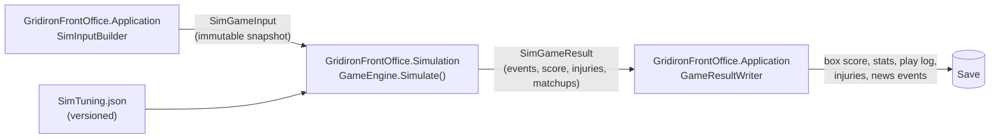
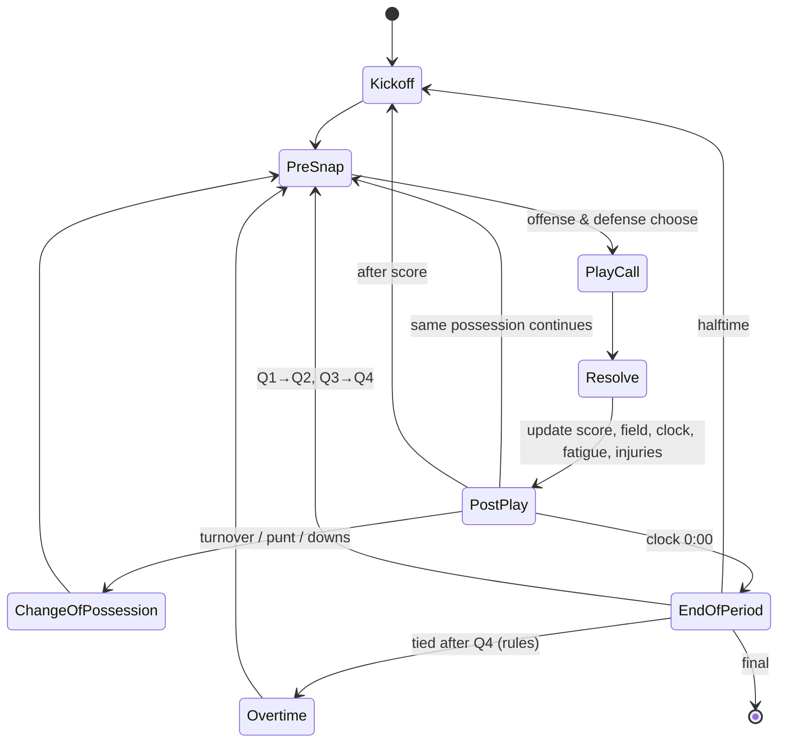

# Simulation Engine

> **Status:** Proposed · 2026-10-13 · Related: [D-009](../DECISIONS.md#d-009-game-day-role-gm--game-plan), [D-012](../DECISIONS.md#d-012-deterministic-simulation-with-an-in-house-prng), [D-013](../DECISIONS.md#d-013-statistical-play-by-play-simulation-no-physics)

---

## 1. What the engine is (and isn't)

**It is** a *statistical play-by-play* simulator. Each play is resolved by comparing the relevant players' ratings in the relevant matchups and sampling an outcome from calibrated probability distributions. The engine tracks the game state (clock, down, distance, field position, score, timeouts, fatigue), so games have a believable *flow*: two-minute drills, fourth-down decisions, comebacks, blowouts.

**It isn't** a physics or spatial engine. There are no x/y coordinates for players, no collision detection and no route geometry. "Space" is abstracted into matchup outcomes such as separation, pressure and gap integrity.

### Requirements

| # | Requirement | Measure |
|---|---|---|
| 1 | **Believable aggregates** | League-wide season stats inside the calibration bands (§9) |
| 2 | **Believable individuals** | Stat leaders, career arcs and distributions look like real football |
| 3 | **Ratings matter, monotonically** | Better players produce better outcomes, all else equal (property tests) |
| 4 | **The game plan matters, but doesn't dominate** | An optimal plan vs. the default is worth about +2–5% win probability against an equal opponent |
| 5 | **Deterministic** | Same `SimGameInput` + seed → an identical `SimGameResult` |
| 6 | **Explainable** | Every play records its deciding matchup (§7) |
| 7 | **Fast** | < 50 ms per game, target 10 ms. A week runs in parallel. |
| 8 | **Pure** | No I/O, no clock, no globals. Fully testable in isolation. |

---

## 2. Boundaries



**`SimGameInput`**
- `GameId`, `Seed`, `EngineVersion`, `TuningVersion`, rules (OT format, kickoff rules)
- For each team, a `SimTeam`:
  - `SimPlayer[]` (dressed players): `Id`, `Position`, the rating vector (**true ratings**; the engine plays the real game and fog of war affects only *perception*), stamina, injury status, traits
  - Depth chart by package and slot
  - `GamePlan` (§5) and `CoachTendencies` (play-calling style, 4th-down aggression, tempo)
  - Home/away. Weather and surface come later.

**`SimGameResult`**
- Final score and per-quarter scores, OT flag
- `PlayEvent[]`: the ordered log. Each event: situation before, call, personnel, outcome type, yards, participants (passer, target, ball carrier, tackler(s), defender in coverage, …), penalties, injuries, clock run-off, **deciding matchup**, win probability before and after (§8)
- Derived on demand: drives, box score, player and team stat lines (**the event log is the single source of truth**)

---

## 3. Game loop



**Pre-snap decisions (both coaching AIs):**
1. **Offense:** run / pass / play-action / screen / QB sneak / kneel / spike, or on 4th down punt / FG / go for it. Driven by situation (down, distance, field position, score difference, time remaining, timeouts), `CoachTendencies` and the `GamePlan`.
2. **Personnel:** offensive package (11, 12, 21, 22, 10, empty), defensive response (base, nickel, dime, goal line).
3. **Defense:** coverage shell (Cover 0/1/2/3/4/6 abstracted as man vs. zone and single- vs. two-high), blitz or no blitz, run commitment (box count).
4. **Clock management:** hurry-up, timeouts, intentional run-off, 2-minute and 4-minute offense.

**4th-down and 2-point decisions** use a decision model driven by the Expected Points / Win Probability tables (§8), shifted by coach aggression and the game plan. This produces believable "analytics-era" behavior on average, with variety between coaches.

---

## 4. Play resolution

Every resolver follows the same pattern:

> **Matchup ratings → a logistic or linear model → distribution parameters → a seeded sample → outcome + deciding matchup**

All coefficients live in **`SimTuning.json`**, versioned and loaded at startup, so calibration never needs a recompile.

### 4.1 Pass play pipeline

| Stage | Inputs | Output |
|---|---|---|
| 1. **Protection** | Each pass rusher vs. assigned blocker(s): pass rush (power/finesse) vs. pass block, plus blitz extra rushers vs. RB/TE protection | Time-to-pressure distribution; pressure, hit or sack; the *losing blocker* is recorded |
| 2. **Coverage** | Each eligible receiver vs. assigned defender (man) or zone defender: route running, release and speed vs. man/zone coverage, press and speed | A separation score per receiver per "read window" |
| 3. **Read and target** | QB awareness/decision-making, pocket presence under pressure, the game plan's focus target | The chosen target (or a throwaway or scramble) |
| 4. **Throw** | Accuracy (short/medium/deep by depth), arm strength (deep), pressure penalty, throw on the run | Ball placement quality |
| 5. **Catch point** | Placement + separation vs. hands, contested catch vs. ball skills | Complete / incomplete / **interception** / deflection; drop chance |
| 6. **After the catch** | Elusiveness, speed, break tackle vs. tackling, pursuit and angles | YAC (a right-skewed distribution); **fumble** chance; broken-tackle events |

### 4.2 Run play pipeline

| Stage | Inputs | Output |
|---|---|---|
| 1. **Point of attack** | Run blockers vs. run defenders at the called gap (inside/outside), box count vs. blockers | Gap quality: stuffed / normal / crease / hole |
| 2. **Ball carrier** | Vision (finding the cutback), acceleration, power vs. tackling | Yards before contact + yards after contact |
| 3. **Big play** | Speed and elusiveness vs. second-level and safety pursuit | A heavy right tail: breakaway chance |
| 4. **Ball security** | Ball security vs. hit power and strip skill | Fumble, and the recovery roll |

> Yardage is sampled from **mixture distributions** (e.g., a "normal play" component plus an "explosive" component) rather than a single normal. Real football has fat tails, and a plain normal distribution produces boring, wrong-looking games.

### 4.3 Special teams
- **Kickoffs:** kick power vs. rules (touchback line) → touchback rate; returns use returner vs. coverage. Onside kicks get a low base rate, situational.
- **Punts:** punt power/accuracy → gross and net distance, hang time vs. return, fair catch, coffin-corner inside the 20.
- **Field goals and PATs:** make probability = f(distance, kick power, kick accuracy, weather later), with a block chance vs. the rush.
- **Long snaps:** a tiny bad-snap probability (long snappers matter about as little as they do in real life).

### 4.4 Penalties
- A per-play hazard by type (false start, holding, offensive pass interference, defensive pass interference, offside, roughing, facemask, …), scaled by each participant's **discipline** rating and the situation (crowd noise for road false starts).
- Accept/decline logic for the non-offending team (the coaching AI picks the better option).
- Target: about 5–7 accepted penalties per team per game.

### 4.5 Injuries
- Each snap, each participating player gets an injury hazard: `base × positionFactor × contactIntensity × (1 + fatigue) × injuryProneness / toughness`.
- On injury: sample body part, type and severity, which gives the expected weeks out. The player leaves the game, and the depth chart substitutes.
- Calibrated to a believable rate of season-ending injuries per team ([Q-17](../OPEN_QUESTIONS.md#q-17-injury-frequency)).

### 4.6 Fatigue and substitution
- Per-player fatigue increases with snaps (heavier for DL and RB) and recovers between series.
- Fatigue reduces effective ratings and increases injury hazard.
- Rotation follows depth chart rules (DL rotation share, RB committee) plus auto-substitution thresholds.

---

## 5. The game plan (the user's lever on game day)

The user is **GM + game plan** ([D-009](../DECISIONS.md#d-009-game-day-role-gm--game-plan)). The plan modifies play-calling probabilities and matchup assignments. It never overrides ratings.

| Category | Setting | Effect inside the engine |
|---|---|---|
| Offense | **Run/pass balance** (slider) | Shifts the run/pass call probability on neutral downs |
| | **Tempo** (slow / normal / hurry-up) | Plays per game, opponent fatigue vs. our fatigue |
| | **Aggression** (conservative ↔ aggressive) | 4th-down go rate, deep-shot frequency, 2-point tendency |
| | **Featured player** | Target share and touch share bias toward one player |
| | **Protection emphasis** | Keeps a TE/RB in to block more often: less pressure, fewer routes |
| Defense | **Blitz frequency** | Extra rushers: more pressure and sacks, but more explosive plays allowed |
| | **Coverage preference** (man ↔ zone) | Which coverage ratings matter most |
| | **Shell** (single-high ↔ two-high) | Run defense vs. deep-pass prevention |
| | **Focus** (stop the run ↔ stop the pass) | Box count and run commitment |
| | **Shadow** (CB1 follows their WR1) | A matchup assignment override |
| Situational | **4th-down chart** (conservative / standard / analytics) | The decision model threshold |
| | **2-point policy** | The decision model threshold |

- **Opponent scouting report:** the Game Plan screen shows the opponent's tendencies and strengths (from their actual play logs) to inform the plan.
- **Default plan:** "Coach's plan", where the head coach sets it automatically. A user override persists until changed or reset.
- **Guardrail test:** SimLab A/B runs. Equal teams, default vs. tuned plan, 10k games. The effect must sit inside the +2–5% window. A "wrong" plan (e.g., blitz-heavy against an elite-QB, quick-passing offense) should cost a similar amount.

---

## 6. Randomness and determinism

- **PRNG:** an in-house xoshiro256** (or PCG32) in `GridironFrontOffice.Simulation.Random`. `System.Random` is banned because its seeded algorithm is an implementation detail that could change between .NET versions, and that would break golden tests and reproducibility.
- **Seed derivation:** `gameSeed = StableHash(leagueSeed, "game", gameId)`. Inside a game, a single PRNG stream is consumed in a fixed order.
- **Determinism hazards to avoid:** iterating over `Dictionary`/`HashSet` (order isn't a contract), parallelism *inside* a game, `DateTime.Now`, culture-sensitive parsing, and floating-point reductions in a nondeterministic order. Parallelism *across* games is fine.
- **Floating point:** deterministic on the same build and machine. Cross-architecture (x64 vs. ARM64) bit-exactness is not guaranteed and not required.
- **Engine versioning:** `EngineVersion` (code) and `TuningVersion` (data) are stored with every game. Golden tests pin the expected output for a set of canonical inputs. Changing tuning means updating the golden files on purpose.

---

## 7. Explainability: the deciding matchup

Every play records **who won the rep that mattered**:

```csharp
public readonly record struct DecidingMatchup(
    MatchupKind Kind,          // PassRushVsBlock, CoverageVsRoute, RunBlockVsRunD, CarrierVsTackler, KickVsDistance, …
    PlayerId Winner,
    PlayerId Loser,
    float Margin);             // how decisive (normalized)
```

Examples:
- Sack → `PassRushVsBlock`, winner = EDGE, loser = LT
- 40-yard completion on a go route → `CoverageVsRoute`, winner = WR, loser = CB
- Stuffed run → `RunBlockVsRunD`, winner = DT, loser = LG

**Consumers**
- **Film Room** ([STANDOUT_FEATURES.md §C](../STANDOUT_FEATURES.md#c-film-room-explainable-results)): key matchups won and lost, unit grades, player grades.
- **Player grades** (0–100 per game) feed awards voting, contract talks and fog-of-war "performance signal" updates.
- **The news generator**: "Toure feasted on the Wolves' right side: 3 sacks."

---

## 8. Expected Points & Win Probability models

- **Generated by SimLab from the engine itself.** Simulate many thousands of games, then fit lookup tables:
  - **EP** by (down, distance bucket, yard line).
  - **WP** by (score difference, time remaining bucket, possession, field position bucket, timeouts).
- Shipped as versioned data (`ep-v{n}.bin`, `wp-v{n}.bin`), regenerated whenever tuning changes significantly. A test checks that the tables match `TuningVersion`.
- **Uses:** the coaching AI's 4th-down and 2-point decisions, the live WP chart in the Game Center, swing plays (WPA) and EPA analytics in the Film Room.
- **Why self-generated:** the models always agree with the sim. A real-world model would disagree with our engine's quirks and produce nonsense decisions.

---

## 9. Calibration

### 9.1 SimLab workflow
```
simlab calibrate --seed 42 --seasons 200 --tuning ./SimTuning.json --out ./reports/calib-2026-10-13.md
```
1. Generate a league (or many random leagues) with a fixed seed.
2. Simulate N full seasons **without** progression (to isolate the engine).
3. Compute league aggregates and distributions. Compare them with the target bands. Emit a Markdown report with pass/fail and deltas.
4. Tune coefficients, then repeat. (Optionally later: automated parameter search over a subset of coefficients.)

### 9.2 Initial target bands

> ⚠️ **These bands are approximate, from memory of recent pro seasons.** Before tuning seriously, check them against a public reference (league-average tables for the last 3–5 seasons) and record the source and values in this doc.

| Metric (per team per game unless noted) | Target band |
|---|---|
| Points | 21–24 |
| Offensive plays | 60–66 |
| Yards per play | 5.0–5.6 |
| Pass attempts / rush attempts | 32–36 / 25–29 |
| Completion % | 62–67% |
| Yards per pass attempt | 6.7–7.3 |
| Sack rate (per dropback) | 6–7.5% |
| Interception rate (per attempt) | 2.0–2.7% |
| Rushing yards per carry | 4.1–4.6 |
| Fumbles lost | 0.4–0.6 |
| Turnovers | 1.1–1.5 |
| 3rd-down conversion % | 37–41% |
| Red zone TD % | 53–60% |
| Field goal % (all distances) | 83–88% |
| PAT % | 93–97% |
| Punts | 3.5–4.5 |
| Accepted penalties | 5–7 |
| Home team win % (league, season) | 53–57% |
| Games going to OT | 4–8% |

**Season leader sanity bands (17 games):** passing yards leader 4,500–5,300 · rushing yards leader 1,400–2,000 · receiving yards leader 1,500–1,900 · sacks leader 14–19 · interceptions leader 6–9.

### 9.3 Behavioral properties (automated tests)
- **Monotonicity:** raising one player's key rating (all else equal) never lowers the team's expected outcome in that phase. Checked statistically over 2k games.
- **Dominance curve:** the win probability vs. team-strength difference curve is smooth and plausible. Equal teams give 50% ± home field. A large talent gap gives about 90–95%, never 100%.
- **Parity over seasons:** with realistic rosters, the distribution of win totals per season roughly matches real leagues (no 17–0 teams every year, and a few 13–14 win teams).
- **No degenerate strategies:** e.g., always going for it on 4th down or 100% blitz doesn't produce dominant results.

---

## 10. Performance design

- The game state is a mutable **struct** owned by the engine. Player ratings are copied into compact arrays at game start (data-oriented, cache-friendly).
- **No LINQ, no allocation, no logging** in the per-play loop (trace logging sits behind `IsEnabled` or a compile-time switch). Event structs go into a pre-sized pooled list.
- A week runs games with `Parallel.ForEachAsync` (games are independent). Results are written to the database in one transaction after all games finish.
- BenchmarkDotNet suite: `SimulateGame` mean and allocations; budget < 50 ms, target 10 ms, < 1 MB allocated per game.

---

## 11. Watching a game (Game Center)

**The engine never runs in "real time".** It produces the whole result instantly. The Game Center then **replays the event log** at the chosen speed:

- Speeds: 1× (about 3–6 s per play), 2×, 4×, **Instant** (skip to final).
- Shows the scorebug, drive chart (SVG field strip), play-by-play feed, WP chart, key stats and other games' scores.
- Results for *other* games are hidden until they "finish" during the replay, which keeps the suspense.
- Because the result already exists, closing the Game Center mid-replay loses nothing.
- **Future (post-1.0):** halftime adjustments would require splitting simulation at halftime (simulate the first half → user tweak → simulate the second half). The engine API should allow `Simulate(input, stopAt: Halftime)` and `Resume(state, newPlan)` from the start, even if unused, so the option stays cheap.

---

## 12. Engine roadmap

| Version | Milestone | Scope |
|---|---|---|
| v0.1 | M2 | Game state machine, simple run/pass, kicks, scoring, clock, basic play calling. Stats derived from events. |
| v0.2 | M2 | Matchup-based pass and run pipelines, penalties (top 6 types), basic injuries, fatigue. **Deciding matchup recorded on every play** (cheap now, expensive to retrofit). SimLab calibration within bands. |
| v0.3 | M3 | Depth chart packages, basic game plan (3 settings), OT rules, playoffs |
| v1.0 | M8 | Full game plan, EP/WP tables, player grades, Film Room data |
| v1.x | M10+ | Weather, surface, scheme fit, coaching quality effects, halftime adjustments (maybe) |
