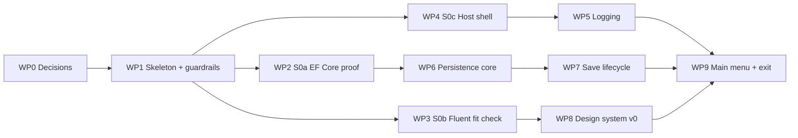

# M0 · Foundations: the Plan

> **Status:** Proposed (for owner review) · 2026-10-15 · Milestone definition: [ROADMAP.md §M0](../ROADMAP.md#m0--foundations-walking-skeleton)
>
> This is the detailed plan for M0, the "walking skeleton". It turns the roadmap's M0 scope into **ten ordered work packages**, lists every file, project, package and doc that changes, and ends with the exit checklist. **There's no football in M0.** It proves the toolchain, the host, logging, persistence you can trust, and the design system basics.
>
> **Specs for M0:** F-00 (platform) and F-01's M0 slice (saves) are already specified by [ARCHITECTURE.md](../ARCHITECTURE.md), [PERSISTENCE.md](../architecture/PERSISTENCE.md), [DATA_ACCESS_GUIDE.md](../architecture/DATA_ACCESS_GUIDE.md), [LOGGING.md](../architecture/LOGGING.md) and [UI_DESIGN_SYSTEM.md](../architecture/UI_DESIGN_SYSTEM.md). This plan is the build order for them, so no separate F-00/F-01 spec files are written.

---

## 1. What you'll have at the end of M0

- `./build.ps1` builds every project with warnings as errors and runs the fast tests, including **transaction torture tests** that kill the process mid-write.
- Launching the app opens a **WPF window with the Stadium look** (Dark by default) and a main menu in under 3 seconds.
- You can **create a save** (just a name, since there's no league yet), see it on the **load screen**, reopen it, close it, and delete it to the Recycle Bin. The file is never left locked.
- Every run writes **`gfo-YYYYMMDD.log`** with a startup banner, lifecycle events and full stack traces for any crash (including JavaScript errors in the WebView).
- A **snapshot** of a save can be taken and restored.
- A browser-based **DevHost** with a `/_gallery` showing every v0 component in Dark and Light, with team tint on and off.
- **Guardrails that bite:** adding a forbidden project reference, a stray `BeginTransaction` or an `async void` turns the build red.
- The three spikes answered, each with a decision recorded: **EF Core holds up** (S0a), **Fluent UI v5's grid works or the fallback is chosen** (S0b), and **the title bar approach** (S0c).

---

## 2. Decisions M0 builds on

M0 makes these real. **All seven were accepted on 2026-10-15** (your words are quoted in DECISIONS.md):

| Decision | What M0 builds on it | Status |
|---|---|---|
| [D-002](../DECISIONS.md#d-002-platform-net-10-lts--blazor-hybrid-windows-first) | .NET 10 LTS: `global.json` pins SDK **10.0.402** (the 10.0.4xx band), runtime 10.0.13. Host is WPF ([D-021](../DECISIONS.md#d-021-host-wpf--blazorwebview-maui-removed)). | ✅ Accepted |
| [D-003](../DECISIONS.md#d-003-ui-lives-in-razor-class-libraries-the-host-stays-thin) | UI in Razor Class Libraries, a thin host, plus the DevHost | ✅ Accepted |
| [D-007](../DECISIONS.md#d-007-logging-serilog-to-rolling-log-files) | Serilog as the logging library | ✅ Accepted |
| [D-015](../DECISIONS.md#d-015-integer-keys-with-strongly-typed-ids) | Integer keys + strongly typed IDs (the convention is set up in M0, and the first IDs arrive in M1) | ✅ Accepted |
| [D-016](../DECISIONS.md#d-016-single-writer-command-queue) | The single-writer command queue (`SaveWriter`) | ✅ Accepted |
| [D-018](../DECISIONS.md#d-018-testing-stack) | xUnit v3 (on Microsoft.Testing.Platform), Shouldly, Verify, bUnit, NetArchTest | ✅ Accepted |
| [D-020](../DECISIONS.md#d-020-feature-folders-no-mediator-or-mapper-libraries) | Feature folders, no MediatR or AutoMapper | ✅ Accepted |

Not needed until later: D-012 (the PRNG) in M1, when league generation needs it, and D-019 (Velopack) in M11.

**Also settled (see §11):** the commit and branch convention, spike code, how work packages land, and the crash dialog's scope ([D-066](../DECISIONS.md#d-066-git-workflow-gfo-commit-format-one-branch-per-milestone)).

---

## 3. Work packages at a glance

All of M0 lands on **one branch, `feat/m0-foundations`**, with a commit per work package, merged unsquashed into `main` when the exit checklist passes ([D-066](../DECISIONS.md#d-066-git-workflow-gfo-commit-format-one-branch-per-milestone)). Every work package ends with `./build.ps1` green. Sizes are relative (S ≈ one session, M ≈ two or three, L ≈ more), since the roadmap has no dates by design.

| WP | Name | Size | Depends on | Produces a decision? |
|---|---|---|---|---|
| WP0 | Decisions and docs prep | S | — | Accepts the Proposed decisions above |
| WP1 | Repo skeleton and guardrails | M | WP0 | — |
| WP2 | **Spike S0a:** EF Core proof | S–M | WP1 | Yes (amends D-024 notes) |
| WP3 | **Spike S0b:** Fluent UI v5 fit check | M | WP1 | Yes (grid verdict, icons, v5 API names) |
| WP4 | **Spike S0c:** host shell | S–M | WP1 | Yes (title bar approach) |
| WP5 | Logging and diagnostics | M | WP1, WP4 | — |
| WP6 | Persistence core and torture tests | L | WP2 | — |
| WP7 | Save lifecycle: catalog, snapshots, delete | M | WP6 | — |
| WP8 | Design system v0 and the gallery | L | WP3 | — |
| WP9 | Main menu, wiring and the M0 exit | M | WP5, WP7, WP8 | Tag `m0-complete` |



**Why the spikes come first:** each one can change the plan after it. If EF Core disappoints, persistence switches to the documented linq2db fallback. If the grid fails, `DataGrid<T>` wraps a different grid. The title bar choice shapes the host and the app shell. Spikes are cheap, so these answers should arrive before WP6 to WP9 build on them.

---

## 4. The work packages in detail

### WP0 · Decisions and docs prep (S) ✅ Done 2026-10-15
**Goal:** the paperwork M0 depends on.
- [x] Mark D-002, D-003, D-007, D-015, D-016, D-018 and D-020 **Accepted**, with your confirmation quoted (2026-10-15).
- [x] Settle the commit and branch convention, and update [TESTING_AND_QUALITY.md §8.4](../architecture/TESTING_AND_QUALITY.md#84-git-workflow-d-066) to match ([D-066](../DECISIONS.md#d-066-git-workflow-gfo-commit-format-one-branch-per-milestone)).
- [x] Link this plan from ROADMAP §M0 and the docs README.

**Changes:** `docs/DECISIONS.md`, `docs/architecture/TESTING_AND_QUALITY.md`, `docs/ROADMAP.md`, `docs/README.md`.

### WP1 · Repo skeleton and guardrails (M) ✅ Done 2026-10-15
**Goal:** every project exists, builds, and is held to the dependency rules from day one.

**Repo files (as built)**
- [x] `global.json`: SDK `10.0.402` (bumped from 10.0.100 once the owner installed it), `rollForward: latestPatch`, and `"test": { "runner": "Microsoft.Testing.Platform" }` (see "Changed from the plan").
- [x] `.gitignore` (the standard .NET template + `artifacts/`, `*.gfo` and its `-wal`/`-shm` files, except future test fixtures), `.gitattributes` (LF in the repo, CRLF for `.ps1`, binary assets).
- [x] `.editorconfig`: file-scoped namespaces, `_camelCase` private fields, `VSTHRD100` (async void) as an error, `Async` suffix. Test folders allow underscored names.
- [x] `Directory.Build.props`: `net10.0`, nullable, implicit usings, warnings as errors, `latest-recommended` analysis, code style in build, and the banned-API wiring.
- [x] `Directory.Packages.props`: every version pinned (§6). The two analyzers are `GlobalPackageReference`s, so every project gets them.
- [x] `build/BannedSymbols.*.txt`, **three tiers**: `Transactions` (every project; `SaveWriter` will suppress it at its one call site), `Pure` (Core, Simulation, Application: `System.Random`, wall clock, `Thread.Sleep`, `.Result`/`.Wait()`, `Console`), `RawSqlite` (`new SqliteConnection` everywhere except Infrastructure).
- [x] `GridironFrontOffice.slnx` with `/src/`, `/tools/`, `/tests/` and `/build/` folders.
- [x] `.config/dotnet-tools.json` with `dotnet-ef` 10.0.13.
- [x] `THIRD_PARTY_NOTICES.md`: every package's license, checked from its package metadata (or its repository's LICENSE where the package declares none).
- [x] `build.ps1`, compatible with Windows PowerShell 5.1.

**Projects** (folders use short names, projects use full names, [D-028](../DECISIONS.md#d-028-project-naming-gridironfrontoffice)):

| Project | Type | References (packages) | Contents today |
|---|---|---|---|
| `src/Core` | Class library | — | Empty: `Result<T>` etc. arrive in WP6 |
| `src/Simulation` | Class library | Core | Empty until M2 |
| `src/Application` | Class library | Core, Simulation (EF Core, `PrivateAssets="compile"`) | Empty: ports arrive in WP6 |
| `src/Infrastructure` | Class library | Application (EF Core SQLite, EF Design, Serilog ×5) | Empty: WP5, WP6 |
| `src/UI.Components` | Razor Class Library | — (Components.Web, Fluent UI v5 + Icons) | Empty: WP8 |
| `src/UI` | Razor Class Library | UI.Components, Application (Components.Web, Fluent UI v5) | `AppRoot` router, placeholder layout and Home page |
| `src/Desktop` | WPF + BlazorWebView, `net10.0-windows10.0.19041.0`, ReadyToRun on publish | UI, Infrastructure (WebView.Wpf) | A window hosting `AppRoot`, 1280×720 minimum. **Verified to launch.** |
| `src/DevHost` | Blazor Web App, Interactive Server | UI, Infrastructure | Serves `AppRoot`'s pages on `http://localhost:5180`. **Verified to respond.** |
| `tools/SimLab` | Console | Application, Infrastructure | Prints its version. Commands arrive in M2. |
| `tests/*.Tests` (Core, Simulation, Application, Infrastructure, UI.Components, UI, Architecture) | xUnit v3 test executables | Their subject project (+ Infrastructure for Application.Tests, + bUnit for the UI tests) | Architecture tests now. The rest fill in from WP6. |
| `tests/Infrastructure.Tests.Crasher` | Console | Infrastructure | Stub, implemented in WP6 |

**Architecture tests (23, all passing)**
- **Project-file rules:** every project under `src/` and `tools/` has a declared allow-list of project references ([ARCHITECTURE.md §4.1](../ARCHITECTURE.md#41-dependency-rules)), and a new project without one fails.
- **Package rules:**
  - Core and Simulation reference no packages.
  - Application references only the EF Core core package.
  - Only Infrastructure takes the SQLite provider.
  - UI projects take no EF Core, SQLite, Serilog, host packages or WPF.
  - Serilog appears only in Infrastructure and the hosts.
  - Only Desktop uses WPF, and it targets the Windows SDK TFM.
- **Type-level layering (NetArchTest)** for Core, Simulation, Application, UI.Components and UI. These only bite once code exists.
- *Moved to WP6:* "no `DbContext` registered in DI" needs `AddGfoInfrastructure`, which arrives there.

**Exit: met.** `./build.ps1` is green (about 5 s, 23 tests, 0 warnings). **Proven on deliberate violations, each removed afterwards:**

| Violation | Result |
|---|---|
| A stray `BeginTransaction` (Infrastructure) | RS0030 build error |
| `DateTime.Now` (Core) | RS0030 |
| `System.Random` (Simulation) | RS0030 |
| `async void` (Application) | VSTHRD100 |
| `new SqliteConnection` (DevHost) | RS0030 |
| EF Core types used from UI | Doesn't compile (CS0234) |
| A `UI → Infrastructure` project reference | The architecture test fails |

**Changed from the plan**
- **Test runner:** the .NET 10 SDK refuses to run xUnit v3 through the VSTest bridge, so tests run on **Microsoft.Testing.Platform** (`global.json`). That means no `Microsoft.NET.Test.Sdk` or `xunit.runner.visualstudio`, and filters are xUnit options (`--filter-not-trait "Category=Slow"`). Empty test projects exit with code 8, which `build.ps1` accepts. Recorded on [D-018](../DECISIONS.md#d-018-testing-stack).
- **Banned APIs** are three files under `build/` instead of one root `BannedSymbols.txt`, so each tier applies only where it should.
- **`tests/Simulation.Tests`** was created now (empty) instead of in M2, so the test layout matches [ARCHITECTURE.md §4](../ARCHITECTURE.md#4-solution-structure) from the start.
- **`-Full`** runs slow tests and the ReadyToRun publish. Cold-start timing joins with Spike S0c (WP4).

### WP2 · Spike S0a: EF Core proof (S–M, throwaway code) ✅ Done 2026-10-15
**Goal:** confirm EF Core + the unit-of-work rules hold up before the real persistence is built ([DATA_ACCESS_OPTIONS.md §5](../architecture/DATA_ACCESS_OPTIONS.md#5-recommendation-and-the-spike-that-decides-it)).

**Verdict: EF Core confirmed.** All 27 checks passed and every target was met, so the linq2db fallback isn't needed ([D-024](../DECISIONS.md#d-024-data-access-ef-core-with-the-gfo-unit-of-work)). The spike copied the guide's `SaveWriter` / `UnitOfWork` / `SaveReader`, the pragma interceptor and the typed-ID convention, and used `dotnet ef` to generate its migrations. It ran in Release on the owner's machine (Ryzen 7 5800X), SDK 10.0.402, EF Core 10.0.13.

**The four operations**

| Operation | Result |
|---|---|
| (a) Sign a free agent: player, contract, 3 contract years and a log entry, with a mid-command flush for the new ID | 18 ms. An over-the-cap signing returned `Result.Fail` and persisted nothing. |
| (b) Persist a **week**: 16 games, 1,440 stat rows, 16 play logs, standings (EF + raw SQL, one command) | **27 ms** warm |
| (b) Persist a **season** in one command: 285 games, 25,650 stat rows, 285 play logs, standings | **665 ms** (target < 1 s) |
| (c) Roster read model (players + current cap hit + injury), projected to a DTO | One SQL statement. **0.45 ms** avg, 0.54 ms p95. |
| (d) Migrate a populated "old" save: add a column and backfill it from 25,650 stat rows | **45 ms**, plus a 26 ms `VACUUM INTO` pre-upgrade snapshot (2.6 MB). 0 mismatches, and EF reads the result through the new model. |

**Torture checks (all pass):**
- An exception midway, after an EF flush *and* a raw insert, rolls both back.
- `Result.Fail` after changes persists nothing.
- A nested `ExecuteAsync` throws instead of deadlocking, and the gate is released.
- 50 concurrent read-modify-write commands lose no updates.
- A read during an open write isn't blocked (8 ms) and sees the last committed state.
- **The transaction is IMMEDIATE:** a second writer gets `SQLITE_BUSY` before the first has written anything. This confirms [ARCHITECTURE.md §6.3](../ARCHITECTURE.md#63-reads-and-writes-the-single-writer-rule).
- Closing (checkpoint + `ClearPool`) releases the file.

**Other measurements**

| Measurement | Result | What it means |
|---|---|---|
| EF model build, first context in a process | 519 ms (once per launch) | It happens at first save open, not at the main menu (the save catalog reads with raw read-only connections) |
| Create a save, warm | 67 ms | |
| Open an existing save + first query, warm | 122 ms | A cold first open is about 0.8 s, inside the < 1.5 s budget. EF compiled models could trim the 519 ms if ever needed. |
| `PRAGMA quick_check` on a 10.8 MB save | 29 ms | About 3 ms/MB, so about 0.4 s at the 150 MB budget |
| Smallest real command (context + IMMEDIATE transaction + generation bump + commit) | **0.20 ms** avg, 0.24 ms p95 | The live draft's 1-second clock heartbeat costs nothing |
| Seed a league through EF change tracking (about 10,500 entities) | 1,788 ms cold, **1,125 ms warm** | About 100 µs per entity |
| The same kind of rows through raw prepared statements | 28,000 rows in 80 ms | About 3 µs per row, **roughly 50× faster** |
| Awaited vs. sync `ExecuteNonQuery` per row (season persist) | 665 vs. 582 ms | Within about 12%: keep the async form, no analyzer suppression |
| Play log per game (synthetic, 170 plays): JSON → Brotli | 39.9 KB → **6.0 KB** | Close to the 5 KB estimate in [PERSISTENCE.md §6](../architecture/PERSISTENCE.md#6-growth-estimates-and-retention). About 17 MB per 10 seasons, well under the [D-039](../DECISIONS.md#d-039-play-by-play-is-kept-measure-before-pruning) trigger. |
| Save size: league + 618 games of stats and logs (about 2.2 seasons) | 10.8 MB | About 4.5 MB per season, so about 50 MB at 10 seasons (budget 150 MB) |

**Findings that change WP6 (all recorded in the docs)**
1. **Typed-ID keys don't get `AUTOINCREMENT`.** EF's SQLite convention adds it only to plain `int` keys. A converted key becomes a bare `INTEGER PRIMARY KEY`, which SQLite may reuse after the highest row is deleted, and IDs are referenced from history. `LeagueDbContext` applies `UseAutoincrement()` to every generated typed-ID key. **EF Core 10 ignores the old raw `Sqlite:Autoincrement` annotation**; it has to be the value-generation strategy API. ([DATA_ACCESS_GUIDE.md §3.3](../architecture/DATA_ACCESS_GUIDE.md#33-infrastructure-the-context-and-the-session), [D-015](../DECISIONS.md#d-015-integer-keys-with-strongly-typed-ids))
2. **Generated migrations break the build.** The main migration file has no `<auto-generated>` header, so IDE0161 and CA1861 fail it. `.editorconfig` now marks `**/Migrations/*.cs` as generated code (already in the repo).
3. **League generation and yearly draft classes are bulk paths.** At about 100 µs per entity, EF change tracking spends about 1 s of the < 5 s generation budget on inserts alone. Use raw prepared statements, as for stats ([DATA_ACCESS_GUIDE.md §5.4](../architecture/DATA_ACCESS_GUIDE.md#54-bulk-writes-hot-paths)).
4. **Fixture saves at an older schema** can be created with `IMigrator.MigrateAsync("<migration>")`, the technique the spike used to simulate an old save ([PERSISTENCE.md §7](../architecture/PERSISTENCE.md#7-schema-versioning-and-migrations)).
5. **Test-probe gotcha:** a Microsoft.Data.Sqlite `DefaultTimeout` of 0 means *wait forever*, not "fail fast". Lock probes use 1 s.
6. **Doc correction:** "persist a week: ~26k stat rows" was a season. A week is about 1,440 rows ([DATA_ACCESS_OPTIONS.md §5](../architecture/DATA_ACCESS_OPTIONS.md#5-recommendation-and-the-spike-that-decides-it) fixed).

**Changed from the plan:** the spike also measured cold vs. warm costs, command latency, `quick_check` and the raw-vs-EF insert gap, because the open-save and generation budgets depend on them.

**Afterwards:** `spikes/S0a.EfProof/` is deleted once its code is in git history ([D-066](../DECISIONS.md#d-066-git-workflow-gfo-commit-format-one-branch-per-milestone)).

### WP3 · Spike S0b: Fluent UI v5 fit check (M, throwaway code) ✅ Done 2026-10-15
**Goal:** prove the Stadium look and the grid on Fluent UI Blazor v5 before building on them.

**Verdict: Fluent passes. `FluentDataGrid` stays behind `DataGrid<T>`, and the fallback grid isn't needed** ([D-067](../DECISIONS.md#d-067-spike-s0b-fluent-ui-v5-fits-datagridt-keeps-fluentdatagrid)).
- **Setup:** the DevHost (Interactive Server) on Fluent UI Blazor 5.0.1, with 2,000 synthetic players × 25 columns.
- **Team colors:** seven F-02 primaries chosen to stress the accent: Fluent blue, colonial blue, safety orange, sun gold, crimson, turquoise and near-black.
- **Checklist:** every item below passed. The ⚠️ items needed a fix, which is now in the docs.

**Theme**

| Check | Result |
|---|---|
| Stadium tokens on the typed `Theme` | ✅ Archivo loaded and applied, radii 8 / 14 / 20 / 999 px, slate surfaces and text, all through `Theme.Fonts`, `Theme.Borders.Radius` and `Theme.Colors.Neutral` |
| Team color at runtime | ✅ Mode and color travel together, so Dark survives a color change (v5 issue #5351) |
| Exact accent fill | ⚠️ → ✅ Fluent's ramp put `#903B19` on the primary button for `#D9541E`. `IsExact = true` keeps the exact color, and GFO computes the accent text colors. **7 colors × 2 modes:** fill exact; on-accent text ≥ 4.85:1; links and brand text ≥ 4.5:1; checked controls ≥ 3:1. |
| Light mode | ✅ The Stadium light palette, with accent text re-corrected (`#C84D1C` for the orange) |
| Match Windows | ⚠️ → ✅ With `ThemeMode.System`, a Windows light/dark switch made Fluent's CSS swap in its default theme (white, Segoe UI, Fluent blue). GFO now resolves System itself and re-applies on `prefers-color-scheme` (the re-apply path is verified). The browser's color-scheme emulation doesn't fire change events, so a real Windows switch is checked in S0c. |
| Fluent's theme cache | Only the `ThemeSettings` path writes `localStorage`, and `GetThemeSettingsAsync` reads it back stale. GFO clears it at startup and never reads it. |

**Grid** (2,000 rows)

| Check | Result |
|---|---|
| Virtualized + pinned + sticky, together | ⚠️ → ✅ after two scoped CSS fixes: spacer rows span every column (rows went blank once scrolled right past column 1), and the table is sized to its columns (the pin let go after a long horizontal scroll). The grid also must not get `height: 100%` (the sticky header scrolled away). |
| Row height | ✅ `ItemSize` sets it exactly (28 / 32 / 36 / 44 px). `RowSize` is ignored when virtualized. Row 2,000 is reachable. The scrollbar's size estimate is about 2.5% short, which is harmless. |
| Sorting | ✅ 23–39 ms (Fluent's header) and 45–52 ms (GFO's header) from click to screen. Multi-sort mode works. |
| Headers | ⚠️ → ✅ Fluent's default header overflows 64–72 px stat columns (an options button plus a sort button with a 75 px minimum, and `MinWidth` defaults to 100 px). A GFO compact header through `HeaderCellItemTemplate` fits and sorts in one click. |
| Keyboard | ⚠️ Arrow keys move cell focus and follow virtualization (Down kept going past the rendered rows). There's no PageUp/PageDown/Home/End, so the wrapper adds them. |
| Cell templates | ✅ Rating pills with ranges, money and tabular numbers. Pills fit at 28 px rows. |
| Pinned cells | ✅ Opaque, and hover is opaque across pinned and unpinned cells. At rest Fluent paints pinned cells Surface 2, so the wrapper matches the row. |

**Overlays, all ✅**
- **Drawer:** `ShowDrawerAsync<T>` with the content inside `FluentDialogBody` (title, padding). The ✕ appears via `Header.CloseAction.Visible`, and Escape closes it.
- **Confirm:** `ShowConfirmationAsync(message, title, primaryButton, secondaryButton)`. Escape returns `Cancelled`.
- **Toast:** `INotificationService.ShowToastAsync`, shown bottom-right in the Stadium tokens.

**Icons:** Fluent System Icons (Regular and Filled, 20 px) render cleanly next to Archivo. The package is about 22 MB. **Confirmed** by the owner, who also allowed the grid's two scoped CSS fixes ([D-067](../DECISIONS.md#d-067-spike-s0b-fluent-ui-v5-fits-datagridt-keeps-fluentdatagrid)).

**Findings that change later work (all now in the docs)**
1. **`GfoThemeService` (WP8):**
   - builds a custom `Theme` from the exact team color;
   - adds the Stadium tokens and GFO's accent colors;
   - resolves Match Windows itself;
   - clears Fluent's cache ([UI_DESIGN_SYSTEM.md §3.2–3.3](../architecture/UI_DESIGN_SYSTEM.md#32-team-tinting)).
2. **`DataGrid<T>` (WP8):**
   - the two scoped CSS fixes;
   - the compact sort header;
   - `MinWidth` = `Width`;
   - `ItemSize` from the density setting;
   - PageUp/PageDown/Home/End;
   - pinned cells painted like their row;
   - never `height: 100%` ([UI_DESIGN_SYSTEM.md §5.3](../architecture/UI_DESIGN_SYSTEM.md#53-datagridt-a-gfo-wrapper-over-fluentdatagrid)).
3. **App shell (WP8):** paints the page Ground. Fluent paints `body` with Background1, which is Surface 1.
4. **S0c (WP4):** a real Windows light/dark switch, plus a check for a startup flash of Fluent's default theme.
5. **Doc corrections:**
   - the confirm dialog's argument order;
   - drawer content goes in `FluentDialogBody`;
   - there's no `IToastService` or `FluentDrawer`;
   - `FluentIcon` takes `Value`, not `Icon`;
   - `SetDarkThemeAsync`/`SetTeamsLightThemeAsync` don't exist.
6. **Testing gotcha:** in a hidden browser pane, `IntersectionObserver` stalls, so virtualization *looks* broken. Verify grids with the page visible.

**Changed from the plan:** the heading said the code would be "kept as the gallery's start". It's throwaway instead, per [D-066](../DECISIONS.md#d-066-git-workflow-gfo-commit-format-one-branch-per-milestone). WP8 builds `GfoThemeService` and `DataGrid<T>` properly from these results. M0's real setup stays: the Fluent registration, `<FluentProviders />`, the bundled fonts and `gfo-fonts.css`.

**Afterwards:** the spike pages (`src/DevHost/Components/Spike/`), `wwwroot/spike.css`/`spike.js` and the `SpikeTheme` registration are deleted once they're in git history.

### WP4 · Spike S0c: host shell (S–M, throwaway code) ✅ Done 2026-10-16
**Goal:** choose the title bar approach on the real host and re-measure startup.

**Decision: the app bar is the title bar** ([D-068](../DECISIONS.md#d-068-host-shell-the-app-bar-is-the-title-bar)). The owner chose it over a slim WPF caption strip and the native title bar.
- **Setup:** one Desktop build with a `--titlebar=native|chrome|html` switch. A measurement harness ran outside the repo and checked three things:
  - what the window answers for `WM_NCHITTEST` at each point of interest;
  - maximize and restore, double-click on the bar, and the minimum size;
  - captures of the app's own window only (`PrintWindow`), never whatever else was on screen.

| Check | (a) WPF caption strip | (b) app bar as title bar | Native |
|---|---|---|---|
| Resize edges and corners | ✅ | ✅ | ✅ |
| Drag, double-click to maximize/restore | ✅ (strip) | ✅ (the bar's empty space; search and buttons stay clickable) | ✅ |
| Snap Layouts (`HTMAXBUTTON` on maximize) | ✅ | ✅ | ✅ |
| Min / close buttons | ✅ | ✅ after a fix: the drag region had swallowed them | ✅ |
| Maximized fits the work area | ✅ after a fix: measured overhang 8 px, not 4 | ✅ | ✅ |
| Minimum 1280 × 720 | ✅ | ✅ | ✅ |
| Chrome height | 32 + 40 px | **40 px** | 31 + 40 px |

**Other results**
- **Startup:** about 1.4–1.5 s warm to a themed screen (median 1.51 s over 8 runs), and 1.57 s on a first-ever launch. That's inside the 3 s launch budget. The breakdown is in [HOST_BENCHMARK.md](../architecture/HOST_BENCHMARK.md#real-shell-spike-s0c-2026-10-16).
- **DPI:** WPF was only system-aware. `app.manifest` now declares PerMonitorV2, and this stays as real host setup. Hit testing converts through WPF, so it's DPI-correct. All three of the owner's monitors are at 100%, so mixed scales weren't exercised.
- **First paint:** without fallbacks, there were about 220 ms of white, then a frame of Fluent's default theme (light on a light Windows). With the three layers, every frame is Stadium-colored:
  1. native Ground backgrounds;
  2. a static `gfo-booting` class on the host page;
  3. the theme service revealing the page.

  This was verified for a dark app on a light Windows and a light app on both ([UI_DESIGN_SYSTEM.md §3.3](../architecture/UI_DESIGN_SYSTEM.md#33-source-of-truth-and-persistence)).
- **Match Windows:** real WebView2 `prefers-color-scheme` events arrive within about 20 ms (4 of 4), and the theme follows. **New:** Fluent's own listener resets to its default theme on every switch, even under an explicit Dark choice. Setting the flag it checks keeps the theme intact, so GFO owns all switches ([UI_DESIGN_SYSTEM.md §3.2](../architecture/UI_DESIGN_SYSTEM.md#32-team-tinting)). This completes D-067.

**Findings that change later work**
1. **WP8 `GfoThemeService`:**
   - re-apply on *every* scheme change;
   - remove `gfo-booting` after the first apply;
   - tell the host the mode, so the WPF caption buttons and DWM frame follow it;
   - never set WebView2's `PreferredColorScheme`, which persists in the profile.
2. **WP8 `AppShell`:**
   - the 40 px app bar is the title bar (`data-drag-region`);
   - it reserves 138 px for the caption buttons;
   - interactive elements in it are holes, and `[data-no-drag]` marks custom ones.
3. **WP9 Desktop:**
   - the `WindowChrome` + `WM_NCHITTEST` plumbing and the WPF caption buttons;
   - the measured maximize overhang;
   - the native first-paint colors from `settings.json`;
   - the static boot class and Fluent's listener flag in `index.html`;
   - an explicit WebView2 user data folder under `IAppPaths` (the default sits next to the exe, which an updater replaces).
4. **Doc corrections:** the native title bar costs 31 px. `app-region: drag` needs host hit testing under the composition control, which doesn't expose WebView2's non-client region API, so the page reports its regions instead.

**Afterwards:** the spike code (`src/Desktop/Spike/`, `wwwroot/spike.*`, the spike wiring in `App` and `MainWindow`, and the spike host page) is deleted once it's in git history. `app.manifest` stays.

### WP5 · Logging and diagnostics (M) ✅ Done 2026-10-16
**Goal:** everything in [LOGGING.md](../architecture/LOGGING.md) that M0 needs.

- [x] **`AppPaths` (`IAppPaths`):** `%LOCALAPPDATA%\GridironFrontOffice\{Saves, Snapshots, logs, diagnostics, WebView2}` plus `settings.json`. The DevHost uses `GridironFrontOffice-Dev`; tests use a temp folder.
- [x] **`SettingsStore` (`ISettingsStore`):** `settings.json` with an atomic write (temp file, then replace), loaded **before** DI. A missing file is **created with the defaults on first launch**, so it can be edited by hand before the Settings page exists (owner's choice); its log level is honored in both hosts (tested). An unreadable one is kept as `settings.unreadable.json` and logged. Comments, trailing commas, nulls and unknown settings are tolerated.
- [x] **Serilog bootstrap** (`GfoLogging`), shared by both hosts:
  - an async rolling file (daily + 10 MB, 14 files);
  - `Microsoft.*` and `System.*` at Warning;
  - `AppVersion` and `SessionID` enrichers;
  - **a custom line formatter** (`GfoLogFormatter`) that adds a properties line only when there are any, and **tokenizes user folders on every line**.
- [x] **The startup banner:** version + commit (from the informational version), OS, .NET, WebView2, culture, screen, DPI and monitors, tokenized paths, settings and the session ID.
- [x] **Global hooks:** `AppDomain.UnhandledException` and `TaskScheduler.UnobservedTaskException` (both hosts); `Application.DispatcherUnhandledException` (Desktop, always fatal).
- [x] **`PageErrorBoundary`** around every routed page: it logs the exception and shows a recovery panel (Try again, Home), and navigating clears it.
- [x] **`gfo-diagnostics.js`:** loaded before Blazor and buffered until `ClientDiagnostics` attaches. It forwards `window` errors and unhandled rejections as Error (`GridironFrontOffice.UI.Js`), capped at 50 per session.
- [x] **The crash dialog**, a native WPF window: Open logs folder, Close, Restart. The choice is logged, the log is flushed, and the app exits.
- [x] **`Log.CloseAndFlush()`** on exit (`Application.Exit`, `ProcessExit`, and the DevHost's `finally`).
- [x] **Debug-only test actions:** the Home page's diagnostics test panel (page error, JavaScript error, unobserved task, crash), plus `--diag-test=page|js|task|crash|ui` and Ctrl+Shift+F12 in the desktop host.

**Exit: met.** Every path was run in both hosts. The log shows the banner, the lifecycle events and each forced exception with its full stack trace, and the JavaScript errors appear in both the browser and the WebView ([LOGGING.md §8.1](../architecture/LOGGING.md#81-proving-it-debug-builds)).
- **Desktop:**
  - the background-thread crash → dialog → **Close** → exit code 1;
  - the UI-thread crash → dialog → **Restart** → a clean new instance.
  - A warm start logs "Host page loaded" about 1.1 s after process start.
- **No Windows user name** appeared in either log.
- **Tests:** 25 in Infrastructure and 8 in UI (bUnit).

**Found while proving it**
1. **`ClientDiagnostics` disposal** called JavaScript even when it had never attached. That threw when the DevHost's statically prerendered copy was disposed. Fixed: it detaches only if it attached.
2. **Fluent v5 bug:** when a prerender scope is disposed, Fluent components fault fire-and-forget tooltip cleanups on the disposed service provider. The unobserved-task hook surfaced them as Errors. **The DevHost no longer prerenders**, which also makes it behave like the desktop WebView (which never prerenders).
3. **Restart** carries the original arguments over, minus a Debug `--diag-test`. **WP9's single-instance guard** must let a restarted process wait for the old one to exit.
4. **Done early for WP9:** the WebView2 profile now lives in `IAppPaths.WebView2` instead of next to the exe. The Desktop host also registers Fluent and links its CSS and the fonts; `<FluentProviders />` in the shared layout needs them.

### WP6 · Persistence core and torture tests (L) ✅ Done 2026-10-16
**Goal:** the data layer exactly as in [DATA_ACCESS_GUIDE.md §3](../architecture/DATA_ACCESS_GUIDE.md#3-the-building-blocks-the-code-youll-write-once-in-m0), proven by torture tests.

**Application (ports and contracts)**
- `ILeagueDb`, `ILeagueReadDb` (in M0 they expose only `SaveInfo`), `IUnitOfWork`, `ISaveWriter`, `ISaveReader`, `IDomainEvent`, `IDomainEventDispatcher`, `ISaveManager`, `ISaveCatalog`, `ISnapshotService`, `IAppPaths`, `IPlatformServices`, `ILeagueSessionAccessor`. *(As built: the accessor is Infrastructure-internal; the catalog, snapshot and platform ports landed with their implementations in WP7; `IAppPaths` came in WP5.)*
- The strongly typed ID convention (D-015): `readonly record struct XxxID(int Value)`, plus one EF `ConfigureConventions` rule that converts them all. The first IDs arrive in M1, and the convention gets a test now.

**Infrastructure**
- `LeagueDbContext` (internal, Fluent API configuration only) with **one table in M0: `SaveInfo`** ([PERSISTENCE.md §5.1](../architecture/PERSISTENCE.md#51-meta)): `SaveID`, `LeagueName`, `SchemaVersion`, app versions, timestamps, `PlayTimeSeconds`, `IsIronman`, `ClockMode`, `ClockPreset`, `InjuryFrequency`, `CareerCanEnd`, `IsEdited`, **`Generation`**. Columns for later features exist with defaults, so M1+ doesn't migrate `SaveInfo` for settings already decided.
- The `InitialCreate` migration. Migrations run **on open**, after a pre-upgrade snapshot. A save from a newer app is refused with a clear message.
- `SqlitePragmaInterceptor` (`synchronous=NORMAL`, `temp_store=MEMORY`, `cache_size`, `busy_timeout`). At creation: `journal_mode=WAL`, `page_size`, `application_id = 'GFO1'`, `user_version`.
- `LeagueSession`, `LeagueSessionAccessor`, **`SaveWriter`** (the only transaction owner, the nested-command guard, the `Generation` bump, post-commit events), `UnitOfWork` (`CreateCommand` on the same transaction), `SaveReader` (no-tracking), and a minimal in-house `DomainEventDispatcher` (D-020).
- `SaveManager`: `CreateAsync(name)`, `OpenAsync(path)` (`quick_check` → schema check → migrate → session), `CloseAsync()` (drain the writer → `wal_checkpoint(TRUNCATE)` → dispose → `SqliteConnection.ClearPool`).
- `AddGfoInfrastructure(paths)`, with **no `AddDbContext`**.

**Torture tests** (`tests/Infrastructure.Tests`, [DATA_ACCESS_GUIDE.md §9](../architecture/DATA_ACCESS_GUIDE.md#9-proving-it-the-torture-tests-m0-run-on-every-build)). The domain doesn't exist yet, so the tests use `SaveInfo` plus a **test-only table** each test creates with raw SQL (the real schema stays clean):

| Test | How |
|---|---|
| Exception midway persists nothing | Change `SaveInfo.LeagueName` + raw insert, throw → both unchanged |
| Domain failure persists nothing | Same, with `Result.Fail` |
| EF + raw SQL in one command are atomic | EF change + `uow.CreateCommand` insert, fail → neither exists |
| Reader during write doesn't lock | Hold a `SaveReader` query open while a long write commits |
| Nested execute throws | Inner `ExecuteAsync` → `InvalidOperationException`, no deadlock |
| Concurrent commands are serialized | 50 parallel commands → `SaveInfo.Generation` = 50 |
| Racing versioned commands record exactly one | Two commands with the same expected version → one Ok, one Fail |
| Killed process leaves no partial write | The Crasher inserts 100k rows in one command, prints `WRITING`, gets killed → `integrity_check = ok`, row count unchanged |
| File unlocked after close | Close → delete the file succeeds |
| No `DbContext` in DI (moved from WP1) | Build the container from `AddGfoInfrastructure` → no `DbContext` or `DbContextOptions` service registered |
| Newer schema refused | Open a save with a higher `SchemaVersion` → a clear error |

**Exit:** every torture test passes on every build.

**Result: built, and every torture test passes on every build** (about 3.5 s in total, and stable over repeated runs).
- **Core:** `Result<T>`, `DomainError`, `Unit`, `IStronglyTypedID`, and `SaveInfo` with the creation-setting enums.
- **Application:** the data contracts, plus `ISaveManager`/`OpenSave`/`SaveErrors` and the `SaveOpened`/`SaveClosed` events.
- **Infrastructure:**
  - the context, the typed-ID convention, the pragma interceptor and the session;
  - `SaveWriter` (IMMEDIATE transactions, the nested-command guard, the `Generation` bump, events after the gate);
  - `UnitOfWork`, `SaveReader`, the event dispatcher;
  - `SaveManager` (create, open, close; the format, integrity and schema checks; the pre-upgrade snapshot and migrations; release on close or `Dispose`);
  - the `InitialCreate` migration;
  - `AddGfoInfrastructure(paths, app)`, now registered by both hosts.
- **Tests:** 24 persistence tests ([DATA_ACCESS_GUIDE.md §9](../architecture/DATA_ACCESS_GUIDE.md#9-proving-it-the-torture-tests-m0-run-on-every-build)), including the Crasher kill test. 80 tests in the gate overall.

**Changed from the plan**
- **The schema version is the number of EF migrations**, and a save is "newer" when it has a migration this app doesn't know ([PERSISTENCE.md §7](../architecture/PERSISTENCE.md#7-schema-versioning-and-migrations)).
- **`ILeagueSessionAccessor` became the Infrastructure-internal `LeagueSessionAccessor`.** It holds EF types; Application reads `ISaveManager.Current` instead.
- **`ISaveCatalog`, `ISnapshotService` and `IPlatformServices`** move to WP7, which implements them. `IAppPaths` was done in WP5.
- **Saves are created with `CreateAsync(name)`** and the decided defaults (Live, Standard, Realistic, not Ironman). M1's wizard adds an overload that takes the settings.

**Found while building it**
1. **`user_version` was never written:** the helper existed but nothing called it. A test caught it; it's now set after every migration.
2. **A refused "newer" save stayed locked:** the version shown in the message was read on a fresh pooled connection after the pool had been cleared. It's now read first, then released.
3. **The kill test hung in a first draft.** The assertion's diagnostic message read the Crasher's stderr eagerly, but the Crasher never exits on its own. It now reads stderr only on failure and always kills the Crasher in a `finally`, so there are no orphans.
4. **Not yet tested:** upgrading an older save. There's only one migration, so the test arrives with M1's first schema change.

### WP7 · Save lifecycle: catalog, snapshots, delete (M) ✅ Done 2026-10-18
**Goal:** the save-management pieces of F-01's M0 slice ([PERSISTENCE.md §2, §9, §10](../architecture/PERSISTENCE.md)).
- [x] `SaveCatalog`: scans `Saves\*.gfo` with **read-only** connections, checks `application_id`, reads `SaveInfo` (name, created, last played, app version), and flags unreadable files.
- [x] **Continue** = the most recently played save.
- [x] `SnapshotService`: `VACUUM INTO` off the UI thread, named per [PERSISTENCE.md §2.1](../architecture/PERSISTENCE.md#21-snapshot-policy-proposed-defaults). In M0 the triggers are `created` and `pre-upgrade-v{n}` only (phase triggers arrive with phases). The retention budget is pruned oldest-first.
- [x] **Restore** (the engine for the M3 Time Machine): close → snapshot `pre-restore` → replace the file → reopen. The Ironman and live-event guards are stubbed as rule checks in `SaveManager`, with tests.
- [x] **Delete to the Recycle Bin** through `IPlatformServices` (Desktop: the Windows shell API; DevHost: a `.trash` folder in the dev directory), together with the save's snapshot folder.

**Exit:** a snapshot is taken and restored (tested), a deleted save lands in the Recycle Bin, and a corrupt file shows a "Can't read this save" card instead of crashing.

**Result: all three exit criteria met.** Restore is tested, including undoing a restore. Delete reached the real Recycle Bin in a one-off check (below). Damaged, empty, text and foreign-SQLite files each get an Unreadable card.
- **Application:**
  - `ISaveCatalog` + `SaveCard` (status `Ready`/`NeedsUpgrade`/`FromNewerVersion`/`Unreadable`) and `SaveCards.ContinueTarget`;
  - `ISnapshotService`, plus `SnapshotTrigger` and `SnapshotPolicy`: the §2.1 table as pure, unit-tested code;
  - `SaveRules.CanRestore` (Ironman, live event);
  - `ISaveManager.RestoreAsync`/`DeleteAsync`, the `SaveDeleted` event and the new `SaveErrors`;
  - the `IPlatformServices` and `ILiveEventStatus` ports (`NoLiveEvents` until M2).
- **Infrastructure:**
  - `SaveCatalog`;
  - `SnapshotService` (between commands under the writer's gate, then retention);
  - `SaveManager` (the `created` snapshot, `pre-upgrade` through the service, restore, delete);
  - `SqliteFile.ReadOnly` (a read-only connection that leaves nothing behind);
  - log events 2015–2019 and 2021–2022.
- **Hosts:**
  - Desktop: `WindowsPlatformServices` (`SHFileOperationW` on an STA thread, with "allow undo" and the nuke warning; Explorer `/select`);
  - DevHost: `DevPlatformServices` (a `.trash` folder).
- **Tests:** 54 new tests, and 134 in the gate overall.
  - Application.Tests has its first 27: names, keep counts, the budget, the restore rules, Continue.
  - Infrastructure has 27 more: catalog, snapshots, restore, delete.
  - The Infrastructure tests passed 5 runs in a row, with no orphaned processes.
- **The real Recycle Bin, checked once by hand:** a throwaway console app compiled `WindowsPlatformServices.cs` itself and recycled a file and a folder in one call, from the thread pool. Both appeared in the Recycle Bin under their original location (and were then restored). A file held open by another process returned an `IOException` (shell error 0x20), not a dialog. Automated tests use a recording fake, so a build never touches the real Recycle Bin.

**Changed from the plan**
- **The whole §2.1 table is code now,** not just the M0 triggers. Every phase kind has its name and keep count, so the budget could be tested with week snapshots. Nothing triggers the phase kinds until phases exist.
- **The budget never prunes the safety nets.** `created`, `pre-upgrade` and `pre-restore` are never pruned for the budget, and neither is the snapshot just taken; only phase snapshots give way ([PERSISTENCE.md §2.1](../architecture/PERSISTENCE.md#21-snapshot-policy-proposed-defaults)).
- **Restore carries the play time over.** `PlayTimeSeconds` is real time spent, so it doesn't go back with the league.
- **Delete keeps a shared snapshot folder.** If a copy made in Explorer has the same `SaveID`, deleting one file leaves the folder for the other.
- **`IPlatformServices.ShowInFolder`** came with the port, since the Unreadable card's only action is Show in folder.
- **Not in WP7:** recovering from a corrupt save (Standard's offer, Ironman's automatic restore). It builds on the restore engine and arrives with the Time Machine.

**Found while building it**
1. **A read-only connection to a closed WAL save leaves `-wal` and `-shm` files behind.** SQLite can't delete them from a read-only connection. A plain read-only scan would have littered the saves folder. `SqliteFile.ReadOnly` now uses `immutable=1` when there's no `-wal`. A test proves a scan leaves the folder unchanged, and the open-time format check uses the same connection.
2. **`VACUUM INTO` writes a rollback-journal file**, even from a WAL source. Snapshots are rollback-journal files, so restore switches the staged copy back to WAL before it replaces the save.
3. **Restoring `pre-restore` would overwrite itself.** The new `pre-restore` is taken before the replace, so the chosen snapshot is staged (copied next to the save) first. A test undoes a restore.
4. **The Crasher failed to start** because hosts must now register `IPlatformServices`. Its unhandled DI exception filled the redirected stderr pipe, so the process blocked instead of exiting. The kill test's `finally` cleaned it up as designed. The Crasher now registers a stub.

### WP8 · Design system v0 and the gallery (L)
**Goal:** the components M1 needs, in the Stadium look, documented in the gallery ([UI_DESIGN_SYSTEM.md](../architecture/UI_DESIGN_SYSTEM.md), [VISUAL_DESIGN.md](../VISUAL_DESIGN.md)).

| Component or service | Notes |
|---|---|
| `GfoThemeService` | The only code that calls Fluent's theme service. It builds a custom `Theme` from the **exact** team color, adds the Stadium tokens and GFO's computed accent colors, resolves Match Windows itself and clears Fluent's cache ([D-067](../DECISIONS.md#d-067-spike-s0b-fluent-ui-v5-fits-datagridt-keeps-fluentdatagrid)). Dark (default) / Light / Match Windows, Accent: Team / Neutral. |
| `gfo-tokens.css` | Rating colors, urgent, density, radii, display font. Light-mode overrides. Cascade layers. |
| Fonts | Archivo (variable, with the width axis) and JetBrains Mono as local `woff2` files. Never loaded from the web. |
| `Icon` | Maps GFO icon names to Fluent System Icons, so the set can be swapped cheaply |
| `IGfoDialogs`, `IGfoToasts` | Thin services over Fluent's dialog and toast |
| `DataGrid<T>` v0 | Implements the S0b verdict ([UI_DESIGN_SYSTEM.md §5.3](../architecture/UI_DESIGN_SYSTEM.md#53-datagridt-a-gfo-wrapper-over-fluentdatagrid)): virtualization, the pinned column and sticky header with the two scoped CSS fixes, the compact sort header, `ItemSize` from the density setting, `MinWidth` = `Width`, and the keyboard map (adds PageUp/PageDown/Home/End, Enter, Space) |
| `AppShell` | Fluent nav + the 40 px app bar, which **is the title bar** ([D-068](../DECISIONS.md#d-068-host-shell-the-app-bar-is-the-title-bar): `data-drag-region`, 138 px reserved for the WPF caption buttons), primary action slot, inline progress slot. Paints the page Ground (Fluent's `body` is Surface 1). |
| `EmptyState`, `Stat`, `Kbd`, `SegmentedControl` (if v5 lacks one) | Small GFO pieces |
| Settings page (Appearance) | Theme mode, accent mode, density, written to `settings.json` and applied live |
| `/_gallery` | One page per component, in Dark and Light, with team tint on and off, using three sample team colors (dark navy, bright orange, pale) per [VISUAL_DESIGN.md §10](../VISUAL_DESIGN.md#10-qa-checklist-for-every-new-screen) |

**Tests:** bUnit for every GFO component (rendering, parameters, keyboard, ARIA). Fluent's web components need bUnit's JS interop set to loose mode.

**Exit:** the gallery shows every v0 component in both themes, with tint on and off. The QA checklist passes.

### WP9 · Main menu, wiring and the M0 exit (M)
**Goal:** put it together into the walking skeleton.
- [ ] The Desktop composition root: settings → logging → DI (`AddWpfBlazorWebView`, `AddGfoInfrastructure`, `AddGfoApplication`, `AddGfoUi`, Fluent) → window.
- [ ] The window per [D-068](../DECISIONS.md#d-068-host-shell-the-app-bar-is-the-title-bar):
  - `WindowChrome` with the `WM_NCHITTEST` hook (Snap Layouts on maximize, drag from the app bar's reported regions);
  - the WPF caption buttons following the theme mode;
  - the measured maximize overhang;
  - first paint from `settings.json`: native Ground backgrounds, plus `gfo-booting` and Fluent's listener flag in `index.html`;
  - ~~an explicit WebView2 user data folder under `IAppPaths`~~ (done in WP5).
- [ ] **Single instance:** a named mutex. A second launch brings the existing window to the front and exits.
- [ ] Window size and position remembered in `settings.json`, and restored safely when a monitor has been removed.
- [ ] **Main menu** (UI RCL): Continue / New League / Load / Settings.
  - **New League in M0** asks only for a league name (the real wizard is M1) and creates the save.
  - **Load screen:** save cards (name, created, last played, app version warning, unreadable-file card), plus Open and Delete.
  - **Open** shows the app shell with an empty Home ("Your league will live here"). **Close** returns to the menu.
- [ ] DevHost wired the same way, against the dev save folder.
- [ ] Run the exit checklist (§10), record the cold-start time, tag **`m0-complete`**.

---

## 5. What the repository looks like after M0

```
GridironFrontOffice/
├─ .config/dotnet-tools.json        # dotnet-ef (local tool)
├─ .editorconfig  .gitattributes  .gitignore
├─ build/BannedSymbols.*.txt      # three banned-API tiers
├─ build.ps1
├─ CLAUDE.md
├─ Directory.Build.props  Directory.Packages.props  global.json
├─ GridironFrontOffice.slnx
├─ THIRD_PARTY_NOTICES.md           # license inventory (D-011)
├─ data/                            # empty until M1 (teams, colleges, names)
├─ docs/                            # + milestones/M0_FOUNDATIONS.md
├─ src/
│  ├─ Core/                Result<T>, DomainError, Unit
│  ├─ Simulation/          (empty until M2)
│  ├─ Application/         Data/ (ports, contracts), Saves/ (queries), Events/
│  ├─ Infrastructure/      Data/ (LeagueDbContext, SaveWriter, SaveReader, UnitOfWork, interceptor, Migrations/),
│  │                       Saves/ (SaveManager, SaveCatalog, SnapshotService), Logging/, Settings/, Paths/
│  ├─ UI.Components/       Theming/, DataGrid/, Dialogs/, Toasts/, Icons/, Components/ (EmptyState, Stat, Kbd…), wwwroot/ (tokens, fonts, js)
│  ├─ UI/                  Shell/, Pages/ (MainMenu, LoadScreen, Home, Settings), wwwroot/js/gfo-diagnostics.js
│  ├─ Desktop/             App.xaml, MainWindow.xaml, Diagnostics/ (CrashWindow, CrashHandler), PlatformServices, composition root
│  └─ DevHost/             Program.cs, gallery pages (/_gallery/...)
├─ tools/SimLab/           (stub)
└─ tests/
   ├─ Architecture.Tests/  Core.Tests/  Application.Tests/
   ├─ Infrastructure.Tests/  Infrastructure.Tests.Crasher/
   └─ UI.Components.Tests/  UI.Tests/
```

`spikes/S0a.EfProof/` exists only during WP2 (§11, question 3), and S0b's pages live in `src/DevHost/Components/Spike/` only during WP3.

---

## 6. Packages added (pinned in `Directory.Packages.props`)

Every package's license is checked and recorded in `THIRD_PARTY_NOTICES.md` when it's added (D-011). Versions are the latest stable at scaffold time.

| Package | Used by | Expected license |
|---|---|---|
| `Microsoft.AspNetCore.Components.WebView.Wpf` (10.0.x) | Desktop | MIT |
| `Microsoft.FluentUI.AspNetCore.Components` (5.0.x) + the Icons package | UI.Components, UI, hosts | MIT |
| `Microsoft.EntityFrameworkCore` (10.0.x) | Application (core only, no provider) | MIT |
| `Microsoft.EntityFrameworkCore.Sqlite`, `.Design` (dev only), `Microsoft.Data.Sqlite` | Infrastructure | MIT (SQLitePCLRaw native bundle: Apache-2.0) |
| `Serilog`, `.Extensions.Logging`, `.Sinks.File`, `.Sinks.Async`, `.Sinks.Debug` | Composition roots | Apache-2.0 |
| `Microsoft.CodeAnalysis.BannedApiAnalyzers`, `Microsoft.VisualStudio.Threading.Analyzers` | All projects (build only) | MIT |
| `xunit.v3` (on Microsoft.Testing.Platform), `Shouldly`, `Verify.XunitV3`, `bunit`, `NetArchTest.Rules` | Tests | Apache-2.0, BSD-3-Clause, (checked when first used), MIT, MIT |
| **Fonts:** Archivo, JetBrains Mono | UI.Components | SIL OFL 1.1 |

Not in M0: BenchmarkDotNet (M2), `Microsoft.Extensions.TimeProvider.Testing` (M6), Markdig (M11), Velopack (M11).

---

## 7. Docs that change during M0

| Doc | Change | When |
|---|---|---|
| DECISIONS.md | Proposed → Accepted for the seven above. New entries for the S0b grid verdict, the icon set (D-031's "proposed" part), the S0c title bar, plus the S0a results note on D-024 | WP0, WP2–WP4 |
| TESTING_AND_QUALITY.md §8.4 | Commit and branch convention aligned with the actual practice | WP0 |
| UI_DESIGN_SYSTEM.md, VISUAL_DESIGN.md, DATA_ACCESS_GUIDE.md | "(v5)" API names replaced with the verified ones | WP3 |
| HOST_BENCHMARK.md | Real-shell startup numbers | WP4 |
| ARCHITECTURE.md §4 / §6 | Only if the spikes change something (e.g., a fallback grid) | As needed |
| ROADMAP.md §M0 | Exit boxes ticked, a link to this plan | WP0, WP9 |
| CLAUDE.md | The "Commands" section becomes real (no longer "planned"), plus any new gotchas the spikes find | WP1, WP9 |

---

## 8. Explicitly not in M0
- Any football: teams, players, the PRNG and league generation are M1.
- The New League wizard beyond a name (M1), the Time Machine screen, export, import, duplicate (M3).
- The command palette (M1), the developer overlay (`Ctrl+Shift+D`), the "Copy diagnostics" zip (§11, question 4).
- CI (F-30), the installer and updates (M11), sound.

---

## 9. Risks and fallbacks

| Risk | Signal | Fallback |
|---|---|---|
| Fluent v5 is brand new: API names differ from the docs | S0b finds mismatches | Fix the docs in WP3. That's the spike's job. |
| `FluentDataGrid` can't do virtualized + pinned + sticky at once (a known v4 issue) | S0b P0 checklist | Keep Fluent everywhere else, swap `DataGrid<T>`'s internals to QuickGrid or Radzen. Screens don't change. |
| The bulk persist is over 1 s, or EF ergonomics disappoint | S0a timings | Raw prepared statements already cover hot paths. If needed, the linq2db fallback ([DATA_ACCESS_OPTIONS.md](../architecture/DATA_ACCESS_OPTIONS.md)). |
| Title bar option (b) loses Snap Layouts or misbehaves at high DPI | S0c comparison | Option (a), the native caption strip |
| bUnit + Fluent web components need heavy JS mocking | WP8 first tests | Loose JS interop. Test GFO behavior, not Fluent internals. |
| DevHost (Interactive Server) behaves differently from the Hybrid host | Bugs that appear in only one host | Treat Desktop as the truth for release checks. Keep JS interop small. |
| The kill-process test is flaky on slow machines | Intermittent failures | Wait for the explicit `WRITING` marker, generous timeouts, a fresh temp directory per run |

---

## 10. M0 exit checklist

From [ROADMAP.md §M0](../ROADMAP.md#m0--foundations-walking-skeleton), plus the spike outcomes:

- [ ] Launch → main menu in under 3 s (cold start measured on the Release ReadyToRun build)
- [ ] Create a save → it appears on the load screen → reopen it → close it → the file is unlocked and can be deleted
- [ ] **All transaction torture tests pass**, including killing the process mid-transaction and reopening with no partial data
- [ ] The log file contains the banner, the lifecycle events, a forced test exception with a stack trace, and a forwarded JavaScript error
- [x] A snapshot can be taken and restored (WP7, tested)
- [ ] `./build.ps1` is green. A forbidden reference, a stray `BeginTransaction` and an `async void` each turn it red (demonstrated, not committed).
- [ ] The gallery shows every v0 component in both themes, with team tint on and off
- [x] Spike decisions recorded: S0a (EF Core, D-024), S0b (grid + icons + verified v5 names, D-067), S0c (title bar, D-068)
- [ ] `THIRD_PARTY_NOTICES.md` lists every package, font and icon set in use
- [ ] Tag `m0-complete`

---

## 11. Questions for the owner (answered 2026-10-15)

1. ~~The seven Proposed decisions~~ → all **accepted**, each with your words quoted in DECISIONS.md (§2).
2. ~~Commit and branch convention~~ → **your current format**, `(type) *module* : summary`, with `type/short-name` branches ([D-066](../DECISIONS.md#d-066-git-workflow-gfo-commit-format-one-branch-per-milestone)).
3. ~~Spike code~~ → **deleted** once its results are recorded (D-066).
4. **Crash dialog scope:** not answered, so the recommendation stands. "Open logs folder" + "Restart" in M0, and the "Copy diagnostics" zip in M11. Say so if you want the zip sooner.
5. ~~How work packages land~~ → **one M0 branch**, `feat/m0-foundations`, with a commit per work package, merged unsquashed when the exit checklist passes (D-066).
