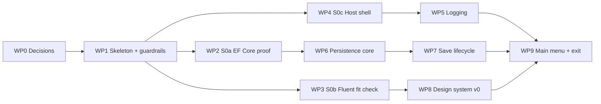

# M0 · Foundations: the Plan

> **Status:** Proposed (for owner review) · 2026-10-15 · Milestone definition: [ROADMAP.md §M0](../ROADMAP.md#m0--foundations-walking-skeleton)
>
> This is the detailed plan for M0, the "walking skeleton". It turns the roadmap's M0 scope into **ten ordered work packages**, lists every file, project, package and doc that changes, and ends with the exit checklist. **There's no football in M0.** It proves the toolchain, the host, logging, persistence you can trust, and the design system basics.
>
> **Specs for M0:** F-00 (platform) and F-01's M0 slice (saves) are already specified by [ARCHITECTURE.md](../ARCHITECTURE.md), [PERSISTENCE.md](../architecture/PERSISTENCE.md), [DATA_ACCESS_GUIDE.md](../architecture/DATA_ACCESS_GUIDE.md), [LOGGING.md](../architecture/LOGGING.md) and [UI_DESIGN_SYSTEM.md](../architecture/UI_DESIGN_SYSTEM.md). This plan is the build order for them, so no separate F-00/F-01 spec files are written.

---

## 1. What you'll have at the end of M0

- `./build.ps1` builds every project with warnings as errors and runs the fast tests, including **transaction torture tests** that kill the process mid-write.
- Launching the app opens a **WPF window with the Stadium look** (Dark by default) and a main menu in under 3 seconds.
- You can **create a save** (just a name, since there's no league yet), see it on the **load screen**, reopen it, close it, and delete it to the Recycle Bin. The file is never left locked.
- Every run writes **`gfo-YYYYMMDD.log`** with a startup banner, lifecycle events and full stack traces for any crash (including JavaScript errors in the WebView).
- A **snapshot** of a save can be taken and restored.
- A browser-based **DevHost** with a `/_gallery` showing every v0 component in Dark and Light, with team tint on and off.
- **Guardrails that bite:** adding a forbidden project reference, a stray `BeginTransaction` or an `async void` turns the build red.
- The three spikes answered, each with a decision recorded: **EF Core holds up** (S0a), **Fluent UI v5's grid works or the fallback is chosen** (S0b), and **the title bar approach** (S0c).

---

## 2. Decisions M0 builds on

M0 makes these real. **All seven were accepted on 2026-10-15** (your words are quoted in DECISIONS.md):

| Decision | What M0 builds on it | Status |
|---|---|---|
| [D-002](../DECISIONS.md#d-002-platform-net-10-lts--blazor-hybrid-windows-first) | .NET 10 LTS: `global.json` pins SDK **10.0.402** (the 10.0.4xx band), runtime 10.0.13. Host is WPF ([D-021](../DECISIONS.md#d-021-host-wpf--blazorwebview-maui-removed)). | ✅ Accepted |
| [D-003](../DECISIONS.md#d-003-ui-lives-in-razor-class-libraries-the-host-stays-thin) | UI in Razor Class Libraries, a thin host, plus the DevHost | ✅ Accepted |
| [D-007](../DECISIONS.md#d-007-logging-serilog-to-rolling-log-files) | Serilog as the logging library | ✅ Accepted |
| [D-015](../DECISIONS.md#d-015-integer-keys-with-strongly-typed-ids) | Integer keys + strongly typed IDs (the convention is set up in M0, and the first IDs arrive in M1) | ✅ Accepted |
| [D-016](../DECISIONS.md#d-016-single-writer-command-queue) | The single-writer command queue (`SaveWriter`) | ✅ Accepted |
| [D-018](../DECISIONS.md#d-018-testing-stack) | xUnit v3 (on Microsoft.Testing.Platform), Shouldly, Verify, bUnit, NetArchTest | ✅ Accepted |
| [D-020](../DECISIONS.md#d-020-feature-folders-no-mediator-or-mapper-libraries) | Feature folders, no MediatR or AutoMapper | ✅ Accepted |

Not needed until later: D-012 (the PRNG) in M1, when league generation needs it, and D-019 (Velopack) in M11.

**Also settled (see §11):** the commit and branch convention, spike code, how work packages land, and the crash dialog's scope ([D-066](../DECISIONS.md#d-066-git-workflow-gfo-commit-format-one-branch-per-milestone)).

---

## 3. Work packages at a glance

All of M0 lands on **one branch, `feat/m0-foundations`**, with a commit per work package, merged unsquashed into `main` when the exit checklist passes ([D-066](../DECISIONS.md#d-066-git-workflow-gfo-commit-format-one-branch-per-milestone)). Every work package ends with `./build.ps1` green. Sizes are relative (S ≈ one session, M ≈ two or three, L ≈ more), since the roadmap has no dates by design.

| WP | Name | Size | Depends on | Produces a decision? |
|---|---|---|---|---|
| WP0 | Decisions and docs prep | S | — | Accepts the Proposed decisions above |
| WP1 | Repo skeleton and guardrails | M | WP0 | — |
| WP2 | **Spike S0a:** EF Core proof | S–M | WP1 | Yes (amends D-024 notes) |
| WP3 | **Spike S0b:** Fluent UI v5 fit check | M | WP1 | Yes (grid verdict, icons, v5 API names) |
| WP4 | **Spike S0c:** host shell | S–M | WP1 | Yes (title bar approach) |
| WP5 | Logging and diagnostics | M | WP1, WP4 | — |
| WP6 | Persistence core and torture tests | L | WP2 | — |
| WP7 | Save lifecycle: catalog, snapshots, delete | M | WP6 | — |
| WP8 | Design system v0 and the gallery | L | WP3 | — |
| WP9 | Main menu, wiring and the M0 exit | M | WP5, WP7, WP8 | Tag `m0-complete` |



**Why the spikes come first:** each one can change the plan after it. If EF Core disappoints, persistence switches to the documented linq2db fallback. If the grid fails, `DataGrid<T>` wraps a different grid. The title bar choice shapes the host and the app shell. Spikes are cheap, so these answers should arrive before WP6 to WP9 build on them.

---

## 4. The work packages in detail

### WP0 · Decisions and docs prep (S) ✅ Done 2026-10-15
**Goal:** the paperwork M0 depends on.
- [x] Mark D-002, D-003, D-007, D-015, D-016, D-018 and D-020 **Accepted**, with your confirmation quoted (2026-10-15).
- [x] Settle the commit and branch convention, and update [TESTING_AND_QUALITY.md §8.4](../architecture/TESTING_AND_QUALITY.md#84-git-workflow-d-066) to match ([D-066](../DECISIONS.md#d-066-git-workflow-gfo-commit-format-one-branch-per-milestone)).
- [x] Link this plan from ROADMAP §M0 and the docs README.

**Changes:** `docs/DECISIONS.md`, `docs/architecture/TESTING_AND_QUALITY.md`, `docs/ROADMAP.md`, `docs/README.md`.

### WP1 · Repo skeleton and guardrails (M) ✅ Done 2026-10-15
**Goal:** every project exists, builds, and is held to the dependency rules from day one.

**Repo files (as built)**
- [x] `global.json`: SDK `10.0.402` (bumped from 10.0.100 once the owner installed it), `rollForward: latestPatch`, and `"test": { "runner": "Microsoft.Testing.Platform" }` (see "Changed from the plan").
- [x] `.gitignore` (the standard .NET template + `artifacts/`, `*.gfo` and its `-wal`/`-shm` files, except future test fixtures), `.gitattributes` (LF in the repo, CRLF for `.ps1`, binary assets).
- [x] `.editorconfig`: file-scoped namespaces, `_camelCase` private fields, `VSTHRD100` (async void) as an error, `Async` suffix. Test folders allow underscored names.
- [x] `Directory.Build.props`: `net10.0`, nullable, implicit usings, warnings as errors, `latest-recommended` analysis, code style in build, and the banned-API wiring.
- [x] `Directory.Packages.props`: every version pinned (§6). The two analyzers are `GlobalPackageReference`s, so every project gets them.
- [x] `build/BannedSymbols.*.txt`, **three tiers**: `Transactions` (every project; `SaveWriter` will suppress it at its one call site), `Pure` (Core, Simulation, Application: `System.Random`, wall clock, `Thread.Sleep`, `.Result`/`.Wait()`, `Console`), `RawSqlite` (`new SqliteConnection` everywhere except Infrastructure).
- [x] `GridironFrontOffice.slnx` with `/src/`, `/tools/`, `/tests/` and `/build/` folders.
- [x] `.config/dotnet-tools.json` with `dotnet-ef` 10.0.13.
- [x] `THIRD_PARTY_NOTICES.md`: every package's license, checked from its package metadata (or its repository's LICENSE where the package declares none).
- [x] `build.ps1`, compatible with Windows PowerShell 5.1.

**Projects** (folders use short names, projects use full names, [D-028](../DECISIONS.md#d-028-project-naming-gridironfrontoffice)):

| Project | Type | References (packages) | Contents today |
|---|---|---|---|
| `src/Core` | Class library | — | Empty: `Result<T>` etc. arrive in WP6 |
| `src/Simulation` | Class library | Core | Empty until M2 |
| `src/Application` | Class library | Core, Simulation (EF Core, `PrivateAssets="compile"`) | Empty: ports arrive in WP6 |
| `src/Infrastructure` | Class library | Application (EF Core SQLite, EF Design, Serilog ×5) | Empty: WP5, WP6 |
| `src/UI.Components` | Razor Class Library | — (Components.Web, Fluent UI v5 + Icons) | Empty: WP8 |
| `src/UI` | Razor Class Library | UI.Components, Application (Components.Web, Fluent UI v5) | `AppRoot` router, placeholder layout and Home page |
| `src/Desktop` | WPF + BlazorWebView, `net10.0-windows10.0.19041.0`, ReadyToRun on publish | UI, Infrastructure (WebView.Wpf) | A window hosting `AppRoot`, 1280×720 minimum. **Verified to launch.** |
| `src/DevHost` | Blazor Web App, Interactive Server | UI, Infrastructure | Serves `AppRoot`'s pages on `http://localhost:5180`. **Verified to respond.** |
| `tools/SimLab` | Console | Application, Infrastructure | Prints its version. Commands arrive in M2. |
| `tests/*.Tests` (Core, Simulation, Application, Infrastructure, UI.Components, UI, Architecture) | xUnit v3 test executables | Their subject project (+ Infrastructure for Application.Tests, + bUnit for the UI tests) | Architecture tests now. The rest fill in from WP6. |
| `tests/Infrastructure.Tests.Crasher` | Console | Infrastructure | Stub, implemented in WP6 |

**Architecture tests (23, all passing)**
- **Project-file rules:** every project under `src/` and `tools/` has a declared allow-list of project references ([ARCHITECTURE.md §4.1](../ARCHITECTURE.md#41-dependency-rules)), and a new project without one fails.
- **Package rules:**
  - Core and Simulation reference no packages.
  - Application references only the EF Core core package.
  - Only Infrastructure takes the SQLite provider.
  - UI projects take no EF Core, SQLite, Serilog, host packages or WPF.
  - Serilog appears only in Infrastructure and the hosts.
  - Only Desktop uses WPF, and it targets the Windows SDK TFM.
- **Type-level layering (NetArchTest)** for Core, Simulation, Application, UI.Components and UI. These only bite once code exists.
- *Moved to WP6:* "no `DbContext` registered in DI" needs `AddGfoInfrastructure`, which arrives there.

**Exit: met.** `./build.ps1` is green (about 5 s, 23 tests, 0 warnings). **Proven on deliberate violations, each removed afterwards:**

| Violation | Result |
|---|---|
| A stray `BeginTransaction` (Infrastructure) | RS0030 build error |
| `DateTime.Now` (Core) | RS0030 |
| `System.Random` (Simulation) | RS0030 |
| `async void` (Application) | VSTHRD100 |
| `new SqliteConnection` (DevHost) | RS0030 |
| EF Core types used from UI | Doesn't compile (CS0234) |
| A `UI → Infrastructure` project reference | The architecture test fails |

**Changed from the plan**
- **Test runner:** the .NET 10 SDK refuses to run xUnit v3 through the VSTest bridge, so tests run on **Microsoft.Testing.Platform** (`global.json`). That means no `Microsoft.NET.Test.Sdk` or `xunit.runner.visualstudio`, and filters are xUnit options (`--filter-not-trait "Category=Slow"`). Empty test projects exit with code 8, which `build.ps1` accepts. Recorded on [D-018](../DECISIONS.md#d-018-testing-stack).
- **Banned APIs** are three files under `build/` instead of one root `BannedSymbols.txt`, so each tier applies only where it should.
- **`tests/Simulation.Tests`** was created now (empty) instead of in M2, so the test layout matches [ARCHITECTURE.md §4](../ARCHITECTURE.md#4-solution-structure) from the start.
- **`-Full`** runs slow tests and the ReadyToRun publish. Cold-start timing joins with Spike S0c (WP4).

### WP2 · Spike S0a: EF Core proof (S–M, throwaway code)
**Goal:** confirm EF Core + the unit-of-work rules hold up before the real persistence is built ([DATA_ACCESS_OPTIONS.md §5](../architecture/DATA_ACCESS_OPTIONS.md#5-recommendation-and-the-spike-that-decides-it)).
- [ ] `spikes/S0a.EfProof/`: a console app with its own small domain-like model (players, contracts, contract years, transactions, stats, play logs) wired through the exact `SaveWriter`/`UnitOfWork` pattern from the guide.
- [ ] The four operations:
  - (a) sign a free agent (multi-table, with a rollback when over the cap)
  - (b) persist a week: ~26k stat rows + 16 compressed play logs + standings, **target < 1 s**
  - (c) a roster read-model projection
  - (d) a migration that adds a column and backfills it on a populated file
- [ ] Record the timings and findings.

**Exit:** the bulk persist takes < 1 s, the migration works on a populated save, and nothing in the guide needs changing (or the guide is corrected). **Decision:** a results note added to [D-024](../DECISIONS.md#d-024-data-access-ef-core-with-the-gfo-unit-of-work), or the linq2db fallback triggered if timings disappoint.

**Afterwards:** the spike folder is deleted in the same branch once the results are recorded. Git history keeps it.

### WP3 · Spike S0b: Fluent UI v5 fit check (M, code kept as the gallery's start)
**Goal:** prove the Stadium look and the grid on Fluent UI Blazor v5 before building on them.
- [ ] Fluent v5 registered in DevHost. A test page that:
  - sets the **brand color at runtime** from a team color, switches **Dark / Light / System**, and always passes mode + color together (issue #5351)
  - overrides **fonts** (Archivo, bundled `woff2`), **radius** tokens (8 / 14 / 20 / pill) and **neutral surfaces** ([VISUAL_DESIGN.md §9](../VISUAL_DESIGN.md#9-mapping-to-fluent-ui-blazor-v5))
- [ ] `FluentDataGrid` with 2,000 rows, **virtualized + pinned first column + sticky header + compact rows + Razor cell templates + keyboard navigation**, all at once, against the P0 checklist in [UI_DESIGN_SYSTEM.md §5.3](../architecture/UI_DESIGN_SYSTEM.md#53-datagridt-a-gfo-wrapper-over-fluentdatagrid).
- [ ] A drawer (the future peek sheet), a dialog, a toast.
- [ ] **Fluent System Icons** next to Archivo, which confirms or replaces the "proposed" icon set in D-031.
- [ ] Every API name marked "(v5)" in the docs checked against the real v5 API.

**Exit and decisions:** a grid verdict (Fluent passes, or the fallback grid is chosen behind `DataGrid<T>`) and the icon set confirmed. Doc fixes: the "(v5)" markers replaced with the verified names across UI_DESIGN_SYSTEM, VISUAL_DESIGN and DATA_ACCESS_GUIDE.

### WP4 · Spike S0c: host shell (S–M)
**Goal:** choose the title bar approach on the real host and re-measure startup.
- [ ] `src/Desktop`: a WPF `MainWindow` hosting `BlazorWebView` (Windows SDK TFM, per the [benchmark gotcha](../architecture/HOST_BENCHMARK.md#gotchas-found-while-measuring-worth-knowing-for-m0)).
- [ ] Prototype both title bar options:
  - **(a)** `WindowChrome` with a slim native caption strip. It keeps Snap Layouts, and the composition control lets WPF overlay the web content.
  - **(b)** a borderless window whose top bar is HTML with `app-region: drag`.

  Then compare look, Snap Layouts, double-click-to-maximize, resize edges and high-DPI behavior.
- [ ] Minimum size 1280×720.
- [ ] `PublishReadyToRun=true` Release publish. Measure cold and warm start to first render.

**Exit and decision:** the title bar approach recorded as a new D-xxx. [HOST_BENCHMARK.md](../architecture/HOST_BENCHMARK.md) updated with the real shell's numbers.

### WP5 · Logging and diagnostics (M)
**Goal:** everything in [LOGGING.md](../architecture/LOGGING.md) that M0 needs.
- [ ] `AppPaths` (`IAppPaths`): `%LOCALAPPDATA%\GridironFrontOffice\{Saves, Snapshots, logs, diagnostics}`. **DevHost and tests redirect** to `GridironFrontOffice-Dev` or a temp folder, so development never touches your real saves.
- [ ] `SettingsStore`: `settings.json` with an atomic write (temp file, then replace), loaded **before** DI so the log level can come from it.
- [ ] Serilog bootstrap in the composition roots (Desktop and DevHost): an async rolling file sink (daily + 10 MB, 14 files), the output template, `Microsoft.*` at Warning, enrichers (`AppVersion`, `SessionId`).
- [ ] The **startup banner**, with app version + commit, OS, .NET, WebView2 version, culture, screen and DPI, and paths written as `%LOCALAPPDATA%` tokens (never your user name).
- [ ] Global hooks: `AppDomain.UnhandledException`, `TaskScheduler.UnobservedTaskException`, `Application.DispatcherUnhandledException`.
- [ ] A Blazor `ErrorBoundary` per page that logs and shows a recovery panel.
- [ ] `gfo-diagnostics.js`: `window.onerror` and `unhandledrejection` forwarded to .NET as Error with `SourceContext = GridironFrontOffice.UI.Js`.
- [ ] The **crash dialog**, a small *native WPF* window because Blazor itself may be the thing that's broken: "Something went wrong. Your league is safe up to your last action." With **Open logs folder** and **Restart** (see §11, question 4).
- [ ] `Log.CloseAndFlush()` on exit.
- [ ] A Debug-only "Throw test exception" action (in DevHost and in Desktop Debug builds) that proves the crash path end to end.

**Exit:** the log contains the banner, lifecycle events and the forced test exception with its stack trace. A JavaScript error appears in the log.

### WP6 · Persistence core and torture tests (L)
**Goal:** the data layer exactly as in [DATA_ACCESS_GUIDE.md §3](../architecture/DATA_ACCESS_GUIDE.md#3-the-building-blocks-the-code-youll-write-once-in-m0), proven by torture tests.

**Application (ports and contracts)**
- `ILeagueDb`, `ILeagueReadDb` (in M0 they expose only `SaveInfo`), `IUnitOfWork`, `ISaveWriter`, `ISaveReader`, `IDomainEvent`, `IDomainEventDispatcher`, `ISaveManager`, `ISaveCatalog`, `ISnapshotService`, `IAppPaths`, `IPlatformServices`, `ILeagueSessionAccessor`.
- The strongly typed ID convention (D-015): `readonly record struct XxxId(int Value)`, plus one EF `ConfigureConventions` rule that converts them all. The first IDs arrive in M1, and the convention gets a test now.

**Infrastructure**
- `LeagueDbContext` (internal, Fluent API configuration only) with **one table in M0: `SaveInfo`** ([PERSISTENCE.md §5.1](../architecture/PERSISTENCE.md#51-meta)): `SaveId`, `LeagueName`, `SchemaVersion`, app versions, timestamps, `PlayTimeSeconds`, `IsIronman`, `ClockMode`, `ClockPreset`, `InjuryFrequency`, `CareerCanEnd`, `IsEdited`, **`Generation`**. Columns for later features exist with defaults, so M1+ doesn't migrate `SaveInfo` for settings already decided.
- The `InitialCreate` migration. Migrations run **on open**, after a pre-upgrade snapshot. A save from a newer app is refused with a clear message.
- `SqlitePragmaInterceptor` (`synchronous=NORMAL`, `temp_store=MEMORY`, `cache_size`, `busy_timeout`). At creation: `journal_mode=WAL`, `page_size`, `application_id = 'GFO1'`, `user_version`.
- `LeagueSession`, `LeagueSessionAccessor`, **`SaveWriter`** (the only transaction owner, the nested-command guard, the `Generation` bump, post-commit events), `UnitOfWork` (`CreateCommand` on the same transaction), `SaveReader` (no-tracking), and a minimal in-house `DomainEventDispatcher` (D-020).
- `SaveManager`: `CreateAsync(name)`, `OpenAsync(path)` (`quick_check` → schema check → migrate → session), `CloseAsync()` (drain the writer → `wal_checkpoint(TRUNCATE)` → dispose → `SqliteConnection.ClearPool`).
- `AddGfoInfrastructure(paths)`, with **no `AddDbContext`**.

**Torture tests** (`tests/Infrastructure.Tests`, [DATA_ACCESS_GUIDE.md §9](../architecture/DATA_ACCESS_GUIDE.md#9-proving-it-the-torture-tests-m0-run-on-every-build)). The domain doesn't exist yet, so the tests use `SaveInfo` plus a **test-only table** each test creates with raw SQL (the real schema stays clean):

| Test | How |
|---|---|
| Exception midway persists nothing | Change `SaveInfo.LeagueName` + raw insert, throw → both unchanged |
| Domain failure persists nothing | Same, with `Result.Fail` |
| EF + raw SQL in one command are atomic | EF change + `uow.CreateCommand` insert, fail → neither exists |
| Reader during write doesn't lock | Hold a `SaveReader` query open while a long write commits |
| Nested execute throws | Inner `ExecuteAsync` → `InvalidOperationException`, no deadlock |
| Concurrent commands are serialized | 50 parallel commands → `SaveInfo.Generation` = 50 |
| Racing versioned commands record exactly one | Two commands with the same expected version → one Ok, one Fail |
| Killed process leaves no partial write | The Crasher inserts 100k rows in one command, prints `WRITING`, gets killed → `integrity_check = ok`, row count unchanged |
| File unlocked after close | Close → delete the file succeeds |
| No `DbContext` in DI (moved from WP1) | Build the container from `AddGfoInfrastructure` → no `DbContext` or `DbContextOptions` service registered |
| Newer schema refused | Open a save with a higher `SchemaVersion` → a clear error |

**Exit:** every torture test passes on every build.

### WP7 · Save lifecycle: catalog, snapshots, delete (M)
**Goal:** the save-management pieces of F-01's M0 slice ([PERSISTENCE.md §2, §9, §10](../architecture/PERSISTENCE.md)).
- [ ] `SaveCatalog`: scans `Saves\*.gfo` with **read-only** connections, checks `application_id`, reads `SaveInfo` (name, created, last played, app version), and flags unreadable files.
- [ ] **Continue** = the most recently played save.
- [ ] `SnapshotService`: `VACUUM INTO` off the UI thread, named per [PERSISTENCE.md §2.1](../architecture/PERSISTENCE.md#21-snapshot-policy-proposed-defaults). In M0 the triggers are `created` and `pre-upgrade-v{n}` only (phase triggers arrive with phases). The retention budget is pruned oldest-first.
- [ ] **Restore** (the engine for the M3 Time Machine): close → snapshot `pre-restore` → replace the file → reopen. The Ironman and live-event guards are stubbed as rule checks in `SaveManager`, with tests.
- [ ] **Delete to the Recycle Bin** through `IPlatformServices` (Desktop: the Windows shell API; DevHost: a `.trash` folder in the dev directory), together with the save's snapshot folder.

**Exit:** a snapshot is taken and restored (tested), a deleted save lands in the Recycle Bin, and a corrupt file shows a "Can't read this save" card instead of crashing.

### WP8 · Design system v0 and the gallery (L)
**Goal:** the components M1 needs, in the Stadium look, documented in the gallery ([UI_DESIGN_SYSTEM.md](../architecture/UI_DESIGN_SYSTEM.md), [VISUAL_DESIGN.md](../VISUAL_DESIGN.md)).

| Component or service | Notes |
|---|---|
| `GfoThemeService` | The only code that calls Fluent's theme service. It always passes the full `ThemeSettings`. Dark (default) / Light / Match Windows, Accent: Team / Neutral. |
| `gfo-tokens.css` | Rating colors, urgent, density, radii, display font. Light-mode overrides. Cascade layers. |
| Fonts | Archivo (variable, with the width axis) and JetBrains Mono as local `woff2` files. Never loaded from the web. |
| `Icon` | Maps GFO icon names to Fluent System Icons, so the set can be swapped cheaply |
| `IGfoDialogs`, `IGfoToasts` | Thin services over Fluent's dialog and toast |
| `DataGrid<T>` v0 | Wraps the S0b verdict: virtualization, pinned column, sticky header, density from tokens, sorting, keyboard map |
| `AppShell` | Fluent nav + top bar (the title bar from S0c), primary action slot, inline progress slot |
| `EmptyState`, `Stat`, `Kbd`, `SegmentedControl` (if v5 lacks one) | Small GFO pieces |
| Settings page (Appearance) | Theme mode, accent mode, density, written to `settings.json` and applied live |
| `/_gallery` | One page per component, in Dark and Light, with team tint on and off, using three sample team colors (dark navy, bright orange, pale) per [VISUAL_DESIGN.md §10](../VISUAL_DESIGN.md#10-qa-checklist-for-every-new-screen) |

**Tests:** bUnit for every GFO component (rendering, parameters, keyboard, ARIA). Fluent's web components need bUnit's JS interop set to loose mode.

**Exit:** the gallery shows every v0 component in both themes, with tint on and off. The QA checklist passes.

### WP9 · Main menu, wiring and the M0 exit (M)
**Goal:** put it together into the walking skeleton.
- [ ] The Desktop composition root: settings → logging → DI (`AddWpfBlazorWebView`, `AddGfoInfrastructure`, `AddGfoApplication`, `AddGfoUi`, Fluent) → window.
- [ ] **Single instance:** a named mutex. A second launch brings the existing window to the front and exits.
- [ ] Window size and position remembered in `settings.json`, and restored safely when a monitor has been removed.
- [ ] **Main menu** (UI RCL): Continue / New League / Load / Settings.
  - **New League in M0** asks only for a league name (the real wizard is M1) and creates the save.
  - **Load screen:** save cards (name, created, last played, app version warning, unreadable-file card), plus Open and Delete.
  - **Open** shows the app shell with an empty Home ("Your league will live here"). **Close** returns to the menu.
- [ ] DevHost wired the same way, against the dev save folder.
- [ ] Run the exit checklist (§10), record the cold-start time, tag **`m0-complete`**.

---

## 5. What the repository looks like after M0

```
GridironFrontOffice/
├─ .config/dotnet-tools.json        # dotnet-ef (local tool)
├─ .editorconfig  .gitattributes  .gitignore
├─ build/BannedSymbols.*.txt      # three banned-API tiers
├─ build.ps1
├─ CLAUDE.md
├─ Directory.Build.props  Directory.Packages.props  global.json
├─ GridironFrontOffice.slnx
├─ THIRD_PARTY_NOTICES.md           # license inventory (D-011)
├─ data/                            # empty until M1 (teams, colleges, names)
├─ docs/                            # + milestones/M0_FOUNDATIONS.md
├─ src/
│  ├─ Core/                Result<T>, DomainError, Unit
│  ├─ Simulation/          (empty until M2)
│  ├─ Application/         Data/ (ports, contracts), Saves/ (queries), Events/
│  ├─ Infrastructure/      Data/ (LeagueDbContext, SaveWriter, SaveReader, UnitOfWork, interceptor, Migrations/),
│  │                       Saves/ (SaveManager, SaveCatalog, SnapshotService), Logging/, Settings/, Paths/
│  ├─ UI.Components/       Theming/, DataGrid/, Dialogs/, Toasts/, Icons/, Components/ (EmptyState, Stat, Kbd…), wwwroot/ (tokens, fonts, js)
│  ├─ UI/                  Shell/, Pages/ (MainMenu, LoadScreen, Home, Settings), wwwroot/js/gfo-diagnostics.js
│  ├─ Desktop/             App.xaml, MainWindow.xaml, CrashWindow.xaml, PlatformServices, composition root
│  └─ DevHost/             Program.cs, gallery pages (/_gallery/...)
├─ tools/SimLab/           (stub)
└─ tests/
   ├─ Architecture.Tests/  Core.Tests/  Application.Tests/
   ├─ Infrastructure.Tests/  Infrastructure.Tests.Crasher/
   └─ UI.Components.Tests/  UI.Tests/
```

`spikes/S0a.EfProof/` exists only during WP2 (§11, question 3).

---

## 6. Packages added (pinned in `Directory.Packages.props`)

Every package's license is checked and recorded in `THIRD_PARTY_NOTICES.md` when it's added (D-011). Versions are the latest stable at scaffold time.

| Package | Used by | Expected license |
|---|---|---|
| `Microsoft.AspNetCore.Components.WebView.Wpf` (10.0.x) | Desktop | MIT |
| `Microsoft.FluentUI.AspNetCore.Components` (5.0.x) + the Icons package | UI.Components, UI, hosts | MIT |
| `Microsoft.EntityFrameworkCore` (10.0.x) | Application (core only, no provider) | MIT |
| `Microsoft.EntityFrameworkCore.Sqlite`, `.Design` (dev only), `Microsoft.Data.Sqlite` | Infrastructure | MIT (SQLitePCLRaw native bundle: Apache-2.0) |
| `Serilog`, `.Extensions.Logging`, `.Sinks.File`, `.Sinks.Async`, `.Sinks.Debug` | Composition roots | Apache-2.0 |
| `Microsoft.CodeAnalysis.BannedApiAnalyzers`, `Microsoft.VisualStudio.Threading.Analyzers` | All projects (build only) | MIT |
| `xunit.v3` (on Microsoft.Testing.Platform), `Shouldly`, `Verify.XunitV3`, `bunit`, `NetArchTest.Rules` | Tests | Apache-2.0, BSD-3-Clause, (checked when first used), MIT, MIT |
| **Fonts:** Archivo, JetBrains Mono | UI.Components | SIL OFL 1.1 |

Not in M0: BenchmarkDotNet (M2), `Microsoft.Extensions.TimeProvider.Testing` (M6), Markdig (M11), Velopack (M11).

---

## 7. Docs that change during M0

| Doc | Change | When |
|---|---|---|
| DECISIONS.md | Proposed → Accepted for the seven above. New entries for the S0b grid verdict, the icon set (D-031's "proposed" part), the S0c title bar, plus the S0a results note on D-024 | WP0, WP2–WP4 |
| TESTING_AND_QUALITY.md §8.4 | Commit and branch convention aligned with the actual practice | WP0 |
| UI_DESIGN_SYSTEM.md, VISUAL_DESIGN.md, DATA_ACCESS_GUIDE.md | "(v5)" API names replaced with the verified ones | WP3 |
| HOST_BENCHMARK.md | Real-shell startup numbers | WP4 |
| ARCHITECTURE.md §4 / §6 | Only if the spikes change something (e.g., a fallback grid) | As needed |
| ROADMAP.md §M0 | Exit boxes ticked, a link to this plan | WP0, WP9 |
| CLAUDE.md | The "Commands" section becomes real (no longer "planned"), plus any new gotchas the spikes find | WP1, WP9 |

---

## 8. Explicitly not in M0
- Any football: teams, players, the PRNG and league generation are M1.
- The New League wizard beyond a name (M1), the Time Machine screen, export, import, duplicate (M3).
- The command palette (M1), the developer overlay (`Ctrl+Shift+D`), the "Copy diagnostics" zip (§11, question 4).
- CI (F-30), the installer and updates (M11), sound.

---

## 9. Risks and fallbacks

| Risk | Signal | Fallback |
|---|---|---|
| Fluent v5 is brand new: API names differ from the docs | S0b finds mismatches | Fix the docs in WP3. That's the spike's job. |
| `FluentDataGrid` can't do virtualized + pinned + sticky at once (a known v4 issue) | S0b P0 checklist | Keep Fluent everywhere else, swap `DataGrid<T>`'s internals to QuickGrid or Radzen. Screens don't change. |
| The bulk persist is over 1 s, or EF ergonomics disappoint | S0a timings | Raw prepared statements already cover hot paths. If needed, the linq2db fallback ([DATA_ACCESS_OPTIONS.md](../architecture/DATA_ACCESS_OPTIONS.md)). |
| Title bar option (b) loses Snap Layouts or misbehaves at high DPI | S0c comparison | Option (a), the native caption strip |
| bUnit + Fluent web components need heavy JS mocking | WP8 first tests | Loose JS interop. Test GFO behavior, not Fluent internals. |
| DevHost (Interactive Server) behaves differently from the Hybrid host | Bugs that appear in only one host | Treat Desktop as the truth for release checks. Keep JS interop small. |
| The kill-process test is flaky on slow machines | Intermittent failures | Wait for the explicit `WRITING` marker, generous timeouts, a fresh temp directory per run |

---

## 10. M0 exit checklist

From [ROADMAP.md §M0](../ROADMAP.md#m0--foundations-walking-skeleton), plus the spike outcomes:

- [ ] Launch → main menu in under 3 s (cold start measured on the Release ReadyToRun build)
- [ ] Create a save → it appears on the load screen → reopen it → close it → the file is unlocked and can be deleted
- [ ] **All transaction torture tests pass**, including killing the process mid-transaction and reopening with no partial data
- [ ] The log file contains the banner, the lifecycle events, a forced test exception with a stack trace, and a forwarded JavaScript error
- [ ] A snapshot can be taken and restored
- [ ] `./build.ps1` is green. A forbidden reference, a stray `BeginTransaction` and an `async void` each turn it red (demonstrated, not committed).
- [ ] The gallery shows every v0 component in both themes, with team tint on and off
- [ ] Spike decisions recorded: S0a (EF Core), S0b (grid + icons + verified v5 names), S0c (title bar)
- [ ] `THIRD_PARTY_NOTICES.md` lists every package, font and icon set in use
- [ ] Tag `m0-complete`

---

## 11. Questions for the owner (answered 2026-10-15)

1. ~~The seven Proposed decisions~~ → all **accepted**, each with your words quoted in DECISIONS.md (§2).
2. ~~Commit and branch convention~~ → **your current format**, `(type) *module* : summary`, with `type/short-name` branches ([D-066](../DECISIONS.md#d-066-git-workflow-gfo-commit-format-one-branch-per-milestone)).
3. ~~Spike code~~ → **deleted** once its results are recorded (D-066).
4. **Crash dialog scope:** not answered, so the recommendation stands. "Open logs folder" + "Restart" in M0, and the "Copy diagnostics" zip in M11. Say so if you want the zip sooner.
5. ~~How work packages land~~ → **one M0 branch**, `feat/m0-foundations`, with a commit per work package, merged unsquashed when the exit checklist passes (D-066).
